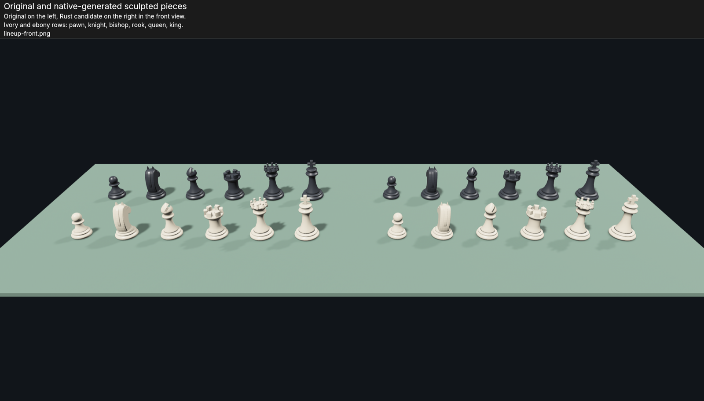
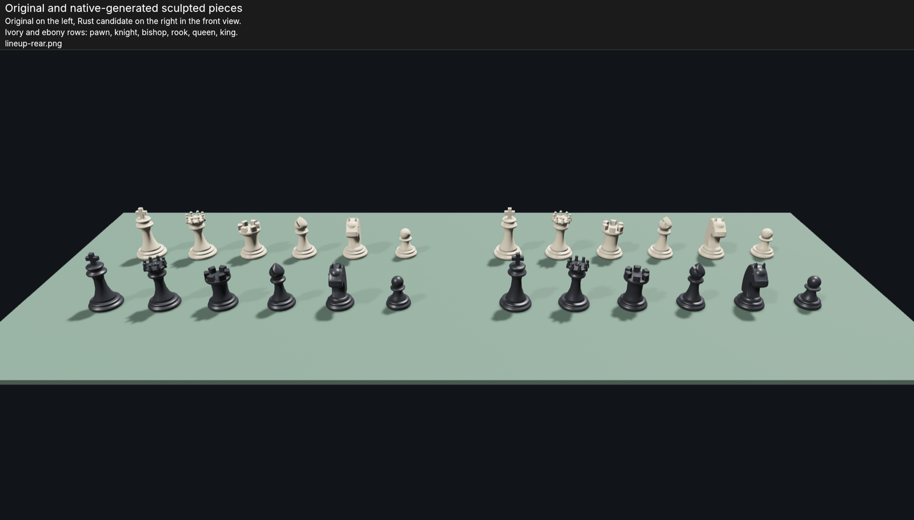
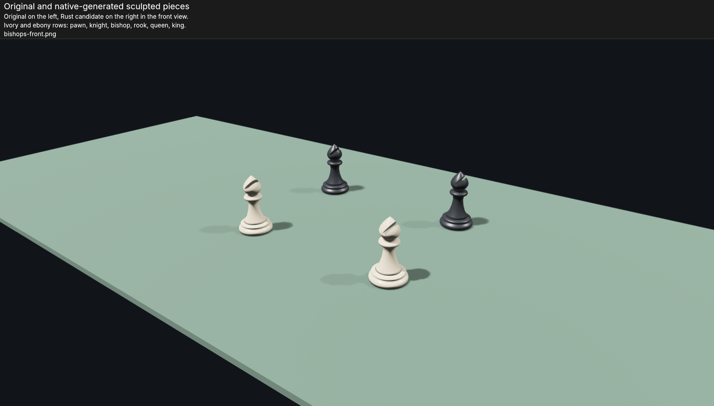
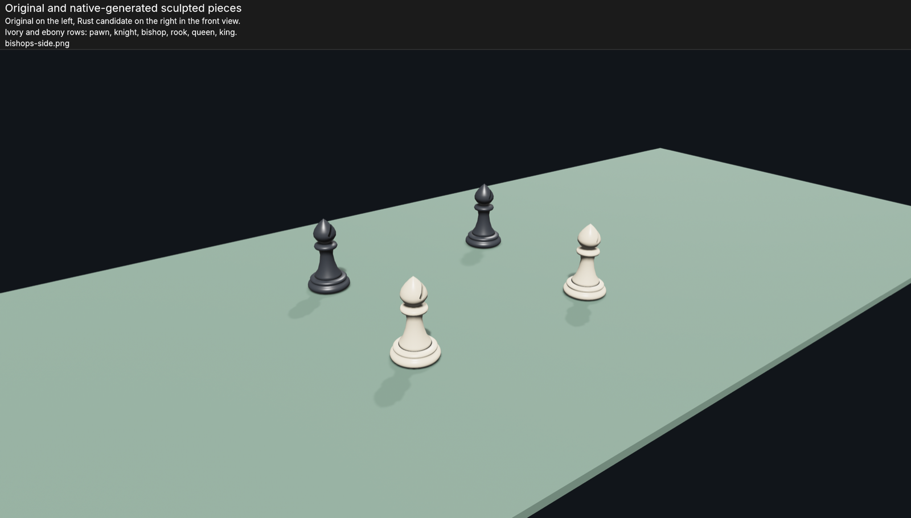

# Native piece generator replacement

Recorded 2026-10-16 for T047. The original Three.js-generated library is retained
as the historical comparison fixture in `tests/fixtures/assets/`, with its
original provenance. The production library now comes from the Rust generator.

| Library | Bytes | SHA-256 |
| --- | --- | --- |
| Historical Three.js | 1,376,224 | `ee0c9bf8cd98f1239046b0566748030c4c320f049fd6ab3232f1f7e9691a020e` |
| Native Rust replacement | 1,499,440 | `f841223d2270426b26c8da913a175be6a4ee6f674e45fa63737973041efb969d` |

The replacement preserves all twelve named color/kind parents, authored bounds,
ivory/ebony material values, the six distinct silhouettes and actual bishop-slit
geometry. Topology and binary serialization differ, so this is an explicitly
reviewed replacement, not byte-identical regeneration. Offline generation uses
the existing shared executor and pinned libraries recorded in provenance.

The production-main-thread comparison harness rendered both libraries in one
Bevy window/device on Apple M4 Pro through Metal. Four real GPU readbacks covered
front/rear lineups and bishop front/side closeups. All were inspected: all six
piece forms remain recognizable, materials match, and the bishop slit remains
open. The historical file has a named scene without a default scene; the harness
resolves `ChessPieceLibrary` by name for both libraries.

[Capture receipt](native-assets/comparison.json) records the original 3024 by 1722
readback dimensions and asset hashes. The checked-in previews below are reduced
to 1600 pixels wide for review.

The comparison can be reproduced with the explicitly selected native harness
using `--compare-assets CANDIDATE_GLB OUTPUT_DIRECTORY`; use a new output directory.
This debug visual check establishes current-host asset readability, not optimized
performance, full workspace polish or Windows/Linux graphics acceptance.
