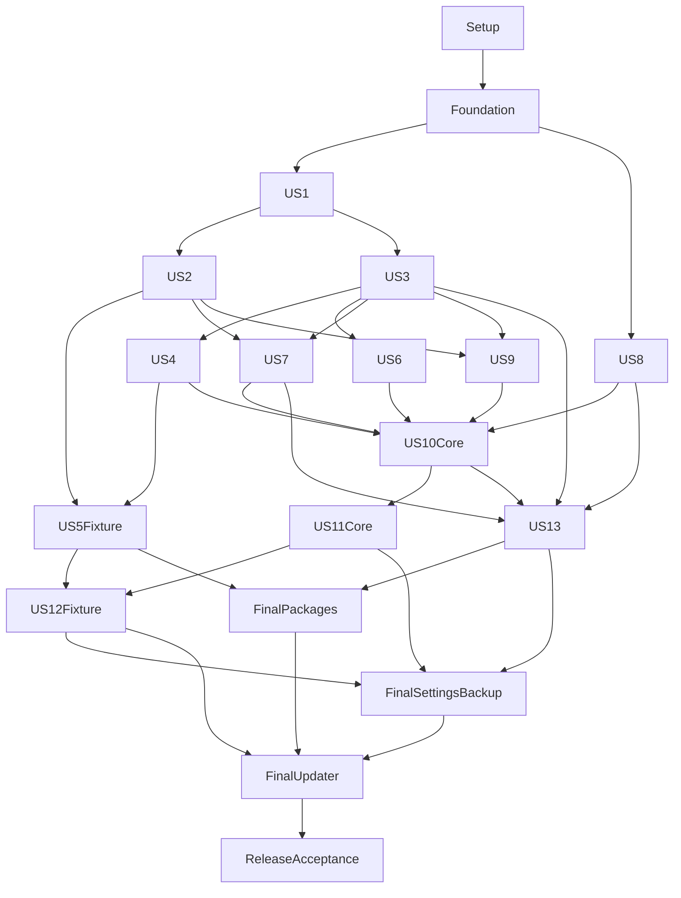

# Tasks: Reckless Desktop Chess

**Branch**: `001-reckless-desktop-chess` | **Updated**: 2026-10-17 | **Status**: Native implementation in progress.

**Input**: [plan](plan.md), [specification](spec.md), [data model](data-model.md),
[decisions](decisions.md), [research](research.md), [quickstart](quickstart.md)
and the six [contracts](contracts/). All 13 P1 journeys remain first-release scope.
This generation updates planning only and authorizes no implementation, commit,
push, credential setup, workflow activation or release publication.

Load the [constitution](../../.specify/memory/constitution.md) and
[canonical engineering rules](../../.specify/rules/README.md) for every task.
Policy stays in those files. The earlier per-task commit/push request belongs to
the authorized implementation workflow; this task-generation turn performs none.

**Tests**: Explicitly required by the specification. Establish meaningful failing
contract checks before their implementation. Register nested suites through
Cargo-discovered roots. Hermetic tests, production-renderer tests and real native
accessibility/package/performance acceptance are separate evidence classes.

**Format**: `- [ ] T### [P?] [USn?] Description with exact paths`. Story labels
occur only in their story phases. `[P]` permits disjoint test-file work only
after the named shared contracts exist. Shared manifests, module/test-root
registration, migrations, bootstrap and Makefile stay serialized. Numeric order
is the default sequence; the dependency section permits specific earlier slices.

**Paths**: One root Cargo package, `src/presentation/` for egui,
`src/scene/` for Bevy adapters, `src/desktop/` for native orchestration/profile
services, `src/update/` for updater policy, source-mirrored `tests/`, and native
tools under `tools/{assets,engine,data,packaging,benchmark}/`. Paths describe
outputs where absent. Existing domain modules and external persisted formats
are reused; no domain/persistence type contains ECS IDs. Test binaries register
through `tests/{domain,engine,storage,desktop,presentation,scene,update,native}.rs`
as their first working suites land. Every `tests/native/*` module registers only
through `tests/native.rs`, never through a hermetic root. This production-renderer
harness owns the native main thread and is explicitly registered with
`harness = false` and `test = false`; it must not initialize a native event loop
on a test worker. Default Cargo tests retain hermetic suites and doctests.
Separate named `--test native` lint/build selections cover the harness because
`--all-targets` omits it; `make native-tests` explicitly runs it. Shipping
application executables and packages exclude harness controls and listeners;
an optimized native test executable retains its own orchestration adapters.

## Preserved implementation history

The next 28 checked rows are retained verbatim, including obsolete stack wording,
IDs and linked evidence. They describe historical implementation, not native
Bevy/egui acceptance. Native tasks below are checked only after their own evidence is recorded. Current
data-model constraints supersede historical browser/wire descriptions in T014
and T016 for the new in-process interface; persisted canonical encodings remain
readable. Historical setup is not a prerequisite to reinstall an obsolete stack.

- [X] T001 Resolve the selected stable Rust-side dependencies and actual APIs from `specs/001-reckless-desktop-chess/research.md#final-resolution-research` in `Cargo.toml` and `Cargo.lock`, preserving Rust 1.99.0, edition 2024, root-package layout and existing strict lint/profile settings.
- [X] T002 Initialize the Vue 3.5.44, TypeScript 6.0.3, Vite 8.3.4, Three.js 0.186.1 and Bun 1.4.3 frontend in `ui/package.json`, `ui/bun.lock`, `ui/tsconfig.json` and `ui/vite.config.ts`; resolve compatible stable supporting pins and configure project aliases.
- [X] T003 Configure Tailwind 4.3.3 through its official Vite plugin and shadcn-vue/Reka UI in `ui/components.json` and `ui/src/theme/tokens.css`, with one token owner and local bundled assets.
- [X] T004 Configure Vue-aware type-checked ESLint 10.12.0, typescript-eslint 8.71.2, Prettier 3.9.10 and Tailwind class ordering in `ui/eslint.config.ts`, `ui/.prettierrc.json` and `ui/package.json`; exercise these selected tools on Bun.
- [X] T005 Configure the root Tauri 2.12.4 application, CLI 2.12.3, root Cargo build and local frontend assets in `build.rs`, `tauri.conf.json`, `src/main.rs` and `ui/index.html`, removing Hello World only when the real bootstrap is connected.
- [X] T006 Define least-privilege release capabilities and local-only CSP in `capabilities/main.json` and `tauri.conf.json`, excluding generic shell/filesystem access, remote executable content and test listeners.
- [X] T007 Configure Vitest 5.0.5 browser tests, matching browser-playwright provider, Playwright 1.64.1 and Vue Test Utils 2.5.1 in `ui/vitest.config.ts` and `ui/package.json`; retain stable compatible exact resolution.
- [X] T008 Configure WebdriverIO 9.31.9, @wdio/tauri-service 1.5.0 and the stable test-only native WebDriver feature in `ui/wdio.conf.ts`, `Cargo.toml` and `capabilities/test.json`, ensuring release selection excludes all automation permissions/plugins.
- [X] T009 Extend `Makefile` and `ui/package.json` with sequential formatter, vue-tsc, ESLint, Rust, browser-test and optimized-build gates; make `make run` launch the optimized desktop app with application arguments forwarded only when supplied. T023 connects schema-drift checking when the authoritative DTO schema exists.
- [X] T010 Record actual resolved dependency versions, Bun compatibility and local prerequisites in `specs/001-reckless-desktop-chess/evidence/toolchain.md`, including Linux updated WebKitGTK and native Fathom/Clang prerequisites.
- [X] T011 [P] Add authoritative-position, castling-encoding, full-identity collision and invalid-FEN contract fixtures in `tests/board/position.rs` and `tests/fixtures/positions.json`.
- [X] T012 [P] Add envelope/version, unsigned-counter precision, stale revision, idempotency, queue saturation and event-resync fixtures in `tests/desktop/envelope.rs`.
- [X] T013 [P] Add transactional-save, migration-failure, durable-receipt and missing-fixture checks in `tests/storage/document_store.rs`.
- [X] T014 Implement `BoardPosition` validation and identity in `src/board/position.rs` and `src/board/enums.rs`, enforcing every BoardPosition table constraint in `specs/001-reckless-desktop-chess/data-model.md`; accept structural studies without pretending to prove historical reachability. Exact field constraints: Piece placement: "Validated square/piece/color values; exactly one king per side"; Turn: "`BoardEnumColor`"; Castling rights: "Explicit original rook squares, compatible with selected variant"; En passant: "Validated target and legal-context normalization"; Halfmove/fullmove counters: "Checked bounded integers"; Variant: "Standard or Chess960 castling interpretation"; Legal moves: "Derived from the authoritative position, never browser declarations"; Repetition identity: "Board, turn, castling, and relevant en passant rights; counters excluded".
- [X] T015 Implement typed `BoardMove`, SAN/FEN/Shredder-FEN conversion, promotion and standard/Chess960 king-to-rook mapping in `src/board/move.rs` and `src/board/notation.rs`; retain "typed origin, destination, optional promotion, and special move interpretation" and reject unsupported variant declarations.
- [X] T016 Implement wire identities, revisions, typed errors and protocol/schema versions in `src/desktop/identity.rs`, `src/desktop/envelope.rs` and `src/desktop/error.rs`; preserve "Wire representation is a canonical string" and "Revisions and cumulative 64-bit counters use canonical unsigned decimal strings"; reject unsupported future versions.
- [X] T017 Implement injected monotonic time and deadline values in `src/clock/time_provider.rs` and `src/clock/duration.rs`, with deterministic test time, checked duration boundaries and no persisted wall-clock authority for elapsed time.
- [X] T018 Implement quota/affinity-aware capacity discovery, explicit detection failure, CPU leases and one coordinated CPU executor in `src/capacity/budget.rs`, `src/capacity/lease.rs` and `src/capacity/executor.rs`; establish real admission/release behavior consumed by engine launch and file work.
- [X] T019 Implement the async-facing bundled-rusqlite storage actor and transactional migration runner in `src/storage/document_store.rs` and `src/storage/migration.rs`, using WAL, foreign_keys=ON, synchronous=FULL and a 5-second busy timeout; return durable receipts only after commit.
- [X] T020 Implement the initial games/move-tree/clock/preferences schema and indexes in `src/storage/migrations/0001_core.sql`, with full position identities, foreign keys and independent persistence/IPC versions; add later story tables through subsequent numbered migrations.
- [X] T021 Implement Rust-owned opaque native file/directory handles and validated atomic-write staging in `src/desktop/file_handle.rs` and `src/storage/atomic_file.rs`; bind selections to native dialogs and refuse stale/untrusted handles.
- [X] T022 Implement ordered Tauri subscriptions and mutation deduplication in `src/desktop/stream.rs` and `src/desktop/request_cache.rs`: 64 unacknowledged events, 10-second ack deadline, last 1024 mutation results for 5 minutes, gap/resync semantics and 5 Hz job progress.
- [X] T023 Generate draft-07 JSON schemas, TypeScript wire types and strict Ajv validators from Rust DTOs through `src/desktop/schema.rs`, `ui/tools/generate-contracts.ts` and `ui/src/desktop/generated/contracts.ts`; wire deterministic generation-drift checking into `ui/package.json`.
- [X] T024 Implement the typed frontend bridge and snapshot/revision/sequence store in `ui/src/desktop/bridge.ts` and `ui/src/desktop/snapshot.ts`, exposing typed operations and validated state without another chess-rules implementation.
- [X] T025 Build the verified current-host Reckless v0.9.0 sidecar from commit 0e92358f5acd66e5ac77b1bf558202e47c515435 using `tools/main.rs`, `tools/engine/build.rs`, `Cargo.toml` and `resources/engine/manifest.json`, registering the working tool dispatcher as an explicit root-package Cargo binary and setting Cargo default-run to chess; verify the exact 63,266,880-byte NNUE hash from research, supply EVALFILE, keep Syzygy enabled and override host-native build flags in the isolated external checkout.
- [X] T026 Implement package/checksum/host compatibility selection and bounded startup readiness in `src/engine/package/manifest.rs`, `src/engine/package/selector.rs`, `src/engine/process_provider.rs` and `src/engine/session.rs`, injecting the consumer-owned process boundary, with 5-second uci/ready handshakes and a usable typed engine/capability identity.
- [X] T027 Create original parametric sculpted GLB pieces and generation provenance in `ui/tools/generate-pieces.ts`, `resources/pieces/chess.glb` and `resources/pieces/provenance.json`, including distinct six-piece silhouettes and offline ivory/ebony satin materials.
- [X] T028 Implement the minimal direct Three.js/WebGL2 3D-only scene, snapshot rendering, picking and semantic 64-square input surface in `ui/src/board/scene.ts`, `ui/src/board/BoardView.vue` and `ui/src/board/semantic_grid.ts`, with a fully visible board at the initial 20-degree view and explicit initialization failure.

The former unchecked T029 composition changes are staged; former T030 smoke-test
preparation includes unstaged changes. Both index and working copies are inputs
to migration, not completed or disposable work. Pending IDs are reissued below;
the reconciliation table maps the former rows to their new owners. Preserve
the existing index and working tree until the authorized implementation actually
replaces each caller. Do not reset, discard or stage them during task generation.

## Phase 1: Setup (Native Migration)

**Goal**: Establish a locked native compatibility slice and executable test tooling while preserving existing work.

**Dependencies**: Historical backend and asset work is available; inspect actual files before reuse.

**Independent Test**: Locked compilation/API/license checks and discovered native harnesses succeed without asserting untested target support.

- [X] T029 Record staged versus unstaged migration inventory, existing profile/schema fixtures and asset identity in `specs/001-reckless-desktop-chess/evidence/native-migration.md`; inventory former T029/T030 reuse, original GLB SHA-256 ee0c9bf8cd98f1239046b0566748030c4c320f049fd6ab3232f1f7e9691a020e and 1,376,224 bytes, existing external encodings and current baseline evidence without rewriting owner data.
- [X] T030 Resolve the selected native compatibility slice in `Cargo.toml` and `Cargo.lock`: Bevy 0.20.0, bevy_egui 0.43.1 and matching egui 0.36/wgpu/AccessKit APIs, preserving Rust 1.99.0/edition 2024 and one package; verify actual stable APIs/licenses and record the locked graph in `specs/001-reckless-desktop-chess/evidence/native-migration.md` before relying on it. Include concrete features for one owned Tokio runtime, interprocess Tokio, rfd/directories and target-specific safe winsafe/widestring activation/identity adapters; unify the resolved winit family with Bevy.
- [X] T031 Establish matching-egui/headless-Bevy and production-main-thread harness entry points in `tests/presentation.rs`, `tests/scene.rs`, `tests/native.rs`, `Cargo.toml` and `Makefile`; register the native target with harness=false/test=false, preserve default hermetic tests/doctests, add separate named native lint and nonexecuting release/profiling build checks without combining --all-targets, and make native-test-build/native-tests explicitly compile/run it under `research.md#native-test-target-selection`. Keep orchestration adapters in the harness, fail missing required native prerequisites, preserve former T030 staged/unstaged smoke preparation and zero-warning final gate ordering.

**Checkpoint**: Record actual passing evidence for this increment; unavailable platform evidence and unresolved release gates remain outstanding.

## Phase 2: Foundational (Blocking Native Prerequisites)

**Goal**: Make the exclusive native host, typed application services, capacity partition and basic 3D/accessibility interaction executable before story integration.

**Dependencies**: Phase 1 complete; reuse verified historical backend behavior and preserve staged/unstaged migration inputs.

**Independent Test**: A single writable owner starts offline, a second process can only authenticate activation, bounded urgent controls work under load, and the real current-host renderer safely initializes/fails/retries while retaining state.

- [X] T032 [P] Add profile lease/startup/install-barrier race fixtures in `tests/desktop/profile.rs`: aliases, simultaneous first launch, unsafe identity/permissions, unavailable locking, stale metadata/PID, failed/canceled quit, guard lifetime through replacement and secondary launches that create no storage actor, application worker runtime, engine allocation or Bevy pools; permit only the bounded short-lived activation-client runtime.
- [X] T033 [P] Add bounded authenticated request/response/receipt/acknowledgment activation fixtures in `tests/desktop/activation.rs`: malformed/oversized/extra frames, wrong user/profile/generation, flood admission, missing receipts/acknowledgments, replacement-peer races, canceled connect and no timeout takeover; assert handler capacity before accept and no Windows drop-linger workers.
- [X] T034 [P] Add typed admission/urgent-control/deduplication/cancellation/native-wake and repeated-egui-pass fixtures in `tests/desktop/application.rs`, plus preparation/steady phase, C=4/one-workload-worker/max-capacity and quiescence cases in `tests/capacity/native_partition.rs`; ordinary saturation must not defer absolute stop deadlines or create unbounded waiters.
- [X] T035 Implement existing `nl.sadra.chess` identity/alias resolution and permanent root-held file lease in `src/desktop/profile/identity.rs`, `src/desktop/profile/lease.rs` and `src/desktop/profile/admission.rs`, before mutable storage/runtime/pool startup. Exact model constraints: "Canonical existing data-directory identity plus destination-local ID; path aliases resolve to one lock anchor"; "One root-owned un-cloned exclusive OS file-lock handle; never serialized, inherited by children or owned solely by Bevy"; "Owned lease, ExistingOwner activation result, Busy or typed startup failure; only Owned admits application services". Open stable `control/owner.lock` without truncation, use File::try_lock, never unlink/recreate it, and fail closed on unsafe identity/permissions/unsupported exclusion.
- [X] T036 Implement bounded owner records/phases and durable-intent startup inspection in `src/desktop/profile/owner_record.rs`, `src/desktop/profile/installation.rs` and `src/desktop/bootstrap.rs`. Exact constraints: "Separate bounded versioned metadata: profile ID, fresh owner generation, endpoint and diagnostic PID; atomically published after bind; no ownership authority"; "Starting, Ready, Recovery, ShuttingDown or InstallPending, reachable only while holding the lease"; "Durable profile/owner/helper generation, package digest/version, backup and schema binding; Prepared, Committed and recorded outcome follow the packaging contract". Pending/ambiguous intent blocks data open and normal startup; bind before publishing metadata; stale records never grant ownership.
- [X] T037 Implement activation framing, permit admission and user-authenticated Unix/Windows adapters in `src/desktop/profile/activation.rs` and `src/desktop/native/activation/{unix,windows}.rs`. Exact request constraint: "Version, matching profile/generation, request ID and closed Activate operation; no mutable app payload". Apply 4 KiB frames, four in-flight clients, one coalesced notification, two-second total/four-trial client attempt and one-second connection deadline. Use private Unix directories/effective-user checks, optional macOS socket-mode support, Windows explicit DACL/no remote/noninheritable five pipe instances, reciprocal peer token SID validation, zero-timeout concrete pipe connect and safe drop-linger suppression. Follow `specs/001-reckless-desktop-chess/decisions.md#local-profile-ownership-and-activation`; no heartbeat, auto-reconnect or activation mutation.
- [ ] T038 Extract reusable staged bootstrap orchestration into typed in-process `src/desktop/application.rs` and `src/desktop/messages.rs`, adapting `src/desktop/identity.rs`, `src/desktop/stream.rs` and `src/desktop/request_cache.rs`. Current constraints: "remain opaque validated identifiers"; "Revisions, nanosecond durations and cumulative counters use checked native integer/newtype values."; "Existing persisted canonical strings remain readable."; "Reject unsupported future file versions before mutation." Bound ordinary commands to 256, one unapplied mutation/entity, reserved coalesced Stop/Pause/cancel per admitted entity and global Quit, 64 unacknowledged lifecycle events/10 seconds, 1024 deduplicated results/five minutes, latest-value telemetry and 5 Hz progress. Attach stop deadlines at application-port receipt before admission; reconcile ambiguous outcomes before replay and observe cancellation before any late commit. Additional field constraints: "Presentation shares their actual Rust types."; "Persistence, settings, backup and signed-update schemas have separate versions."; DesktopRequest owns "an action identity, typed operation/payload and expected revision"; DesktopEvent owns "subscription/sequence plus relevant game, revision, session/search/job identities". Replace the concrete Tauri file-dialog adapter in `src/desktop/file_handle.rs` with selected rfd through `src/desktop/native/dialogs.rs`, validating `tests/desktop/file_handle.rs` against owning-window-thread creation, bounded awaited cancellation and opaque selection handles before removing obsolete callers.
- [ ] T039 Implement framework-independent preparation/steady/recovery partition in `src/capacity/phase.rs` and Bevy adapter `src/desktop/native/task_pools.rs`; configure IO=1, async-compute=1, compute=1 before pool creation and disable pipelined rendering. Preparation acknowledges stopped engine searches and drained conflicting Rayon leases before heavy assets/pipelines; preload required quality pipelines/assets before search admission. Steady work reserves host/render plus compute, sharing every remaining admitted runnable slot; later heavy framework work reenters preparation. Preserve "Discovery failure is a typed setup failure requiring a supplied budget." and capacity leases "is released on every completion path"; test bounded <=50 ms application CPU chunks without claiming framework decode scales across all cores. Budget fields: "detected usable hardware threads, detection source, memory availability, and explicit owner overrides"; lease "assigns threads and memory to one heavy workload and is released on every completion path."
- [X] T040 Establish shared tagged search limits and full-history search/readiness/stop-generation barriers in `src/engine/search/limit.rs`, `src/engine/session.rs` and `tests/engine/lifecycle.rs` before US1: "infinite analysis, depth, nodes, move time, or clock control", both clock sides/increments and "optional moves-to-go"; never combine unsupported limits or treat readyok as bestmove completion. US2 extends these contracts rather than supplying a future prerequisite for live play. Exact payload constraint: "Clock control carries both sides' remaining time and increments".
- [X] T041 Add image-rectangle/clipping/DPI/ray/square identity and scene-generation fixtures in `tests/scene/renderer.rs`, `tests/scene/picking.rs` and `tests/presentation/board.rs`, covering every square, occlusion/camera bounds, repeated passes, native ActionRequest forwarding and a geometry change consuming the pending pointer release.
- [X] T042 Implement the minimal Bevy GLB/PBR scene and offscreen image adapter in `src/scene/renderer.rs`, `src/scene/assets.rs`, `src/scene/camera.rs` and `src/scene/picking.rs`. Resolve all 12 named color/kind parents/descendants with authored transforms, not indices or one overlapping whole-library spawn. Camera owns "yaw offset, tilt, zoom and fit, separate from White/Black orientation"; lifecycle covers "initializing, ready, failed and retrying states"; "resize, display-scale and viewport clipping changes recreate sized targets." One logical viewport maps to physical rays; reject clipped-out input and keep chess legality in the domain. Renderer fields: "Bevy asset/entity mappings, the board camera, offscreen image target, immutable presentation snapshots and their render generation"; registry identity uses "12 color/kind GLB parents and their descendants".
- [X] T043 Compose one owned runtime/native window/application root and minimal egui board/player/action shell in `src/desktop/bootstrap.rs`, `src/presentation/app.rs`, `src/presentation/board/view.rs`, `src/presentation/theme/tokens.rs`, `src/lib.rs` and `src/main.rs`, reusing former T029 staged backend work. Enforce "One input action yields one retained request identity even when egui performs multiple passes." Inject plain Rust snapshots/ports, no ECS IDs in persistence; allow automatic Metal/Vulkan/Direct3D backend selection with no eframe/forced Vulkan/second device/browser host. Presentation fields: "selected workspace/game, widget focus, transient edits, confirmation state and received snapshots"; "Clock repaint deadlines are presentation-only." Wire typed installed-resource discovery in `src/desktop/native/resources.rs` before any native launch/package test; distinguish required resources from optional services and route failures through the selected recovery policy.
- [ ] T044 Implement coalesced native wake/deadline scheduling and AccessKit action ingress in `src/desktop/native/event_loop.rs`, `src/desktop/native/accessibility.rs` and `src/presentation/board/semantic_grid.rs`; expose 64 labelled visible semantic squares, keyboard focus/move alternatives and live status, forward native ActionRequest before egui, and prove unchanged scene frames stop while visible clocks/widgets wake independently.
- [ ] T045 Implement fallible real-window render initialization and GPU-independent native Retry/safe-quit controls in `src/desktop/native/recovery.rs` and `src/scene/recovery.rs`; verify pinned safe manual render APIs/window timing without vendor edits or catch_unwind. Exact constraint: "A failed generation invalidates pending picks/animations and emits one native interruption." Explicit Retry has a ten-second deadline and rebuilds Bevy/egui public GPU caches per generation; readiness never resumes games and there is no 2D fallback.
- [ ] T046 Implement native menu/close/Cmd+Q/power handling in `src/desktop/native/lifecycle.rs` and `src/desktop/application.rs`: disable automatic close/exit, resolve unsaved note/editor/Settings choices, asynchronously confirm/pause/save, then one shared three-second graceful child/worker shutdown window and observed terminate/reap. An unresolved critical write/worker exit keeps the app and lease alive; final AppExit follows completion. Sleep interrupts all live games/searches, focus loss does not; retain root-owned cleanup handles through nonreturning exits and never promise force-kill saving. Foundational unsaved-edit dispatch uses only working owner ports; US3/US6/US10 register their actual note/editor/Settings policies when implemented, without a forward prerequisite here.
- [X] T047 Port reproducible original piece generation to `tools/assets/pieces.rs` and `tools/main.rs`, preserving `resources/pieces/chess.glb` hash/provenance or recording explicitly verified replacement evidence; resolve the native generator library against actual pinned APIs before removing Bun tooling.
- [X] T048 Introduce the first working shared native action, Settings-section and dataset descriptor ports in `src/presentation/action/registry.rs`, `src/desktop/preferences.rs` and `src/storage/dataset_package.rs`, registering only implemented actions/fields; downstream stories extend these owners without competing registries. Dataset constraint: "format, checksum, local location, and validation state". Do not scaffold nonfunctional feature implementations or require production starters for fixed-fixture stories.
- [ ] T049 Run current-host optimized offline native/profile/engine/renderer smoke and deterministic foundation gates through `Makefile`, recording actual tests, preserved data/asset identity, pool/admission counts, safe graphics refusal and remaining target evidence in `specs/001-reckless-desktop-chess/evidence/native-foundation.md`; reconcile former T030 preparation without accepting historical browser evidence as native results.
- [X] T050 After native parity with the currently implemented minimal shell and preceding foundation gates, remove final obsolete callers together with `ui/`, Tauri build/config/capabilities/test plugins/generated browser validators and unused Cargo/npm/Bun dependencies; update `Cargo.toml`, `Cargo.lock`, `build.rs`, `Makefile`, `resources/desktop/` and `src/desktop/` in one coherent cleanup. Retain required external schemas/fixtures in their owners; `make run` launches debug native chess and includes `--` only when ARGS is nonempty. Owner-directed debug parity and deferred optimized gates are recorded in [migration evidence](evidence/native-migration.md).
- [ ] T051 Run post-removal native `make verify` and production-main-thread smoke through `Makefile`, register foundation suites via `tests/desktop.rs`, `tests/domain.rs`, `tests/presentation.rs` and `tests/scene.rs`, and record original asset/profile/format continuity, no obsolete runtime dependency, frame/stop/idle measurements and outstanding Windows/macOS/X11/Wayland gates in `specs/001-reckless-desktop-chess/evidence/native-migration.md`.

**Checkpoint**: Record actual passing evidence for this increment; unavailable platform evidence and unresolved release gates remain outstanding.

## Phase 3: User Story 1: Play a complete game against Reckless (Priority: P1)

**Goal**: Deliver the first playable offline game with every selected variant, clock family, draw policy, takeback and premove rule.

**Dependencies**: Foundational complete; later US4/US5 deepen visual/native acceptance without being prerequisites for this local milestone.

**Independent Test**: From an offline current-host package, play either color; cover all special moves/results, precise clocks, claims, takebacks and premoves with controlled time and the pinned engine.

- [X] T052 [P] [US1] Add standard/FRC/DFRC legality, special-move, result/claim, intended-move claim and dead-position/side-specific flag-fall fixtures in `tests/game/rules.rs` and `tests/fixtures/adjudication.json`.
- [X] T053 [P] [US1] Add all time-control families, stage/refund boundaries, exact-deadline moves, snapshot takebacks and once-used low-time alert fixtures in `tests/clock/state.rs`.
- [X] T054 [P] [US1] Add pinned-engine game sequencing, illegal/late bestmove, premove cancellation and stop-before-takeback tests in `tests/engine/live_game.rs`.
- [X] T055 [US1] Add native game-control acceptance in `tests/presentation/game/play.rs` for request deduplication, rejected/accepted feedback, all four promotion pieces, premove queue/replace/cancel, explicit draw claims, immediate single engine-takeback submission without a confirmation dialog, configured local consent, always-confirmed resignation, precise clock presentation and Return to Live. Repeated egui passes cannot duplicate requests; canceled resignation submits no mutation; preserve engine stop-before-mutation barriers and authoritative game/clock state outside egui.
- [X] T056 [US1] Implement `GameSession` fields and closed state/seats/outcome types in `src/game/session.rs`, `src/game/enums.rs` and `src/game/outcome.rs`, preserving all GameSession table constraints in `specs/001-reckless-desktop-chess/data-model.md` and a single mutation owner. Exact field constraints: Identity and revision: "`GameId`, monotonic revision"; Mode: "Human-versus-engine or local two-player"; Initial state: "Variant, initial `BoardPosition`, optional FRC/DFRC seed/indexes"; Seats: "Human or Reckless player per color; mode validates the combination"; Move tree: "Root and nodes identified by `GameMoveId`"; Live cursor: "Node whose position is authoritative for an active game"; View cursor: "Independently selected historical/variation node"; Clock: "`ClockState` owned by the live line"; Phase: "Setup, active, interrupted, completed, or analysis"; Outcome: "Optional typed result plus reason and originating move"; Metadata: "Typed known PGN tags, ordered validated extension tags". Exact model constraints: "Applying a move checks expected revision, live phase, side to move, legality, and result".
- [X] T057 [US1] Implement immutable-parent move nodes and ordered variation trees in `src/game/move_node.rs` and `src/game/tree.rs`, including "plain-text notes, NAGs, saved position markings, and optional post-move clock" and ancestor-cache invalidation. Exact model constraints: "move, parent, ordered variation children, annotations"; "A cached SAN or position is tied to the immutable parent node"; "editing an ancestor invalidates descendants rather than retaining stale derived values."
- [X] T058 [US1] Implement `ClockTimeControl` and validated stages in `src/clock/time_control.rs` and `src/clock/stage.rs`, preserving "Reject negative or overflowing values"; include untimed, sudden death, Fischer, staged/cyclic, simple delay and Bronstein with exclusive bonus kinds. Exact model constraints: "10 minutes per side with a 5-second Fischer increment"; "Model delay kinds separately from increment, with typed duration and applicable per-turn accounting; do not reuse a Fischer-increment field for delay."
- [X] T059 [US1] Implement `ClockState` turn charging, stage transitions, delay/refund display state and full snapshots in `src/clock/state.rs`; preserve "remaining duration per side, active side, completed move counts, stage, turn-start instant, and paused/running status" and "Increment applies once after a legal accepted move"; pause never grants a second delay. Exact model constraints: "Use monotonic elapsed time; persisted wall-clock timestamps are descriptive, not elapsed-time authority."; "Persist once-used flags independently of restored clock snapshots".
- [X] T060 [US1] Implement injected uniform start selection in `src/board/start.rs`: "FRC starts use a validated Scharnagl index 0..959", independent validated DFRC indexes, Standard index 518, persisted initial FEN/indexes and explicit zero-based labels. Exact model constraints: "DFRC uses one validated index for each color"; "Persist the generated initial FEN and both indexes so random starts are reproducible."
- [X] T061 [US1] Implement standard results, repetition identity/history and explicit human/automatic Reckless draw claims in `src/game/adjudication.rs` and `src/game/draw_claim.rs`, including intended moves, checkmate precedence and locally confirmed draw agreement only. Exact model constraints: "checkmate, stalemate, resignation, agreement, time forfeit, dead position, automatic repetition/move-count draw, and accepted draw claim".
- [ ] T062 [US1] Implement sound dead-position/side-specific possible-mate proof adjudication in `src/game/mate_proof.rs`, with 2 seconds/1,000,000 states/128 MiB limits and Unknown returning a preserved paused interruption with Retry or explicit consensual result; keep practical coverage a release blocker.
- [X] T063 [US1] Implement serialized move/result acceptance and native deadline ordering in `src/game/session.rs`, including expected revision, seat, live phase, legality, late-move rejection and atomic clock/tree/result changes. Exact model constraints: "Derived from the authoritative position, never presentation declarations"; "Reject illegal king states, inconsistent rights, invalid move sequences, and unsupported variant declarations before invoking Reckless."
- [X] T064 [US1] Implement full-history engine turn orchestration in `src/game/engine_provider.rs` and `src/engine/live_game.rs`, injecting the game-owned engine contract and using startpos only for Standard, FEN for all FRC/DFRC, terminal-root rejection, safe stop/bestmove barriers, exactly one search-limit variant and the selected delay movetime formula.
- [X] T065 [US1] Implement `StorageGameDocument` serialization and atomic move/pause/resume/result autosaves through `src/storage/game_document.rs` and `src/game/storage_repository.rs`, retaining "validated move tree, result, clock snapshots, and metadata" together with schema, game identity and initial FEN/variant. Exact model constraints: "schema version, game identity, initial FEN/variant"; "Persist moves, phase, revision, and associated clock snapshots atomically so recovery cannot combine different transitions."
- [X] T066 [US1] Implement manual pause/resume and mode-specific takebacks in `src/game/pause.rs` and `src/game/takeback.rs`, preserving prior-human-turn versus one-local-move targets, clock snapshots, local consent/default/no expiry, cancel-on-move/result and retained/reused variations.
- [X] T067 [US1] Implement one disabled-by-default queued premove in `src/game/premove.rs`, with preselected promotion, replacement/cancel, actual elapsed charge, legality revalidation and clearing on pause/takeback/fault/relaunch. Exact model constraints: "one queued premove, configurable and initially disabled"; "Choose promotion before queueing."
- [X] T068 [US1] Implement game create/start/play/navigate/branch/finish/pause/resume/undo handlers and typed native messages in `src/desktop/game_commands.rs` and `src/desktop/game_transition.rs`, wired through `src/desktop/native/bootstrap.rs` with typed revisions and no presentation adjudication. Backend dispatch and production real-engine composition acceptance are recorded in [US1 evidence](evidence/us1.md); full story acceptance remains T071.
- [X] T069 [US1] Implement New Game controls, all selected presets/defaults and start-position selectors in `src/presentation/game/new_game.rs` and `src/presentation/game/configuration.rs`, with initial White/Standard/10+5 and a distinct configurable 3-second untimed engine budget. Exact model constraints: "Presets are Untimed, 1+0, 2+1, 3+0, 3+2, 5+0, 5+3, 10+0, 10+5, 15+10, and 30+0"; "Untimed engine play uses a configurable default of 3 seconds per engine move".
- [X] T070 [US1] Implement live board input, four-choice promotion, player bars/clocks, low-time state, premove feedback, explicit draw claims, immediate revision-checked engine takebacks without a dialog, configured local takeback consent, always-confirmed resignation and Return to Live in `src/presentation/game/play.rs` and `src/presentation/game/controller.rs`; retain stop-before-mutation barriers, display tenths below 10 seconds and preserve clock precision.
- [ ] T071 [US1] Exercise spec story 1 scenarios 1 through 8, the adversarial rules corpus and a real-engine offline game; register tests in `tests/domain.rs` and `tests/engine.rs` and record unresolved proof coverage honestly in `specs/001-reckless-desktop-chess/evidence/us1.md`.

**Checkpoint**: Record actual passing evidence for this increment; unavailable platform evidence and unresolved release gates remain outstanding.

## Phase 4: User Story 2: Use the complete engine for analysis (Priority: P1)

**Goal**: Expose every usable pinned production/diagnostic capability without unsupported commands or incomplete telemetry.

**Dependencies**: Foundational and US1 board/search lifecycle complete.

**Independent Test**: Run each supported limit, ranked candidate analysis, stop/change/restart, configuration, local tablebases and isolated diagnostics using the real pinned engine.

- [ ] T072 [P] [US2] Add transcript and real-engine contract cases for PRO-01 through PRO-07, SRC-01 through SRC-05 and OUT-01 through OUT-08 in `tests/engine/protocol.rs`, including readiness-versus-completion, malformed/oversized output and 1,000 stale-result cycles.
- [X] T073 [P] [US2] Add OPT-01 through OPT-08 validation/application, MultiPV/root caps, tablebase path/load and search-score/raw-eval distinction fixtures in `tests/engine/options.rs`.
- [ ] T074 [P] [US2] Add isolated diagnostic cancellation/reaping, capacity refusal, CLI queued-command behavior and inventory-completeness checks in `tests/engine/workbench.rs`.
- [X] T075 [US2] Extend the foundational `EngineSearchLimit` validation/serialization and analysis-mode tests in `src/engine/search/limit.rs` and `tests/engine/options.rs`: "infinite analysis, depth, nodes, move time, or clock control"; both sides' times/increments and "optional moves-to-go"; preserve exclusive tags and reject malformed limits before engine I/O. Accepted evidence: [engine search limits](evidence/engine-search-limits.md).
- [X] T076 [US2] Extend foundational serialized engine transitions and bounded pipes in `src/engine/session.rs` and `src/engine/uci/transport.rs`, with engine-facing command ownership in `src/desktop/game_supervisor.rs`, enforcing 64 KiB lines, at most 256 pending control messages, 1 MiB diagnostic tails, 2-second stop safety, 3-second shutdown and explicit Retry/new generations. Exact model constraints: "identity, package, applied configuration, actor lifecycle, child identity, pipe owners, active search, deadlines, and bounded diagnostics". Accepted evidence: [engine diagnostics](evidence/engine-diagnostics.md) and [engine Retry and bounded controls](evidence/engine-retry-controls.md). Successful Retry reaps its validation child and releases paused hash/CPU; explicit Resume recreates the playing process.
- [X] T077 [US2] Implement the versioned typed option/capability registry in `src/engine/capabilities.rs` and `src/engine/options.rs`, covering every OPT row, dynamic Threads bounds, button formatting, unknown-option mismatch and idle-only configuration. Exact model constraints: "recognized options have typed identities and values"; "an unknown advertised option is retained as a diagnostic descriptor and creates a coverage mismatch". Accepted backend evidence: [typed engine options](evidence/engine-options.md).
- [X] T078 [US2] Implement legal PV/analysis parsing and score normalization in `src/engine/analysis.rs`, integrated at `src/engine/session.rs`; keep "exact/lower/upper bound", invert bounds when negating, retain reported perspective and treat "missing fields are not zero". Exact model constraints: "MultiPV rank, depth, selective depth, typed cp/mate score"; "legal continuation, and availability of associated statistics"; "Nodes, elapsed time, NPS, hash occupancy, and tablebase hits are optional until reported"; "Raw static `eval` is a distinct White-perspective NNUE integer, not search cp." See [analysis evidence](evidence/engine-analysis.md).
- [X] T079 [US2] Implement correlated analysis orchestration and coalescing in `src/engine/search/session.rs`, binding search/process generation/game/revision/history/limit/lease and emitting at most 20 visual snapshots per second without dropping completion/errors. Exact model constraints: "`EngineSearchId`, session/process generation, game ID, position revision, starting position/history, limit, start instant, cancellation state, and a capacity lease". Accepted backend evidence: [correlated analysis session](evidence/engine-analysis-session.md).
- [ ] T080 [US2] Implement local Syzygy path preparation and actual load/cardinality diagnostics in `src/engine/tablebase/location.rs` and `src/engine/tablebase/status.rs`, using whitespace-free managed aliases, Unix 0700 location and explicit Windows link limitations without silent copying. Preparation/status core and 13 passing fixtures are recorded in [tablebase evidence](evidence/engine-tablebases.md); authentic positive native-table and Windows acceptance remain outstanding.
- [X] T081 [US2] Implement typed `WorkbenchJob` validation/lifecycle in `src/workbench/job.rs` and `src/workbench/enums.rs`, with "validated parameters, package/profile, state, capacity lease, deadline, progress, result, and cancellation"; use 60-second default/10-minute maximum deadlines and perft depth 4 within 1..12. Accepted backend evidence: [typed diagnostic job core](evidence/workbench-job.md).
- [X] T082 [US2] Implement isolated inspector/raw eval/compiler/perft-divide/45-position bench operations and kill/reap cancellation in `src/workbench/executor.rs`; keep live processes isolated and preserve benchmark upstream defaults. Accepted evidence: [isolated workbench execution](evidence/workbench-execution.md).
- [X] T083 [US2] Implement analysis/configure/clear-hash/tablebase/workbench handlers and typed native messages in `src/desktop/engine_commands.rs` and `src/desktop/workbench_commands.rs`. Accepted owning handlers and retained actor evidence: [native handlers](evidence/native-engine-handlers.md), [export writer](evidence/native-workbench-export.md), [Quit and destination routing](evidence/native-engine-quit.md) and [combined validation](evidence/integration-20261016.md). Positive authentic tablebase and platform acceptance remain with T080/T090.
- [X] T084 [US2] Implement ranked analysis lines, cp/mate/bound labels, complete optional statistics and explicit search modes/Stop in `src/presentation/analysis/view.rs` and `src/presentation/analysis/controller.rs`, with an evaluation bar only in analysis/review. Accepted mounted component evidence: [native analysis panel](evidence/native-analysis-panel.md); T083/T089 retain desktop/application wiring.
- [X] T085 [US2] Implement the typed advanced engine configuration, tablebase status and diagnostic workbench UI in `src/presentation/workbench/view.rs` and `src/presentation/workbench/controller.rs`, exposing prerequisites, progress, cancellation and exportable results. Accepted mounted component evidence: [native workbench panel](evidence/native-workbench-panel.md); T083/T089 retain desktop/application wiring.
- [X] T086 [US2] Implement reproducible diagnostic exports with engine/profile/model/configuration identity in `src/workbench/export.rs` and `src/presentation/workbench/results.rs`, safely preserving bounded informational output.
- [X] T087 [US2] Document and verify DEV-06 queued arguments, DEV-07 controlled PGO instrument/train/merge/rebuild comparison and DEV-08 controlled SPSA compile status in `tools/engine/pgo.rs`, `tools/engine/spsa_check.rs` and `docs/engine-workflows.md`; record upstream failure as unavailable rather than editing vendor code. Accepted current-host execution, retained error/cancellation regressions and exact warning boundaries: [developer tool integration](evidence/tool-integration-20261016.md). Production profile and other-target acceptance remain separate gates.
- [X] T088 [US2] Implement the capability coverage runner and evidence schema in `tools/engine/coverage.rs` and `tests/fixtures/engine-capabilities.json`, deriving completeness from the typed registry and the pinned inventory IDs rather than a separate discovery list. Accepted schema/registry and Unix evidence-command validation: [coverage evidence](evidence/engine-capability-coverage.md) and [combined verification](evidence/tool-integration-20261016.md). The 48-row outstanding report does not accept T090/T091/T092 or native Windows confinement.
- [X] T089 [US2] Integrate analysis/workbench state, safe option barriers and capacity priority in `src/desktop/bootstrap.rs` and `src/presentation/app.rs`, leaving unsupported ponder/strength/book/WDL/searchmoves/mate controls explicitly unavailable with source-backed reasons. Native root delegates to `src/desktop/native/engine_runtime.rs`; accepted evidence: [composition](evidence/native-analysis-composition.md), [selection receipts](evidence/native-engine-selection-race.md) and [combined validation](evidence/integration-20261016.md). T090/T091/T092 retain capability, timing and lifecycle acceptance, including the documented upstream immediate-Stop race.
- [ ] T090 [US2] Run all applicable current-host capability workflows with the exact binary and register tests in `tests/engine.rs`; record every OPT/PRO/SRC/OUT/CHS/EVA/CPU/TB/NUM/DEV row's target applicability, real result or outstanding native prerequisite in `specs/001-reckless-desktop-chess/evidence/engine-capabilities.md`.
- [ ] T091 [US2] Measure p95 stop against 1 second, hard-stop behavior against 2 seconds and all 1,000 lifecycle cycles in `specs/001-reckless-desktop-chess/evidence/us2.md`, without replacing genuine target/profile acceptance with transcript-only results.
- [ ] T092 [US2] Extend the native production harness `tests/native/engine_lifecycle.rs` to timestamp stop at application-port receipt before queue admission, exercise saturation and 1,000 cycles with zero stale mutation, and record five-run >=200 stop samples/run under `specs/001-reckless-desktop-chess/decisions.md#acceptance-measurement-protocol` in `specs/001-reckless-desktop-chess/evidence/us2.md`; the separate two-second escalation is not a passing stop sample.

**Checkpoint**: Record actual passing evidence for this increment; unavailable platform evidence and unresolved release gates remain outstanding.

## Phase 5: User Story 3: Play locally and keep games (Priority: P1)

**Goal**: Deliver local two-player play, an organized durable library, full PGN/FEN interchange and safe notes/variation editing.

**Dependencies**: US1 game/tree/clock and foundational storage/transport complete.

**Independent Test**: Play locally with no engine replies, round-trip annotated games, organize/search the library, preview duplicates/errors and recover games from Trash.

- [X] T093 [P] [US3] Add full/mainline PGN and declared-variant FEN round-trip, invalid-branch exclusion and streaming-limit fixtures in `tests/notation/interchange.rs`. Accepted mirrored/public/private fixtures and observed review regressions: [PGN import](evidence/pgn-import.md) and [PGN/FEN export](evidence/pgn-export.md).
- [ ] T094 [P] [US3] Add library metadata filters, normalization/duplicate preview, folder removal, modified-time, Trash/restore and notes/variation-protection tests in `tests/storage/library.rs`.
- [ ] T095 [US3] Add native library/local-play/annotation input and modal focus flows in `tests/presentation/library.rs`, including explicit Save/Discard/Stay, full/mainline export, invalid/duplicate previews, subtree confirmations, paused reopen and native file-handle cancellation.
- [X] T096 [US3] Complete local-seat creation/turn routing and local consent UI through the existing `src/game/{configuration,session}.rs`, `src/desktop/{game_transition,game_supervisor}.rs` and `src/presentation/game/{new_game,controller,play}.rs` owners, reusing authoritative legality/clocks and never starting an engine reply. Four mounted coordinator/registry/storage fixtures and canonical acceptance: [local two-player composition](evidence/local-two-player.md). No duplicate local-play/control implementation was introduced.
- [ ] T097 [US3] Implement bounded streaming PGN staging in `src/notation/pgn_import.rs`, with 20 GiB input, 1,000,000 games, 100,000,000 total plies, 100,000 plies per game, 64 variation levels, 1 MiB text fields and 64 MiB decoded buffers, rejecting size/space limit violations before commit; exclude an entire game with invalid moves/branches. Verified parser/in-memory staging progress: [PGN import](evidence/pgn-import.md). Complete physical staging/space acceptance remains open with T100.
- [X] T098 [US3] Implement canonical PGN full/mainline export and declared-variant FEN import/export in `src/notation/pgn_export.rs` and `src/notation/fen.rs`, preserving ordered unknown tags, escaped plain-text notes/NAGs/markings/clocks/variations and the 512-byte FEN bound. Accepted supported representations, explicit refusals and canonical checkpoint: [PGN/FEN export](evidence/pgn-export.md). Native handles/publication and UI remain T106/T108.
- [X] T099 [US3] Implement collision-checked game/position identity and duplicate matching in `src/notation/game_identity.rs`, with Unicode NFC/trim/case-fold rules, canonical starts/mainline, explicit partial/missing metadata and preserved display strings. Exact model constraints: "variant, initial position, played mainline, players, date, and result". Accepted owner, observed partial-date regression and canonical verification: [game identity](evidence/game-identity.md). Import preview and dataset preparation remain T100/T268.
- [ ] T100 [US3] Implement staged import previews, space estimates, exclusion/duplicate counts, default Skip/explicit Keep Copy and cancel cleanup in `src/storage/import_session.rs`; confirm immutable preview identity/digest before atomic commit and preserve existing annotations.
- [X] T101 [US3] Add library organization/index schema in `src/storage/migrations/0003_library.sql`, preserving "one folder or Unfiled" per game, multiple tags, favorites, Trash status and no fixed total-library game cap. Exact model constraints: "favorites, tags, folders, and Trash status"; "tags allow multiple groupings." Accepted schema/actor checkpoint: [library repository](evidence/library-repository.md). Native adoption/readiness remains with its integration owners.
- [X] T102 [US3] Implement paged search/filter/sort and canonical metadata updates in `src/storage/library_repository.rs`, covering players/date/result/variant/mode/favorites/tags/folders/opening/game length, 100-item pages and most-recently-updated order without changing modified time on viewing. Exact model constraints: "players, date, result, variant, opponent mode, favorites, tags, folders, opening name/code, and game length". Accepted repository and heterogeneous keyset verification: [library repository](evidence/library-repository.md). Mounted controls and production save routing remain T106/T107.
- [X] T103 [US3] Implement nested folder/tag/favorite operations and confirmed folder/subfolder removal to Unfiled in `src/game/library_organization.rs`, preserving the games and valid references. Accepted transaction/domain behavior, including the observed deep-folder recursion repair: [library repository](evidence/library-repository.md). Mounted confirmations remain T109.
- [ ] T104 [US3] Implement recoverable Trash/Restore/permanent-delete operations in `src/storage/trash.rs`, with no expiry, surviving-folder-or-Unfiled restoration, no ID overwrite and pause/save/close prerequisites for open unfinished games. Exact model constraints: "Restore and confirmed permanent deletion without automatic expiry."
- [X] T105 [US3] Implement explicit notes/NAG/markings save and confirmed variation promotion/deletion in `src/game/annotations.rs`, preserving the prior main line, subtree scope and running-game played history. Accepted domain operations and stale-content confirmation repair: [game annotations](evidence/game-annotations.md). Durable editor contexts and mounted Save/Discard/Stay remain T106/T110.
- [ ] T106 [US3] Implement library/import/export/organization/Trash/annotation/variation handlers in `src/desktop/library_commands.rs` and `src/desktop/annotation_commands.rs`, retaining entity revisions and native handles.
- [ ] T107 [US3] Implement library search/filter/favorite/tag/nested-folder controls and empty/error states in `src/presentation/library/view.rs` and `src/presentation/library/controller.rs`, including saved-game paused reopen.
- [ ] T108 [US3] Implement import/duplicate/exclusion preview and full/mainline export UI in `src/presentation/library/import.rs` and `src/presentation/library/export.rs`, requiring confirmation and showing unsupported syntax explicitly.
- [ ] T109 [US3] Implement Trash restore/permanent-delete/folder removal and open-game Trash confirmations in `src/presentation/library/trash.rs` and `src/presentation/library/folders.rs`.
- [ ] T110 [US3] Implement plain-text notes with Save/Discard/Stay and variation/Save Markings controls in `src/presentation/analysis/annotations.rs` and `src/presentation/analysis/variation_tree.rs`, with temporary drawings cleared on selected-position changes.
- [ ] T111 [US3] Exercise story 3 scenarios 1 through 9, register the source-mirrored suites through `tests/domain.rs` and `tests/storage.rs`, and record exact round-trip/duplicate/Trash results in `specs/001-reckless-desktop-chess/evidence/us3.md`.

**Checkpoint**: Record actual passing evidence for this increment; unavailable platform evidence and unresolved release gates remain outstanding.

## Phase 6: User Story 4: Enjoy a polished accessible workspace (Priority: P1)

**Goal**: Finish the premium dark/light 3D workspace with accessible input, remembered camera/layout and adaptive on-demand rendering.

**Dependencies**: Foundational scene/assets/bridge complete; US1 supplies playable interactions and US3 supplies study controls for end-to-end review.

**Independent Test**: Exercise every permitted camera view and core keyboard flow at the minimum window and required scales/themes, including reduced motion, idle rendering and scene failure.

- [ ] T112 [P] [US4] Add camera corner-fitting, orientation, picking, zoom/tilt bounds and input-cancellation tests in `tests/scene/camera.rs`.
- [ ] T113 [P] [US4] Add semantic-grid, promotion/dialog focus, non-color status, reduced-motion and layout-scale tests in `tests/presentation/board/accessibility.rs`.
- [ ] T114 [P] [US4] Add deterministic active-frame adaptation, idle/background exclusion and graphics recovery tests in `tests/scene/quality.rs`.
- [ ] T115 [US4] Finish graphite/emerald and warm-light tokens, panel elevation and persistent responsive layout in `src/presentation/theme/tokens.rs` and `src/presentation/workbench/workspace.rs`: 1440x900 default/reset, 1280x800 minimum, 208/64 navigation, 360-wide panel bounded 300..560, 560 board workspace and drawer below 1360.
- [ ] T116 [US4] Bundle Inter 4.1 variable roman/OFL and original accessible offline figurines in `resources/fonts/InterVariable.ttf`, `resources/fonts/OFL.txt`, `src/presentation/board/figurines.rs` and `src/presentation/theme/typography.rs`; verify offline tabular digits and Letters/Figurines preference. Exact model constraints: "The first-release interface is English."; "Letters and Figurines, initially Letters"; "PGN serialization retains standard letters independently of the display preference".
- [ ] T117 [US4] Refine the original GLB assets, scene lighting and ivory/ebony satin materials in `tools/assets/pieces.rs`, `resources/pieces/chess.glb` and `src/scene/materials.rs`, preserving provenance and distinguishable silhouettes under every permitted view.
- [X] T118 [US4] Implement remembered camera pose and full-board corner fitting in `src/scene/camera.rs`: "full 360-degree yaw and tilt 0..45 degrees", 20-degree initial tilt, 35-degree FOV, 8% margin, distance multiplier [1,1.6] initially 1.1, 15-degree yaw/5-degree tilt/10% zoom buttons and Reset View retaining side orientation. Exact model constraints: "Button steps are 15-degree yaw, 5-degree tilt, and 10% zoom."
- [ ] T119 [US4] Implement click/drag/keyboard/promotion affordances and annotation picking in `src/presentation/board/input.rs` and `src/presentation/board/controls.rs`, with 5 logical-point drag threshold, explicit castling choices, pointer/Escape/revision/dialog cancellation and visual-orientation keyboard focus independent of free yaw.
- [ ] T120 [US4] Implement geometry-generation gesture invalidation in `src/presentation/board/input.rs` and `src/scene/picking.rs`: resize/DPI/camera/side-orientation/viewport changes cancel active move/drawing gestures, clear previews and consume release until a fresh press; retain selected square and saved markings. Verify all changes with `tests/presentation/board/input.rs`.
- [ ] T121 [US4] Implement legal dots/check/last-move/capture/coordinate aids and right-click circles/right-drag arrows in `src/presentation/board/markings.rs` and `src/presentation/board/toolbar.rs`; use approved four colors/modifiers, toggle repeated marks and count captures since the recorded initial position. Exact model constraints: "Colors are green/red/blue/yellow, initially green".
- [ ] T122 [US4] Implement responsive 180 ms piece/auto-flip and 160 ms panel motion in `src/presentation/board/animation.rs`, keeping tilt/zoom/yaw offset separate from game orientation and canceling obsolete animation without delaying native move input. Reduced motion immediately applies final piece, flip, panel and camera-reset states while retaining nonmotion feedback.
- [ ] T123 [US4] Implement Low/Medium/High and Automatic quality plus on-demand invalidation in `src/scene/quality.rs` and `src/scene/renderer.rs`, using the selected shadow/physical-scale tiers, 2-second active windows, 3 high/10 low windows, 20/13 ms p95 thresholds, 30-second cooldown and effects-before-resolution scaling down to 0.75. Cache the offscreen image during unrelated widget/clock updates and exclude intentional idle frames from adaptation. Exact model constraints: "Quality defaults to Automatic with manual Low/Medium/High overrides."
- [ ] T124 [US4] Implement graphics initialization/context/shader/asset-failure interruption, explicit Retry and 10-second recovery deadline in `src/desktop/renderer_commands.rs` and `src/presentation/board/recovery.rs`, preserving all dependent live games paused with no 2D fallback or automatic resume.
- [ ] T125 [US4] Implement accessible status announcements, visible focus, semantic controls and complete loading/empty/error/result states in `src/presentation/board/semantic_grid.rs` and `src/presentation/workbench/status.rs`, with controlled/throttled analysis announcements.
- [ ] T126 [US4] Complete native ActionRequest semantics, all-modal initial/contained/returned focus and keyboard-visible marking controls in `src/desktop/native/accessibility.rs` and `src/presentation/board/semantic_grid.rs`; add matching-egui focus/semantic tests in `tests/presentation/board/accessibility.rs` and actual VoiceOver/macOS, NVDA/Windows and Orca/Linux X11/Wayland acceptance to `specs/001-reckless-desktop-chess/evidence/us4.md`.
- [ ] T127 [US4] Implement persistent window/nav/panel/tab/camera state and Reset Layout in `src/desktop/layout.rs` and `src/presentation/theme/layout.rs`, fitting changed displays and reporting displays unable to fit the minimum. Exact model constraints: "Remember window size/position, navigation collapse, panel widths, and selected side-panel tab".
- [ ] T128 [US4] Record keyboard and VoiceOver/NVDA/Orca checks, both-theme screenshots/interaction recordings at 1280x800, 1440x900 and large windows, 100/150/200% scales, WCAG AA/24-logical-point controls and permitted-camera piece readability in `specs/001-reckless-desktop-chess/evidence/us4.md`; mark unavailable native evidence outstanding. Validate actual VoiceOver on macOS, NVDA on Windows and Orca on Linux X11 and Wayland separately, including modal focus, scaled semantic squares and reduced-motion immediate final states.

**Checkpoint**: Record actual passing evidence for this increment; unavailable platform evidence and unresolved release gates remain outstanding.

## Phase 7: User Story 5: Install and recover on every target (Priority: P1)

**Goal**: Produce offline native packages for the exact target matrix, select safe engine profiles and recover explicitly from failures.

**Dependencies**: US1/US2 and US4 scene/fault behavior for fixture-package acceptance. Final full offline package acceptance joins US13 and all original assets in Polish, without blocking dataset implementation.

**Independent Test**: Clean-install each target package, run offline play/analysis/save, inspect identity/notices and inject engine/graphics/sleep/crash failures.

- [ ] T129 [P] [US5] Add manifest hash, full CPU/OS SIMD gating, profile selection and incompatible-build tests in `tests/engine/package.rs`.
- [ ] T130 [P] [US5] Add controlled engine EOF/protocol/stop-deadline, sleep, saved-clock restart and no-orphan shutdown tests in `tests/desktop/recovery.rs`.
- [ ] T131 [P] [US5] Add production-main-thread installed-resource, startup/sleep/graphics/engine/save failure and offline fixture-package scenarios in `tests/native/installation.rs` and `tests/fixtures/platform-dependencies.json`; distinguish required graphics/fonts/shaders/pieces/engine failures from unavailable optional credentials/portal/audio/tablebases and dataset-local failures. Final production-starter acceptance follows US13.
- [ ] T132 [US5] Build portable Windows/Linux x86 baseline, fully gated x86-64-v3/v4, Apple ARM64 NEON and separate Linux NUMA profiles in `tools/engine/build.rs` and `resources/engine/manifest.json`, recording exact compiler/features/binary/network/source hashes and keeping production Syzygy enabled. Exact model constraints: "engine tag/commit, target triple, required CPU/OS feature set, build profile, enabled Cargo features, network hash, binary hash, compiler, license/source bundle, and optional NUMA runtime requirements".
- [ ] T133 [US5] Implement complete CPU plus OS extended-state and Linux NUMA/library/topology compatibility selection in `src/engine/package/selector.rs` and `src/engine/package/platform.rs`, allowing only compatible app-owned advanced overrides with explicit fallback reasons.
- [ ] T134 [US5] Configure cargo-packager Windows 11 x86-64 unsigned NSIS and engine resources in `packager.toml` and `tools/packaging/windows.rs`; verify clean offline CRT/graphics/native resource installation and unsigned OS-warning guidance, with no WebView2 or paid signing. US12 registers and packages its actual updater helper after that helper is implemented.
- [ ] T135 [US5] Configure Apple Silicon-only macOS 14+ app-then-DMG packaging and nested ad-hoc signing in `tools/packaging/macos.rs` and `packager.toml`; validate native Metal, portable ARM engine loading, update app archive and manual OS approval without Developer ID, timestamps or notarization.
- [ ] T136 [US5] Configure Ubuntu 22.04+ x86-64 .deb/AppImage assembly in `tools/packaging/linux.rs` and `packager.toml`, validating oldest supported glibc, native GPU libraries, X11/Wayland and native dialogs/portal prerequisites; document offline dependency preparation. Resolve the maintained stable-tagged AppImage-toolchain gate before acceptance, never silently use rolling/prerelease tools or remove AppImage.
- [ ] T137 [US5] Implement native sleep/focus/quit/tab-close and recovery orchestration in `src/desktop/native/lifecycle.rs` and `src/game/recovery.rs`, distinguishing live-clock focus behavior, explicit pauses, last-durable crash snapshots, successful Retry and later explicit Resume. Exact model constraints: "interrupt all live games and engine searches, preserve remaining time, and require explicit Resume."
- [ ] T138 [US5] Add profile migration fixtures in `tests/desktop/migration_continuity.rs` and `tests/fixtures/migrations/` for upgrades between released schema versions only (first release onward; no pre-release data is supported, owner decision 2026-10-17), preserving games/Trash/tree/clock/settings/drafts/reports/puzzle history and dataset references without importing destination-local ownership metadata; reject unsupported future versions without owner-data writes. Until a second released schema exists this task records that no upgrade path is required.
- [ ] T139 [US5] Implement save-failure interruption, newest-consistent Retry Save and save-before-close/quit/Trash barriers in `src/game/save_coordinator.rs` and `src/presentation/game/recovery.rs`, retaining unsaved memory state and preventing silent data loss.
- [ ] T140 [US5] Package full third-party notices, exact engine/model identity and corresponding-source/build materials through `tools/packaging/notices.rs`, `resources/notices/manifest.json` and `docs/third-party-notices.md`; preserve personal-use/no application license-file change and separately gate any external conveyance on NNUE terms.
- [ ] T141 [US5] Implement Engine Information, diagnostic/setup/retry and recovered-paused views in `src/presentation/workbench/engine_information.rs` and `src/presentation/game/recovery.rs`, exposing profile/identity/capability/source access without leaking secrets.
- [ ] T142 [US5] Document actual clean install/uninstall, unsigned Windows/manual Mac approval, Linux prerequisite preparation and local native builds in `docs/install.md` and `specs/001-reckless-desktop-chess/quickstart.md`.
- [ ] T143 [US5] Execute Windows 11 x64, macOS 14+ ARM and Ubuntu 22.04+ x64 X11/Wayland fixed-fixture clean-package tests, plus actual suitable-hardware NUMA and optimized-profile checks; record exact OS/GPU-driver/CPU/package hashes and failures in `specs/001-reckless-desktop-chess/evidence/us5.md`. Production-starter offline acceptance is the later full-release join, not a prerequisite for US13 implementation.
- [ ] T144 [US5] Verify release binaries exclude development URLs, test permissions/plugins/listeners and all unwanted target architectures using `tools/packaging/verify.rs`; retain unperformed native/profile checks as release blockers in `specs/001-reckless-desktop-chess/evidence/release.md`.
- [ ] T145 [US5] Verify foundation installed native resource resolution in `src/desktop/native/resources.rs` and package-resource verification in `tools/packaging/verify.rs`, distinguishing required platform/assets from optional services and feature-local starter failures. This phase accepts fixed-fixture packages only; final production starters, original sound resources and all packages are revalidated in Polish after US13.

**Checkpoint**: Record actual passing evidence for this increment; unavailable platform evidence and unresolved release gates remain outstanding.

## Phase 8: User Story 6: Construct and annotate study positions (Priority: P1)

**Goal**: Provide a validated position editor with saveable invalid drafts, session-local history and safe FEN/play transfer.

**Dependencies**: Foundational board/transport/storage, US1 New Game and US3 notes/variations complete.

**Independent Test**: Construct valid/invalid positions with mouse/keyboard, save/reopen drafts, round-trip FEN and transfer a valid position only through explicit New Game Start.

The domain/storage increment and its executed gates are recorded in the
[Library/editor/report checkpoint](evidence/library-editor-report-checkpoint.md).

- [X] T146 [P] [US6] Add invalid-draft persistence, structural king/check/right/counter validation, declared-variant FEN and source-game isolation tests in `tests/board/editor.rs`.
- [ ] T147 [P] [US6] Add editor placement, shortcut, unsaved-edit, Undo/Redo/session-reset and Play-from-Position flows in `tests/presentation/editor.rs`.
- [X] T148 [US6] Implement raw editor draft fields and validation findings in `src/board/editor/draft.rs` and `src/board/editor/validation.rs`, preserving invalid status separately from BoardPosition and exact halfmove 0..1000000/fullmove 1..1000000 bounds. Exact model constraints: "Persist invalid editor drafts separately from validated positions, with explicit invalid status and actionable validation findings."; "prohibit play/engine analysis until corrected."
- [X] T149 [US6] Implement editor-local select/place/remove/move, piece/turn/castling/en-passant/counter edits and session-only Undo/Redo in `src/board/editor/session.rs`, with confirmed Clear Board/Standard Setup and no modification of the source game.
- [X] T150 [US6] Persist valid/invalid drafts with explicit save and separate identities in `src/storage/migrations/0004_editor.sql` and `src/storage/editor_repository.rs`; reopen saved position fields without persisted Undo/Redo. Exact model constraints: "Persist the draft position but not editor Undo/Redo history across sessions."
- [X] T151 [US6] Implement editor new/update/validate/save/list/delete/FEN-transfer handlers in `src/desktop/editor_commands.rs`, creating a separate FEN draft only after unsaved-edit resolution and blocking play/search until validation succeeds.
- [X] T152 [US6] Implement piece palette, click/drag/keyboard placement/removal, field validation and explicit Save/Discard/Stay in `src/presentation/editor/view.rs` and `src/presentation/editor/controller.rs`, including selected-position-or-Standard draft initialization. Exact model constraints: "New drafts copy the selected position or Standard setup if none; saved drafts restore their own position."
- [X] T153 [US6] Implement shared Library Positions/editor draft lists and valid-only Play from Position/New Game prefill in `src/presentation/library/positions.rs` and `src/presentation/editor/draft_list.rs`, requiring explicit Start and preserving current drafts. Exact model constraints: "Play from Position opens New Game with the validated position prefilled and requires Start."; "FEN-to-editor creates a new draft, preserving the previous draft and its unsaved-edit prompt".
- [ ] T154 [US6] Connect validated drafts to analysis/annotations and typed native application ports in `src/desktop/bootstrap.rs` and `src/presentation/app.rs`, preserving existing game/tree histories and all four promotion choices.
- [ ] T155 [US6] Register editor fixtures through `tests/domain.rs`, exercise story 6 scenarios 1 through 7 and record draft/FEN/annotation round trips in `specs/001-reckless-desktop-chess/evidence/us6.md`.

**Checkpoint**: Record actual passing evidence for this increment; unavailable platform evidence and unresolved release gates remain outstanding.

## Phase 9: User Story 7: Review full games and explore openings (Priority: P1)

**Goal**: Deliver durable game reports and offline indexed explorer/book study, preserving played history and exact statistics.

**Dependencies**: US2 analysis, US3 library/tree/identity and foundational storage complete; use fixed local corpora before US13 prepares production starters.

**Independent Test**: Analyze a fixed game and variations, verify its scoring/source identity, query a known corpus and exercise legal/zero-weight book positions without feeding opponent moves.

The report models/policy and Polyglot increment and its executed gates are
recorded in the [checkpoint](evidence/library-editor-report-checkpoint.md).

- [ ] T156 [P] [US7] Add report adjacent-position correlation, selected metric/mates/bounds/forced exclusions, partial/outdated states and scheduling/relaunch tests in `tests/report/job.rs` and `tests/report/scoring.rs`. Include confirmed user-requested report replacement/reanalysis preview cases while preserving the previous report until acceptance.
- [ ] T157 [P] [US7] Add first-occurrence/transposition, combined deduplication, partial-date/missing-rating filters, denominators and opening-name/sample-order fixtures in `tests/opening/explorer.rs`.
- [X] T158 [P] [US7] Add independent Polyglot key/move/record decoding, illegal-entry rejection, zero/scaled weights and study-only navigation fixtures in `tests/opening/book.rs`.
- [ ] T159 [US7] Add native presentation acceptance cases for findings, graph navigation, study-only continuations, missing data and selected-position tab continuity in `tests/presentation/report.rs`, using fixed local corpus/book fixtures.
- [X] T160 [US7] Implement `ReportJob` identity/configuration/line digest/search budget/progress and `ReportMoveFinding` source/evaluation/alternatives/policy-version models in `src/report/job.rs` and `src/report/finding.rs`, preserving "Source game/line revision" and "completion/cancellation state" with a configurable 3-second-per-position default. Exact model constraints: "engine package and options, requested search budget, per-position progress, results"; "Position identity, played move, evaluations, candidate alternatives, app-calculated move labels, and the selected classification-policy version".
- [X] T161 [US7] Implement the exact selected versioned expected-score/loss/accuracy policy in `src/report/scoring.rs`: cp clamp [-10000,10000], cp/400 logistic, mover perspective, inaccuracy/mistake/blunder thresholds .05/.10/.20, forced-move exclusion, per-player mean-loss accuracy and one-decimal display; distinguish mates, missed mates, bounds and unavailable/partial samples.
- [X] T162 [US7] Implement durable report job/results migrations and repository in `src/storage/migrations/0005_reports/up.sql` and `src/storage/report_repository.rs`, preserving completed positions across pause/cancel/relaunch and old reports as outdated after line changes.
- [X] T163 [US7] Implement automatic app-played mainline reports, explicit imported/variation analysis and immutable-line invalidation in `src/report/service.rs`, avoiding report creation merely on reopen, import or metadata-only edits.
- [X] T164 [US7] Implement FIFO report scheduling and priority in `src/report/scheduler.rs`, pausing for every running live game, yielding to interactive analysis/live demand, retaining completed work and restarting interrupted positions with full budget.
- [ ] T165 [US7] Implement `OpeningCorpus`/query/filter/result types in `src/opening/corpus.rs` and `src/opening/query.rs`, preserving "Source/version, local games/index, supported metadata, and validation state" and "Missing ratings/results are unavailable." Exact model constraints: "typed legal continuations and available outcome counts, game counts/frequencies, available average player ratings, and openable sample games".
- [ ] T166 [US7] Implement legal first-40-ply opening indexing and bounded deeper-position extension in `src/opening/index.rs` and `src/storage/opening_repository.rs`, using full collision-checked position identity and at most 128 MiB batches on spare leased capacity.
- [ ] T167 [US7] Implement combined-source deduplication and exact continuation/result/rating statistics in `src/opening/statistics.rs`, counting only first occurrence per game, known-result outcome denominators, next-move frequency denominators and separate unknown/ending counts. Exact model constraints: "Count the first occurrence of a position per source game."
- [X] T168 [US7] Implement dataset/date/player/rating/time-control/result filters, partial-date disclosure, deepest opening labels and 50-sample pagination in `src/opening/explorer.rs`; default rating criterion Both Players, exclude missing required metadata and preserve every source identity. Exact model constraints: "dataset, year/date, player rating, time control, player names, and result where source metadata exists"; "Both Players, White, Black, and Side to Move, default Both Players"; "exclude missing required ratings while active."
- [X] T169 [US7] Implement Standard-only Polyglot parser/legal move lookup and study weights in `src/opening/book.rs`, validating big-endian QHHI entries, descending weights/UCI ties, one-decimal normalized shares and unavailable all-zero percentages. Exact model constraints: "Source/version and prepared legal moves for study only."; "It never supplies opponent moves."; "Polyglot .bin with raw weights and normalized shares per selected position"; "descending weight; all-zero legal weights remain visible with shares unavailable."
- [ ] T170 [US7] Implement shared-position study continuation navigation in `src/game/study.rs`, reusing or adding a variation while preserving the main line and refusing live-move submission from explorer/book actions.
- [ ] T171 [US7] Implement report start/cancel/read/list and corpus/book preview/apply/query handlers in `src/desktop/report_commands.rs` and `src/desktop/opening_commands.rs`, with typed entity revisions, immutable previews and bounded progress/cancellation. Include previewed user-requested report reanalysis/replacement with immutable source/configuration identity and no silent replacement.
- [ ] T172 [US7] Implement full-game evaluation graph, progress/partial/outdated labels, per-player accuracy and clickable finding/branch UI in `src/presentation/report/view.rs` and `src/presentation/report/controller.rs`. Show reanalysis replacement preview and require explicit confirmation before replacing an existing report.
- [ ] T173 [US7] Implement explorer filters/stats/sample games and study-only book panels in `src/presentation/opening/explorer.rs`, `src/presentation/opening/book.rs` and `src/presentation/opening/controller.rs`, sharing the selected board cursor across tabs.
- [ ] T174 [US7] Connect report completion triggers, study annotations, opening library fields and typed native application ports in `src/desktop/bootstrap.rs` and `src/presentation/app.rs`, retaining engine evaluations/raw diagnostics distinctions.
- [ ] T175 [US7] Register report/opening fixtures through `tests/domain.rs` and `tests/storage.rs`; exercise all story 7 scenarios and record exact metric/statistic/reference-book results in `specs/001-reckless-desktop-chess/evidence/us7.md`.

**Checkpoint**: Record actual passing evidence for this increment; unavailable platform evidence and unresolved release gates remain outstanding.

## Phase 10: User Story 8: Solve chess puzzles (Priority: P1)

**Goal**: Deliver complete local timed puzzle training with listed solutions, assisted practice and durable non-overlapping outcomes.

**Dependencies**: Foundational board/time/storage/3D available; no engine-search or report dependency. US13 supplies production CSV/starter provisioning.

**Independent Test**: Use fixed valid/invalid puzzle collections to exercise both timer modes, hints/retries/skip, focus/sleep/relaunch, exhaustion, history and exact summary rates.

- [X] T176 [P] [US8] Add valid/unlisted/illegal solution, progressive-hint reset, failed-then-practice-solved, random listed-reply and no-engine-search fixtures in `tests/puzzle/solution.rs`.
- [X] T177 [P] [US8] Add controlled session/per-puzzle timer, readiness start, review/exhaustion pauses, expiry races and <=1-second checkpoint-recovery tests in `tests/puzzle/timer.rs`. Accepted deterministic timer and last-committed-checkpoint recovery evidence: [saved workspace integration](evidence/puzzle-saved-workspace.md). Native lifecycle and full durability acceptance retain their owning tasks.
- [ ] T178 [P] [US8] Add bounded puzzle durability lag/failure/focus scenarios in `tests/puzzle/checkpoint.rs`: request checkpoint every 250 ms with at most one pending/coalesced snapshot, freeze countdown before it advances over one second past durable state, fail save with Retry Save and explicit Resume; minimize/hide the puzzle window even while another app window has focus must pause/hide it.
- [ ] T179 [P] [US8] Add persisted shuffle/history, zero-denominator rates, confirmed deletion/recomputed summaries and active-run deletion refusal tests in `tests/puzzle/history.rs`.
- [ ] T180 [US8] Add native presentation acceptance of hidden pause content, explicit Resume/Next, timer-mode exclusivity, unlisted wording and history outcomes in `tests/presentation/puzzle.rs`.
- [X] T181 [US8] Implement `PuzzleDefinition` identity/position/validated solution-tree/difficulty/theme model in `src/puzzle/definition.rs`; preserve "Starting position and accepted solution tree, with source identity" and missing optional metadata as unavailable. Accepted evidence: [puzzle definition boundary](evidence/puzzle-definition.md).
- [X] T182 [US8] Implement `PuzzleSession`/attempt/outcome state in `src/puzzle/session.rs` and `src/puzzle/enums.rs`, preserving "Each timed run uses exactly one countdown mode" with 5-minute session/60-second puzzle defaults and no player rating or points. Exact model constraints: "attempted moves and progression/completion state"; "configurable 5-minute sessions and 60-second puzzles".
- [X] T183 [US8] Implement listed-line progression, legal-unlisted versus illegal feedback, progressive hints and practice retries in `src/puzzle/solution.rs`, marking whole-attempt assistance and retaining original failed primary outcomes. Exact model constraints: "source square, destination square, and next-move reveal"; "Hint stages restart per player move, retaining attempt-wide assistance."
- [X] T184 [US8] Implement native session/per-puzzle countdown ownership and active-time accounting in `src/puzzle/timer.rs`, starting only when board ready/visible/interactive, charging replies/animations/hints/retries and excluding pause/review/exhaustion time.
- [ ] T185 [US8] Implement shuffle-without-repeat, frozen filters, persisted listed-reply randomness and explicit exhausted-collection reshuffle in `src/puzzle/selection.rs` and `src/puzzle/random_provider.rs`, pinning the active dataset version. Exact model constraints: "state, order/visited identities, and remaining time across sleep/relaunch". Pure selection/replay boundary verified in [selection evidence](evidence/puzzle-selection.md); joint run persistence remains outstanding.
- [X] T186 [US8] Implement all pause/resume/review/next/skip/end/expiry transitions in `src/puzzle/session.rs`, hiding paused content, requiring explicit Resume after focus/sleep/relaunch and retaining failed outcomes on skip/timeout/practice completion. Exact model constraints: "Session expiry ends the run; per-puzzle expiry records a timeout and advances."; "Keep primary outcomes non-overlapping: failed stays failed after practice completion; track practice completion and assistance separately."; "Start each new puzzle's countdown when ready, visible, and interactive, including after Next."; "a distinct skipped outcome". Accepted pure run evidence: [run lifecycle](evidence/puzzle-run-lifecycle.md); native and durable integration retain their owning tasks.
- [ ] T187 [US8] Add puzzle/run/attempt/event/checkpoint schema and transactional repository in `src/storage/migrations/0002_puzzles/up.sql` (existing applied migration, content unchanged) and `src/storage/puzzle_repository.rs`, saving every accepted input/transition and request active countdown checkpoints every 250 ms with at most one pending/coalesced snapshot; freeze before more than one second beyond the durable checkpoint; save failure pauses with Retry Save and explicit Resume. Exact model constraints: "outcomes, assistance, elapsed time, and session summaries locally".
- [X] T188 [US8] Implement non-overlapping summary counts and assisted/unassisted solve rates in `src/puzzle/summary.rs`, with all finalized failures/timeouts/skips in the denominator, unavailable zero rate and practice/hints as separate events. Exact model constraints: "counts/rates for unassisted/assisted solves, failures, timeouts, and time spent".
- [ ] T189 [US8] Implement confirmed individual/session/all-history deletion in `src/puzzle/history.rs`, refusing active-run deletion, recomputing summaries and retaining datasets indefinitely until explicitly removed.
- [ ] T190 [US8] Implement puzzle filter/start/move/hint/skip/next/pause/resume/end/history/delete handlers and native focus/sleep integration in `src/desktop/puzzle_commands.rs` and `src/desktop/native/lifecycle.rs`.
- [ ] T191 [US8] Implement puzzle setup/filter/timer/board/hint/retry/skip/pause/solution-review UI in `src/presentation/puzzle/view.rs` and `src/presentation/puzzle/controller.rs`, with readiness acknowledgement and no alternative-solution engine verification.
- [ ] T192 [US8] Implement persisted-run Resume, exhaustion/Reshuffle, summaries/history/deletion and confirmed End Run views in `src/presentation/puzzle/history.rs` and `src/presentation/puzzle/summary.rs`.
- [ ] T193 [US8] Register deterministic puzzle suites through `tests/domain.rs` and `tests/storage.rs`; exercise story 8 scenarios 1 through 9 and record exact outcome/timer/checkpoint evidence in `specs/001-reckless-desktop-chess/evidence/us8.md`.

**Checkpoint**: Record actual passing evidence for this increment; unavailable platform evidence and unresolved release gates remain outstanding.

## Phase 11: User Story 9: Manage simultaneous games safely (Priority: P1)

**Goal**: Make simultaneous games share one total CPU/hash budget while keeping independent clocks, saving and clear admission states.

**Dependencies**: US1 live games, US3 saved reopen and US2 search/option barriers complete.

**Independent Test**: Start, switch, pause/resume and close multiple games at one-worker and detected-maximum budgets; inject insufficient capacity, save faults and tab/quit races.

- [ ] T194 [P] [US9] Add deterministic equal-share/remainder rotation, human-turn reservations/lending, safe-boundary reclaim and no-oversubscription fixtures in `tests/capacity/concurrent_games.rs`.
- [ ] T195 [P] [US9] Add multi-game clock/search identity, hash release/recreate, insufficient-memory admission, pause/save/close/quit and relaunch-paused tests in `tests/game/concurrent_games.rs`.
- [ ] T196 [P] [US9] Add complete Story 9.8 repeated-launch tests in `tests/desktop/repeated_launch.rs`: aliases/simultaneous cold start, owner initializing/migrating/restoring/quitting, stale metadata/unreachable endpoint, canceled/failed quit and confirmed exit; measure exactly one writer/game-clock/capacity/engine owner, activation without Resume and recovered paused revisions rather than merely counting windows.
- [ ] T197 [US9] Add native multi-tab history/Return to Live/admission/close confirmation flows in `tests/presentation/game/concurrent_games.rs`, including selected-game versus all-game alert source identities.
- [ ] T198 [US9] Implement multi-game ownership and independent search/clock/revision routing in `src/game/collection.rs`, preserving "Each game owns its state, clocks, revisions, and search correlation independently".
- [ ] T199 [US9] Implement at-least-one-thread running-game reservations and quotient/remainder equal active-search shares in `src/capacity/scheduler.rs`, with stable remainder rotation and lending/reclaim only at safe search boundaries.
- [ ] T200 [US9] Implement initial total hash budget and memory admission in `src/capacity/memory.rs`: floor(min(startup available RAM/10,2 GiB)/MiB), minimum 1 MiB per engine, exact quotient/remainder split, pinned NNUE plus 128 MiB per-process allowance and 512 MiB headroom; refuse rather than silently shrink.
- [ ] T201 [US9] Implement paused-game stop/quit/reap and cache release plus Resume reconstruction in `src/engine/session_pool.rs`, releasing old allocations before new grants and never pretending Hash accepts zero.
- [ ] T202 [US9] Implement separate paused admission waits and running-turn capacity waits in `src/game/admission.rs`, avoiding clock charge before first Start/Resume admission while preserving running clocks during search-capacity waits.
- [ ] T203 [US9] Implement aggregate per-game autosave interruption, confirmed close-tab, successful pause/save-all quit and paused-tab restoration in `src/game/collection.rs` and `src/desktop/native/lifecycle.rs`, blocking exit when a required save fails. Share the native final-exit and root lease lifetime barriers; never launch detached save work on AppExit.
- [ ] T204 [US9] Implement game tabs, all-live-games turn/clock overview and resource/admission/unsaved feedback in `src/presentation/game/tabs.rs` and `src/presentation/game/overview.rs`, keeping unselected games running.
- [ ] T205 [US9] Expose collection operations/overview and actual resource allocations through `src/desktop/game_commands.rs` and `src/desktop/messages.rs`, preserving application admission, request/revision/generation guards and native snapshots without generated browser schemas.
- [ ] T206 [US9] Run one-worker and detected-maximum controlled concurrency/real-engine scenarios, measure peak non-hash memory allowances and record zero-budget-violation/clock identity evidence in `specs/001-reckless-desktop-chess/evidence/us9.md`; register suites through `tests/domain.rs`.
- [ ] T207 [US9] Run actual repeated-launch/focus/attention and install-barrier acceptance through `tests/native/repeated_launch.rs` on macOS/Windows/X11/Wayland; record OS-confirmed Focused versus ActivationRequested, manual selection guidance, one writer, no secondary engine/pools and lease lifetime in `specs/001-reckless-desktop-chess/evidence/profile-ownership.md`.

**Checkpoint**: Record actual passing evidence for this increment; unavailable platform evidence and unresolved release gates remain outstanding.

## Phase 12: User Story 10: Configure a personal workspace (Priority: P1)

**Goal**: Provide common/advanced Settings, portable previewed imports, all-action discovery, remappable shortcuts and correct offline audio.

**Dependencies**: Foundational action/Settings ports and earlier feature owners for core Settings. Core acceptance precedes US11/US12/US13 integrations; complete registry acceptance occurs in Polish after those sections land.

**Independent Test**: Change every group, inspect saved versus effective values, restart/import/reset, trigger shortcut conflicts and verify selected/all-game sound behavior across focus changes.

- [ ] T208 [P] [US10] Add immediate/saved/pending settings, section/all reset, included-field merge, path exclusion, schema-version and unavailable-option tests in `tests/desktop/preferences.rs`.
- [ ] T209 [P] [US10] Add palette applicability/confirmations, context/OS shortcut conflicts and focus/mute/priority/no-replay audio tests in `tests/presentation/settings.rs`.
- [ ] T210 [P] [US10] Add disjoint shortcut and audio-adapter availability/focus/timing suites in `tests/presentation/shortcuts.rs` and `tests/presentation/audio.rs`, covering reserved/conflicting keys, no replay, unavailable device/service warnings with preferences retained, selected-game versus all-game routing and puzzle-window hiding while another app-owned window remains focused.
- [ ] T211 [US10] Implement typed `Preferences` groups/revision/defaults and validation in `src/desktop/preferences.rs`, preserving "validated accepted values and an explicit settings revision" and "Distinguish saved preferences from pending/effective runtime configuration".
- [ ] T212 [US10] Implement persisted typed patches and safe engine/resource option application in `src/storage/preferences_repository.rs` and `src/engine/configuration.rs`, applying appearance immediately, requiring Save elsewhere and preserving existing per-game/run/report snapshots.
- [ ] T213 [US10] Implement 1 MiB versioned JSON settings export/import/migration/preview/apply in `src/desktop/preferences_import.rs`, excluding machine paths, merging only included supported fields after confirmation and rejecting unsupported older/newer versions unchanged. Exact constraint: "Exports exclude machine-specific paths; preserve destination locations."
- [ ] T214 [US10] Implement confirmed per-section/Reset All settings without altering games/history/datasets in `src/desktop/preferences_reset.rs`, returning saved-versus-effective status through existing preference commands.
- [ ] T215 [US10] Implement grouped Settings forms, immediate appearance, Save/Discard/Stay, pending engine status and reset/import previews in `src/presentation/settings/view.rs` and `src/presentation/settings/controller.rs`, covering every approved common/advanced group.
- [ ] T216 [US10] Implement a typed all-workspace action registry and palette in `src/presentation/action/registry.rs` and `src/presentation/action/palette.rs`, deriving availability/confirmations and shortcut actions from one registered action surface.
- [ ] T217 [US10] Implement shortcut context/remapping/conflict/reset behavior in `src/presentation/action/shortcuts.rs` and `src/presentation/settings/shortcuts.rs`, retaining Cmd/Ctrl+K/N/comma, F outside text fields and all selected notation/editor/puzzle bindings with visible equivalents. Exact model constraints: "Cmd/Ctrl+K palette, Cmd/Ctrl+N New Game, Cmd/Ctrl+, Settings, and F Flip Board outside text inputs; Cmd on macOS, Ctrl elsewhere."
- [ ] T218 [US10] Generate original offline move/check/result/low-time WAV assets and provenance in `tools/assets/sounds.rs`, `resources/sounds/manifest.json`, `resources/sounds/move.wav`, `resources/sounds/check.wav`, `resources/sounds/result.wav` and `resources/sounds/low-time.wav`.
- [ ] T219 [US10] Implement native aggregate app-owned focus events and persisted per-side/game low-time-used flags in `src/desktop/focus.rs` and `src/game/alerts.rs`, keeping live clocks running and puzzle focus-pause separate, and preventing takeback/relaunch warning replay.
- [ ] T220 [US10] Implement serialized selected-game move/check and all-game result/low-time audio routing in `src/presentation/audio/router.rs`, with result > low-time > check > move priority, 100 ms same-category coalescing, overlap dropping and permanent discard of muted/unfocused events.
- [ ] T221 [US10] Implement master/category volume and enable controls in `src/presentation/settings/audio.rs`, preserving "70% master and 100% category levels, combined multiplicatively" and never replaying suppressed events on focus or unmute. Exact model constraints: "master volume and per-category volume/enable controls for moves, checks, results, and low time".
- [ ] T222 [US10] Implement native audio playback/availability port in `src/desktop/native/audio.rs` and connect `src/presentation/audio/router.rs`; missing device/service warns without mutating saved enable/volume preferences, preserves offline play and never queues missed sounds. Exact initial constraint: "Initially use 70% master and 100% category levels, combined multiplicatively."
- [ ] T223 [US10] Wire preferences, palette/shortcut/audio registries and typed native messages at `src/desktop/bootstrap.rs` and `src/presentation/app.rs`, retaining reset/import confirmation and runtime capability validation. US11/US12/US13 later add their working sections to this registry; do not require their completion for this core Settings milestone.
- [ ] T224 [US10] Exercise all story 10 scenarios with restart, real safe-boundary option application and native controls; register deterministic Settings/adapter suites through `tests/desktop.rs` and `tests/presentation.rs`, and actual main-thread restart/native-control acceptance in `tests/native/settings.rs` through `tests/native.rs`. Record SC-014 evidence in `specs/001-reckless-desktop-chess/evidence/us10.md`.

**Checkpoint**: Record actual passing evidence for this increment; unavailable platform evidence and unresolved release gates remain outstanding.

## Phase 13: User Story 11: Back up and restore local data (Priority: P1)

**Goal**: Protect all committed user data with consistent manual/daily/safety snapshots and interruption-safe cross-platform replacement restore.

**Dependencies**: US3/US6/US7/US8 user schemas, US9 pause/save-all and US10 core Settings. Final snapshot coverage includes US13 dataset-reference metadata before full-release restore acceptance.

**Independent Test**: Back up a representative collection including Trash, reports, drafts and puzzle runs; restore across target schemas/platform paths and inject backup/restore failures.

- [ ] T225 [P] [US11] Add revision-consistent backup contents/exclusions, first/daily due times, 30/all/five-plus-protected retention and persistent-warning/manual-retry fixtures in `tests/storage/backup.rs`.
- [ ] T226 [P] [US11] Add archive validation, path/option/schema preview, mandatory safety snapshot, staged migration and every interrupted-rename recovery boundary in `tests/storage/restore.rs`. Correlate restored game position/clock revisions and prove zero loss of acknowledged committed snapshots; never label uncommitted memory state saved.
- [ ] T227 [P] [US11] Add restore ownership/exclusion races in `tests/storage/restore_ownership.rs`: `control/owner.lock`, activation records and destination-local profile identity never enter snapshots/replacement; the original root lease survives database rename/rollback and blocks a second writer throughout.
- [ ] T228 [US11] Add native backup warning/retention/preview and blocked-safety/unsupported-schema flows in `tests/presentation/backup.rs`, including restore confirmation and paused reopened games/runs.
- [ ] T229 [US11] Implement typed backup identity/category/manifest/checksum/dependency/recovery protection models in `src/storage/backup/manifest.rs` and backup history in `src/storage/migrations/0006_backups/up.sql`, preserving unencrypted local snapshots and no credential/dataset/update-installer inclusion. Exact constraint: "Backups are unencrypted in the first release." Exclude control directory/lease/activation records/destination-local profile identity. Exact model constraints: "Include user data/settings, games/Trash, annotations, reports, editor drafts, and puzzle history; exclude dataset files."; "Default to an app-data backup folder with configurable destination."
- [ ] T230 [US11] Implement `VACUUM INTO` snapshots through Diesel, taken in the read transaction that reads the manifest revision, plus revision-consistent checksummed archives in `src/storage/backup/create.rs`, validating disk space and fixed archive entry/path rules while avoiding mixed database/settings revisions.
- [ ] T231 [US11] Implement manual Backup Now, first due at 24 hours from initial successful user-data creation and subsequent 24-hour successful-automatic scheduling in `src/storage/backup/scheduler.rs`, with overdue launch handling and no in-session automatic retry loop. Exact model constraints: "Automatic backups are due 24 hours after the last successful automatic backup."
- [ ] T232 [US11] Implement category-specific retention in `src/storage/backup/retention.rs`, retaining latest 30 automatic/all manual and separate latest-five pre-restore/pre-update safety categories plus unresolved-recovery protection. Exact constraint: "Keep the latest 30 automatic backups and all manual backups."
- [ ] T233 [US11] Implement archive/path/count/decoded-size/checksum/schema validation and cross-platform path/unavailable-option/dependency previews in `src/storage/backup/preview.rs`, keeping destination machine locations by default and rejecting unsupported schemas unchanged.
- [ ] T234 [US11] Implement confirmed restore after successful fresh safety backup, complete staged migration/fsync and recoverable same-volume rename journal in `src/storage/backup/restore.rs` and `src/storage/backup/journal.rs`, preserving original data until validation succeeds. Retain the root profile lease across staging, database renames and recovery; never replace destination-local identity/control files.
- [ ] T235 [US11] Implement deterministic interrupted-restore completion/rollback and paused game/puzzle recovery in `src/storage/backup/recovery.rs` and `src/desktop/bootstrap.rs`, without automatic unconfirmed restore or mixed-version state.
- [ ] T236 [US11] Implement backup create/list/preview/restore handlers and successful pause/save-all/unsaved-edit prerequisites in `src/desktop/backup_commands.rs`, retaining immutable preview IDs/digests and failure causes.
- [ ] T237 [US11] Implement Backup Now, destination/status/persistent-warning/Retry and previewed confirmed restore controls in `src/presentation/settings/backup.rs` and `src/presentation/settings/restore.rs`, allowing play to continue when only automatic backup fails.
- [ ] T238 [US11] Register backup/restore suites through `tests/storage.rs`, verify complete same/cross-platform user snapshots and interruption boundaries, and record story 11 evidence in `specs/001-reckless-desktop-chess/evidence/us11.md`. Repeat complete-schema snapshot acceptance after US13 reference metadata is integrated.

**Checkpoint**: Record actual passing evidence for this increment; unavailable platform evidence and unresolved release gates remain outstanding.

## Phase 14: User Story 12: Receive private updates without losing a game (Priority: P1)

**Goal**: Implement private authenticated stable updates and a zero-payment gated tag-release pipeline with explicit safe installation/recovery.

**Dependencies**: US5 installer interfaces/fixture packages, US9 pause/save-all, US10 core Settings and US11 safety backup/recovery. Actual final-package update acceptance follows production US13 resources in Polish. Workflow activation additionally requires verified hard billing stops and authorized key setup.

**Independent Test**: Use controlled native transport/time/credential ports and local signed artifacts to cover every download/approval/cache/install failure; validate real target installers separately.

- [ ] T239 [P] [US12] Add private release/asset identity, HTTPS/origin/redirect credential handling, target/version/signature and 15-second check fixtures in `tests/update/discovery.rs`.
- [ ] T240 [P] [US12] Add metered/unknown per-attempt approval, network changes, 60-second no-byte/30-minute total timeout, cancel/partial cleanup, retry and retained-cache cases in `tests/update/download.rs`. Cover the single completed-cache plus one in-progress replacement limit, retaining old bytes until replacement validates and consumed-cache cleanup only after next verified startup.
- [ ] T241 [P] [US12] Add explicit install/unsaved-edit/save/backup/signature prerequisites, durable intent, install/migration failures and paused relaunch fixtures in `tests/update/install.rs`.
- [ ] T242 [P] [US12] Add deterministic helper readiness-loss/revocation/late-helper, parent-exit/lease-gap, helper-crash/external-installer-still-running and success-receipt/migration tests in `tests/update/helper.rs`; Prepared must never authorize install, no timeouts prove quiescence, and ordinary launch cannot open data while intent is unresolved.
- [ ] T243 [US12] Add native update-state/action/confirmation coverage in `tests/presentation/update.rs`, including no blocking credential prompt, no Remove Download, no background retry and games restored paused.
- [ ] T244 [US12] Implement native credential ownership through keyring 4.2.0 in `src/update/credentials.rs` and `src/desktop/native/credentials.rs` for Keychain/Windows Credential Manager/Linux Secret Service; use repository-scoped Contents-read token entry/replacement/redaction. On every supported OS, unavailable secure storage offers explicit session-only credential use, never plaintext persistence; credential buffers stay outside general snapshots/exports/backups/logs and offline chess remains usable.
- [ ] T245 [US12] Implement the typed stable-check/download/cache/install/recovery state machine in `src/update/state.rs`, including missing/rejected credentials, manual retryability and no automatic installation/restore/retry. Exact model constraints: "check/download attempt, release/asset identity, target, verified manifest digest, cache receipt and phase"; "awaiting network approval, downloading, downloaded, install prerequisites, handoff, failed and cancelled"; "Retries create new attempts and cannot reuse expired metered-connection approval."
- [ ] T246 [US12] Implement authenticated GitHub release/manifest/asset-ID discovery in `src/update/discovery.rs`, allowing only the selected repository/origins, HTTPS stable newer matching-target versions and safe redirects without forwarding Authorization cross-origin. Use manual HTTPS redirect validation and reqwest retry::never so no hidden protocol retry escapes attempt/deadline approval.
- [ ] T247 [US12] Implement native network-cost adapters and attempt-scoped approval in `src/update/network_cost.rs`, treating unsupported detection as Unknown, listening to OS changes plus 5-second active polling and stopping/discarding on observed metered/unknown changes.
- [ ] T248 [US12] Implement bounded native reqwest streaming and disk-space admission in `src/update/download.rs`, with 15-second overall discovery, 60-second no-byte/30-minute total download deadlines, 6 GiB installer cap, cancellation and no automatic retries.
- [ ] T249 [US12] Implement durable validated installer cache in `src/update/cache.rs`, fsync/rename on completion, cleanup partials on cancel/failure/relaunch, keep the prior completed cache until replacement validates and expose no Remove Download action. Keep completed cache receipt bound to version/target/asset/manifest digest and phase; retries create new attempt identities and cannot reuse approval. Allow at most one completed cache and one replacement in progress; remove superseded bytes only after validated replacement, and consumed cache only on next verified startup.
- [ ] T250 [US12] Implement signed-manifest verification with minisign-verify 0.3.0 in `src/update/verifier.rs` and `src/update/manifest.rs`: verify exact signed bytes before parsing, 1 MiB manifest/16 KiB signature bounds, version/channel/target/schema/asset-ID/name/length/SHA-256 binding, unknown/duplicate critical-field rejection and embedded-key trust. Revalidate persisted package bytes before handoff, bound verifier memory, and reject downgrade, cross-origin credentials or unsigned metadata authority; no Tauri updater dependency.
- [ ] T251 [US12] Implement confirmed pre-install orchestration and durable two-phase intent in `src/update/install.rs` and `src/update/intent.rs`: resolve unsaved edits, pause/successfully save every game, fresh successful safety backup, package revalidation, fsynced Prepared, owned private helper readiness acknowledgment, then fsynced Committed before exit. Contract constraint: "Only a matching Committed intent authorizes helper installation; Prepared is never sufficient, including if the parent exits unexpectedly." Lost acknowledgment or unconfirmed helper stop retains app/lease/recovery status; precommit cancel requires confirmed helper quiescence and generation revocation.
- [ ] T252 [US12] Implement owned updater-helper execution in `tools/packaging/update_helper.rs` and native NSIS/macOS app-archive/AppImage/.deb adapters in `src/desktop/native/update/{windows,macos,linux}.rs`; observe actual parent exit, acquire the same noninherited profile lease and revalidate Committed identity/bytes before replacement. Use safe typed arguments, same-volume recovery-aware staging, protected-destination/OS approval and confirmed outcomes. A .deb launcher exiting does not prove installer completion; retain unresolved intent until independent installer quiescence/outcome is established. Validate the outer APPIMAGE path rather than mounted current_exe, reject symlink substitution/path traversal, retain the lease for the entire observed installer lifetime, and durably record confirmed outcome before release/relaunch. Register the working helper as an explicit binary in `Cargo.toml` and integrate its actual package resource paths through `tools/packaging/verify.rs`.
- [ ] T253 [US12] Implement startup install-identity/outcome/migration reconciliation in `src/update/recovery.rs` and `src/desktop/profile/installation.rs`: block ordinary startup in handoff gaps, preserve ambiguous intent across helper/installer crashes, reacquire the lease for explicit recovery, prove all helper/external installer quiescence before Retry or clearance, and clear confirmed-success intent only after installed identity and supported migration validate. Failed migration preserves data/backup and offers previewed explicit recovery or compatible-version/manual guidance; no automatic replay/restore or promised binary rollback.
- [ ] T254 [US12] Implement update check/approve/cancel/retry/install/credential-status handlers and nonblocking startup invocation in `src/desktop/update_commands.rs` and `src/desktop/bootstrap.rs`, allowing one check at a time and respecting Retry-After before explicit retries.
- [ ] T255 [US12] Implement persistent update/credential status, approval, progress/Cancel, Download Newer Version and confirmed Install/recovery views in `src/presentation/settings/update.rs` and `src/presentation/settings/update_install.rs`, with explicit manual-reopening guidance where needed.
- [ ] T256 [US12] Prepare concrete OTA signing-key/public-key transition, encrypted disconnected removable backup/restore rehearsal and protected GitHub secrets procedures in `docs/update-signing.md`; keep client download credentials separate and do not generate, expose or provision owner secrets without applicable authorization. Exact model constraints: "those secrets are never part of client application state."
- [ ] T257 [US12] Verify actual repository/account included compute/storage allowances, standard ARM Mac runner availability, hard no-overage controls and final release-asset feasibility in `specs/001-reckless-desktop-chess/evidence/ci-budget.md`; if unverifiable, keep automation disabled and retain the local-build path.
- [ ] T258 [US12] Prepare inert pinned-action verification/release templates in `.github/workflow-templates/verify.yml` and `.github/workflow-templates/release.yml`: native target matrix, matching vMAJOR.MINOR.PATCH Cargo/package/signed-manifest versions, minimum permissions, no PR secrets, serialized tag jobs, one-day transient artifacts and retention of every published release/asset. Build actual native packages/helpers/manifest signatures only after zero-payment/signing prerequisites are met. Cancel superseded verification runs and start without persistent Actions caches; these controls do not replace billing-stop verification.
- [ ] T259 [US12] Validate template success/failure/allowance-exhaustion and draft-then-complete-publication behavior through `tools/packaging/release_check.rs` and `tests/desktop/release_workflow.rs`; failures must never publish an incomplete release or start paid work.
- [ ] T260 [US12] Run deterministic update fixtures and source-pinned private-delivery integration through `tests/update.rs` and `tests/desktop.rs`; run actual native signature/cache/package-install/restore scenarios in `tests/native/update.rs` through `tests/native.rs`, using isolated local fixtures on Windows NSIS, macOS ARM, Linux AppImage and .deb. Any live-credential validation requires its separate authorization. Record exact outcomes plus every remaining gate in `specs/001-reckless-desktop-chess/evidence/us12.md`.
- [ ] T261 [US12] Run actual isolated helper/installer ownership handoff and recovery scenarios in `tests/native/update_handoff.rs`, including .deb unobservable completion, parent/helper kill points, second launch during the gap and no lock-handle inheritance; record confirmed outcomes separately from deterministic fixtures in `specs/001-reckless-desktop-chess/evidence/us12.md`.

**Checkpoint**: Record actual passing evidence for this increment; unavailable platform evidence and unresolved release gates remain outstanding.

## Phase 15: User Story 13: Study offline with bundled and personal data (Priority: P1)

**Goal**: Prepare licensed bounded Standard starters and safe manual PGN/Polyglot/puzzle CSV dataset lifecycle without runtime downloads.

**Dependencies**: US3 import/identity, US7 explorer/book, US8 puzzle repository and US10 core Settings; no dependency on completed US5 production-package acceptance. Join final resources with US5 packaging in Polish.

**Independent Test**: Install without network, query both correctly labelled collections, solve bundled puzzles, inspect the generated book and preview/import/replace/delete personal data safely.

- [ ] T262 [P] [US13] Add shared subset-selection-v1 contract fixtures in `tests/storage/dataset_selection.rs` and master-title/game-corpus integration cases in `tests/opening/starter_data.rs`: both/missing/invalid ratings, puzzle 249/250 and u32::MAX bands, time-class edges and unsupported controls, exact whitespace/theme-token ordering, canonical identity bytes and framed sequence digests, digest ties, differing nonidentity duplicate representatives, identical/conflicting PuzzleId records, exhausted strata/remainder order, input/worker-order independence, prefix stability, ordered installed-byte reductions and required-empty/unclassified-file/nonreducible-overflow refusal under `decisions.md#starter-subset-selection-v1`. Use fixed independently derived expected bytes/order/counts, with no copied selector implementation in fixtures; leave shared root registration to T279.
- [X] T263 [P] [US13] Add old/current Lichess CSV headers, optional DailyDate, quoted UTF-8/unknown fields, setup-first-move and invalid-row preview fixtures in `tests/puzzle/csv_import.rs`. Accepted boundary and actual executor-cancellation evidence: [CSV source boundary](evidence/puzzle-csv-import.md).
- [ ] T264 [P] [US13] Add manual dataset staged-replace/cancel/delete, active-version pinning, removed-source history and offline/no-auto-download tests in `tests/storage/datasets.rs`.
- [ ] T265 [P] [US13] Add missing/corrupt starter-manifest/index/book/puzzle behavior tests in `tests/storage/dataset_integrity.rs`: affected queries/training refuse with integrity findings, library/history and unaffected play remain intact, and no fabricated empty/partial statistics are returned.
- [ ] T266 [US13] Implement dataset format/source/version/license/checksum/location/validation and preparation-manifest types in `src/storage/dataset_package.rs` and schema in `src/storage/migrations/0007_datasets/up.sql`, preserving "format, checksum, local location, and validation state" across corpus/book/puzzle versions. Extend the working foundational descriptor owner; do not add a second provenance/type registry. Exact model constraints: "policy version, frozen source digests, observed typed strata/counts, selected prefix lengths, selection-sequence digests and ordered byte-cap reductions."; "Each selected record retains its canonical source identity, full game identity where applicable, source metadata and derived preparation stratum."
- [ ] T267 [US13] Implement reproducible source acquisition/provenance through `tools/data/acquire.rs` and `resources/datasets/sources.json`, freezing December 2025 CC0 standard games, the puzzle export advertised 2026-10-05 and openings revision a6189a30dc273ccb21fc2536a9a2fefd5592a67a; record actual URLs/licenses/SHA-256 and fail if the selected source is missing/changed.
- [ ] T268 [US13] Implement one pure shared preparation owner in `src/storage/dataset_selection.rs` and the master/broad game adapter in `tools/data/select.rs`, reusing normalized game identity from `src/notation/game_identity.rs` and the T266 provenance types. The shared owner provides the single game/puzzle identity encoder, typed classification/stratum keys, hash/tie ordering, flat round-robin prefix selection, framed sequence digest and checked cap-reduction transition from `decisions.md#starter-subset-selection-v1`; T270/T272 consume its supported API. Require both master title tags in GM/IM/FM/WGM/WIM/WFM, exclude broadcasts, select the specified duplicate representative, classify both-player exact rating bands and full-string TimeControl, and retain raw metadata/quality reasons. Exact model constraint: "Missing metadata remains typed unavailable with a reason, not a fabricated rating, time class or theme." Pure owner progress and adapter boundaries: [selection foundation](evidence/dataset-selection.md). The master/broad adapter and full task acceptance remain open.
- [X] T269 [US13] Implement Lichess-compatible CSV streaming in `src/puzzle/csv_import.rs`: "PuzzleId,FEN,Moves,Rating,RatingDeviation,Popularity,NbPlays,Themes,GameUrl,OpeningTags", optional DailyDate, quoted UTF-8, validated full lines, preserved unknown metadata and missing optional rating/theme availability; apply Moves[0] before displaying the player solution beginning at Moves[1]. Accepted streaming, resource-boundary and persistence-consistency evidence: [CSV source boundary](evidence/puzzle-csv-import.md). Acquisition, preparation, install and native Start remain with their owning tasks.
- [ ] T270 [US13] Implement the puzzle preparation adapter in `tools/data/puzzles.rs` after T268/T269, consuming `src/storage/dataset_selection.rs` for subset-selection-v1 identity encoding, typed 250-point bands, preparation-only bytewise primary themes, Unknown metadata, hash/tie ordering, round-robin prefixes and framed digests; refuse conflicting PuzzleId records. Preserve full original game/puzzle metadata through the shared preparation/provenance owners. Exact model constraint: "The complete source theme set and raw TimeControl remain available independently of preparation labels." Keep upper targets of 100,000 master games, 250,000 broad games and 200,000 puzzles without claiming unavailable counts.
- [ ] T271 [US13] Implement generated master-only Standard-initial-position Polyglot book in `tools/data/book.rs`, using deduplicated first position occurrences through 40 plies, every observed legal move and exact selected max-65535 nearest/minimum-one overflow scaling. Retain original pre-scaling move counts and generated integer weights in provenance for independent reconstruction.
- [ ] T272 [US13] Build immutable starter databases/indexes/book/opening labels/manifests in `tools/data/build.rs` and `resources/datasets/manifest.json`, consuming T268/T270 selected outputs and the shared `src/storage/dataset_selection.rs` cap transition after T271. Enforce 2,000,000,000 installed bytes including indexes/provenance and 800/800/300/50/50 decimal MB component ceilings; assign every file exactly one component, inspect overflows in the canonical order, reduce the offending prefix to floor(9*n/10), rebuild affected outputs and recheck all ceilings. Book overflow reduces the master prefix; required-empty, unclassified-file and nonreducible overflows fail explicitly. Populate the T266 manifest fields with source hashes, typed available/unknown/rejected and ordered stratum counts, final prefixes, framed selection digests, exact component/total bytes and every ordered reduction under `decisions.md#starter-subset-selection-v1`. Exact model constraints: "These are dataset/preparation values; they neither enter GameSession nor change explorer-filter semantics."; "Exact file checksums and measured collection sizes are preparation outputs, not unanswered preferences or already acquired data."
- [ ] T273 [US13] Implement personal dataset preview/apply/cancel/replacement/deletion in `src/storage/dataset_import.rs`, reusing bounded PGN/Polyglot/CSV validation and corpus/book/puzzle import preview handlers, 1 MiB CSV rows, space checks, confirmed immutable previews and atomic version switching.
- [ ] T274 [US13] Implement active-run/query/report dataset version leases and history snapshots/source retention in `src/storage/dataset_registry.rs`, refusing destructive changes that invalidate active work and retaining old versions until references release.
- [ ] T275 [US13] Implement Data Settings/source/license/count/import/update/delete controls in `src/presentation/settings/datasets.rs` and `src/presentation/opening/dataset_picker.rs`, allowing separate/combined sources and truthful unsupported-variant/missing-data states.
- [ ] T276 [US13] Connect packaged starter discovery and personal dataset commands through `src/desktop/dataset_commands.rs`, `src/desktop/bootstrap.rs` and `src/presentation/app.rs`, with no automatic client dataset download or update.
- [ ] T277 [US13] Implement installed starter integrity validation and feature-local refusal in `src/storage/dataset_integrity.rs` and `src/presentation/settings/datasets.rs`; never fabricate zero/partial explorer statistics or start puzzles from corrupt sources, retain existing library/history and unaffected play, and keep all required starter resources in the shipped package.
- [ ] T278 [US13] Integrate generated-data staging and offline resources in `packager.toml`, `.gitignore` and `tools/packaging/verify.rs`, retaining source manifests in Git while keeping large generated databases/acquisition caches outside tracked source and measuring actual package/resource hashes.
- [ ] T279 [US13] Register starter/import/dataset suites through `tests/domain.rs` and `tests/storage.rs`, verify independent Polyglot references and all story 13 scenarios, and record actual source hashes/counts/licenses/installed bytes in `specs/001-reckless-desktop-chess/evidence/us13.md`.

**Checkpoint**: Record actual passing evidence for this increment; unavailable platform evidence and unresolved release gates remain outstanding.

## Phase 16: Polish and Cross-Cutting Acceptance

**Goal**: Close every first-release requirement with measured native evidence, retaining unresolved platform/license/adjudication/payment gates.

**Dependencies**: All story implementations and core fixture acceptance complete; final resource, Settings, backup and updater integration join here without circular story dependencies.

**Independent Test**: Complete all 13 native journeys, FR-001..FR-026, SC-001..SC-014, capability rows and the requirements-quality review allocations on the declared targets.

- [ ] T280 Complete production starter/font/piece/sound/engine/helper offline packaging and clean install checks via `tools/packaging/verify.rs`, `tests/native/installation.rs` and `specs/001-reckless-desktop-chess/evidence/us5.md` after US13; validate all Windows/macOS/X11/Wayland native dependency failures, original assets and installed-size/hash manifests, leaving any stable AppImage toolchain or <2 GiB GitHub asset-size failure blocked.
- [ ] T281 Revalidate complete Settings action/section registration and full backup/restore content after US11/US12/US13 integration in `tests/presentation/settings.rs`, `tests/storage/backup.rs`, `tests/storage/restore.rs` and `specs/001-reckless-desktop-chess/evidence/us10.md`; include dataset-reference metadata, credential/control exclusions, unavailable service states and all saved/pending/effective options.
- [ ] T282 Complete property/reference/invariant and malformed-input coverage spanning every game/clock/tree/FEN/PGN/puzzle boundary in `tests/domain.rs`, `tests/storage.rs` and `tests/fixtures/reference-manifest.json`, linking fixtures to every numbered specification acceptance scenario.
- [ ] T283 Run the adversarial dead-position and side-specific timeout-mating corpus against proof budgets; record practical coverage and latency in `specs/001-reckless-desktop-chess/evidence/adjudication.md`, leaving the release blocked if required correctness remains unproved.
- [ ] T284 Run large/deep/duplicate import, full-scale indexed explorer, dataset replacement and consistent backup/restore stress workloads in `benches/storage.rs` and `benches/opening.rs`, recording throughput, p95 latency, peak memory and cancellation behavior at one/max capacity.
- [ ] T285 Implement and run repeatable optimized integrated engine/GUI benchmarks in `tools/benchmark/run.rs` and `benches/engine.rs`, measuring p95 input <=100 ms, Automatic active frame p95 <=16.7 ms, offline start <=3 seconds, p95 stop <=1 second and idle CPU <1% of one logical core on the selected reference classes. Follow the canonical measurement protocol: five independent runs, >=200 input/stop samples per applicable workload/run, nearest-rank p95, actual native presentation timestamps, and active frames <=16.7 ms p95 over continuous 60 seconds after <=30 seconds stabilization. Startup is measured before spawn through interactive default-game Start in five fresh processes including lease/schema/assets/pipelines/engine readiness. Idle uses five 60-second intervals after 10-second settling, summing all owned process/child thread CPU against one logical core without core-count division.
- [ ] T286 Measure one-worker versus detected-maximum scaling, total native/owned-child/GPU memory and shared admission allowances in `specs/001-reckless-desktop-chess/evidence/performance.md`, using identical pins/settings/corpora and investigating any contention or unexplained scaling deficit.
- [ ] T287 Run all 13 native journeys in dedicated instrumented test builds and actual production-package smoke checks through `tests/native/full_release.rs` on Windows 11 x64, macOS 14+ ARM and Ubuntu 22.04+ x64 X11/Wayland, including offline starter data, sleep, graphics recovery, save failure and no orphan subprocesses.
- [ ] T288 Complete both-theme/100-150-200%-scale/camera/reduced-motion and VoiceOver/NVDA/Orca review in `specs/001-reckless-desktop-chess/evidence/accessibility.md`, recording contrast, target-size, focus and premium piece-readability fixes as actual results.
- [ ] T289 Audit authenticated local activation, bounded in-process admission, native file/dialog/installer ports, untrusted imports/archive paths, update redirect/signature trust, credential redaction/exclusions and absence of release test controls in `specs/001-reckless-desktop-chess/evidence/security.md`; fix failing boundary fixtures in their owners, with no browser CSP/IPC capability assumptions.
- [ ] T290 Complete exact capability/profile/native tablebase/NUMA evidence reconciliation using `tools/engine/coverage.rs` and `specs/001-reckless-desktop-chess/evidence/engine-capabilities.md`; no usable inventory row may disappear or be classified as upstream unavailable merely because it is unbuilt.
- [ ] T291 Complete native private-update install/relaunch/.deb handoff/interrupted migration and pre-update retention acceptance in `specs/001-reckless-desktop-chess/evidence/updates.md`, preserving explicit approval/save/backup checks and owner-controlled signing custody.
- [ ] T292 Audit dependency/asset/data/source notices, no-payment CI controls and conditional model-conveyance gate in `specs/001-reckless-desktop-chess/evidence/provenance.md` and `specs/001-reckless-desktop-chess/evidence/ci-budget.md`, retaining personal-only use while any external-conveyance requirement is unresolved.
- [ ] T293 Update actual setup/run/import/backup/update instructions and truthful support limits in `README.md`, `docs/install.md` and `specs/001-reckless-desktop-chess/quickstart.md`, replacing stale planning-language questions with implemented behavior and measured evidence.
- [ ] T294 Activate `.github/workflows/verify.yml` and `.github/workflows/release.yml` only after all story integrations, production starter packaging, preceding native/release acceptance, the verified no-overage gate and authorized protected signing setup pass; otherwise leave templates inert and mark the automation release gate outstanding in `specs/001-reckless-desktop-chess/evidence/release.md`, without pushing tags or publishing as part of task execution.
- [ ] T295 Run the final canonical `make verify` sequence and validate every FR-001..FR-026/SC-001..SC-014/capability/acceptance allocation in `specs/001-reckless-desktop-chess/evidence/release.md`; record real counts, unresolved gates and exact artifact hashes without publishing, committing or pushing.

**Checkpoint**: Record actual passing evidence for this increment; unavailable platform evidence and unresolved release gates remain outstanding.

## Phase 17: Persistence and Library Migration (2026-10-17 plan amendment)

**Goal**: Replace hand-written rusqlite access with Diesel, and owned infrastructure with csv-core, strum and diesel-derive-enum, per [plan](plan.md#persistence-and-library-migration) and [research](research.md#persistence-orm-and-library-replacement), with no behavior or persisted-format change.

**Dependencies**: Runs next, before any pending task that adds a migration or repository (T162, T187, T229, T266). Numbering follows the existing list; execution order is set in the dependency section. Each task runs only the focused check it names; the full gate runs once, in T313.

**Independent Test**: A fresh database applies the single baseline and a pre-Diesel database is refused unchanged, every pre-existing storage/desktop/puzzle suite passes unmodified in behavior, the schema-drift gate passes, rusqlite is absent from `Cargo.lock`, and measured throughput is not worse than the recorded rusqlite baseline.

- [X] T296 Resolve diesel 2.3.14 (`sqlite`, `returning_clauses_for_sqlite_3_35`), diesel_migrations 2.3.2, diesel-derive-enum 2.1.0 (`sqlite`), csv-core 0.1.13 and strum 0.28.0 (`derive`) in `Cargo.toml` and `Cargo.lock`, keeping libsqlite3-sys 0.38.2 `bundled` as the only SQLite link alongside the still-present rusqlite; confirm one resolved libsqlite3-sys, locked compilation, `unsafe_code = "forbid"` and every denied Clippy lint against a minimal `table!`/derive probe, and record versions, licenses and any incompatibility in `specs/001-reckless-desktop-chess/evidence/persistence-migration.md` before relying on the APIs.
- [X] T297 Record the rusqlite throughput baseline in `benches/storage.rs` and `specs/001-reckless-desktop-chess/evidence/persistence-migration.md` before any repository changes: populated PGN import commit, library metadata page/filter queries, game document save/open, puzzle event append and editor draft save on fixed fixtures, optimized build, five runs with p95 under the [measurement protocol](decisions.md#acceptance-measurement-protocol), one worker and detected maximum.
- [X] T298 (Superseded 2026-10-17 by the owner's no-legacy decision; continuity scope is replaced by the baseline/refusal cases in T314.) [P] Add red-first migration continuity fixtures in `tests/storage/migration_continuity.rs` and `tests/fixtures/migrations/legacy_v1.sqlite` through `legacy_v4.sqlite` (generated by applying the current SQL files, with row content): each legacy `user_version` database adopts into the Diesel migration table in one transaction with data byte-identical, a fresh database applies all migrations, `user_version` above 4 and an applied Diesel version absent from the embedded set are rejected unchanged as future schemas, and a failing later migration leaves the prior version intact. Observe the adoption cases failing against the current runner before T300.
- [X] T299 [P] Add connection policy fixtures in `tests/storage/connection.rs` asserting WAL journal mode, foreign_keys=ON, synchronous=FULL and a 5000 ms busy timeout on every connection the storage actor opens, and that a commit receipt is emitted only after the Diesel transaction commits.
- [X] T300 Implement the Diesel connection owner in `src/storage/connection.rs` and move the four SQL files byte-for-byte into `src/storage/migrations/0001_core/up.sql` through `0004_editor/up.sql`; replace the hand-written runner in `src/storage/migration.rs` with `embed_migrations!` plus legacy adoption inside one `immediate_transaction`, running pending migrations as savepoints, with typed `StorageDocumentError` future-schema outcomes. Wire the connection into `src/storage/document_store.rs` while repositories still use their existing access; focused check: `cargo test --test storage -- migration_continuity connection`.
- [X] T301 Generate `src/storage/schema.rs` with diesel_cli 2.3.14 `sqlite-bundled` `print-schema` from a database built by the embedded migrations, and add a `schema-check` Makefile target included in `make verify` that regenerates into a temporary path and fails on any difference; document the development-only prerequisite in `specs/001-reckless-desktop-chess/quickstart.md`.
- [X] T302 Convert game document, move-node, clock-snapshot and preferences access in `src/storage/document_store.rs` and `src/storage/game_document.rs` to Diesel table/row/changeset types private to `src/storage`, keeping `StorageGameDocument` payload schemas and durable-receipt semantics; Focused check: `cargo test --test storage document_`.
- [X] T303 Convert puzzle collection/run/event/checkpoint/attempt access in `src/storage/puzzle_repository.rs` and `src/puzzle/persistence.rs` to Diesel, preserving the immutability triggers, append ordering and checkpoint coalescing; Focused check: `cargo test --test storage puzzle_repository`.
- [X] T304 Convert editor draft access in `src/storage/editor_repository.rs` and `src/storage/editor_repository/transaction.rs` to Diesel, preserving invalid-draft storage, stale save/delete refusal, tombstones and bounded pages; Focused check: `cargo test --test storage editor_repository`.
- [X] T305 Convert library entry/folder/tag/state writes in `src/storage/library_repository.rs` and `src/storage/library_transaction.rs` with its `content.rs`, `destruction.rs`, `import.rs`, `metadata.rs`, `organization.rs` and `rows.rs` modules to Diesel, preserving revisions, atomic import commit and Trash semantics; Focused check: `cargo test --lib library_transaction` and `cargo test --test storage library_`.
- [X] T306 Convert library search/filter/sort queries in `src/storage/library_query.rs` to Diesel boxed queries with typed optional filters and no string-built SQL, preserving ordering, pagination bounds and empty-versus-error outcomes; focused check: `cargo test --test storage library_metadata`.
- [X] T307 Convert import space and page-limit inspection in `src/storage/library_import/page_limit.rs`, `src/storage/library_import/space.rs` and `src/storage/library_import/space/{layout,trees}.rs` to Diesel `sql_query` with typed rows where SQLite pragmas have no DSL form, preserving the populated import budgets; focused check: `cargo test --test storage library_import`.
- [ ] T308 Map database enum columns through diesel-derive-enum `DbEnum` with `db_rename`/`DbValueStyle` on their owning enums, removing the manual `parse_kind`, `parse_variant`, `parse_mode` and `parse_result` row parsers in `src/storage/library_prepared.rs` and their equivalents in converted repositories; every stored spelling stays identical, verified by the legacy fixtures from T298.
- [ ] T309 Remove rusqlite with its final callers: convert schema/row inspection helpers in `tests/storage/schema.rs` and every remaining test that imports rusqlite (the desktop and storage fixture files listed in `specs/001-reckless-desktop-chess/evidence/persistence-migration.md`) to Diesel, then delete rusqlite from `Cargo.toml` and `Cargo.lock` and confirm libsqlite3-sys 0.38.2 is still the single bundled link.
- [X] T310 Replace the owned quote state machine in `src/puzzle/csv_import.rs` with `csv_core::Reader::read_record` over a fixed 1 MiB output buffer and bounded field-end buffer, mapping `OutputFull`/`OutputEndsFull` to the existing typed row-limit issues; keep the header, cancellation, row-number and typed-issue layers and the accepted [T269 evidence](evidence/puzzle-csv-import.md) contract, with `tests/puzzle/csv_import.rs` unchanged; focused check: `cargo test csv_import`.
- [ ] T311 Replace hand-written enum string tables that are not database columns with strum `EnumString`, `AsRefStr`, `Display` and `EnumIter` on their owning enums across `src/`, preserving every persisted and displayed spelling through explicit `serialize` names, mapping `strum::ParseError` into the owner's typed error, and driving closed-family registries and their contract coverage from `EnumIter`; list each converted table in `specs/001-reckless-desktop-chess/evidence/persistence-migration.md`.
- [ ] T312 Rerun the T297 workloads on the Diesel implementation in `benches/storage.rs` and record before/after throughput, p95 latency and peak memory at one and maximum workers in `specs/001-reckless-desktop-chess/evidence/persistence-migration.md`; any regression beyond run-to-run variance is a defect fixed in its owning repository, not an accepted cost.
- [ ] T313 Run the canonical `make verify` including `schema-check`, plus `make native-test-build`, and record actual test counts, legacy-profile continuity results, the absence of rusqlite, remaining warnings and unperformed checks in `specs/001-reckless-desktop-chess/evidence/persistence-migration.md`.

- [X] T314 Squash `src/storage/migrations/0001_core`..`0004_editor` into one `src/storage/migrations/0001_initial/up.sql` with an identical final schema (compare `sqlite_master` of both builds), remove legacy `user_version` adoption from `src/storage/migration.rs`, refuse a database with user tables but no Diesel migration table with a typed `StorageDocumentError` and no modification, delete `tests/fixtures/migrations/legacy_v*.sqlite`, rewrite `tests/storage/migration_continuity.rs` for fresh-baseline, pre-Diesel refusal, unknown-applied-version refusal and failed-migration rollback, and regenerate `src/storage/schema.rs` under `make schema-check`. Focused check: `cargo test --test storage -- migration_continuity editor_repository`.

- [X] T315 Remove pre-release persisted-format readers: in `src/storage/game_document.rs` delete schema-1/2 envelope support, renumber the only format to schema 1 and reject every other version with the typed error, and delete compatibility-only tests and fixtures elsewhere. Focused check: `cargo test --test storage document_` and `cargo test --test desktop game_`.

- [ ] T316 Remove all remaining legacy code: the library adoption pipeline for pre-existing documents (`src/storage/library_*`, `src/desktop/native/library_startup.rs` and their tests), and every leftover of the former Tauri/Vue/Three.js stack migration (old-stack comparison tests, fixtures and references in `src/`, `tests/`, `tools/`, `Makefile`, `Cargo.toml`), keeping only checks that guard the shipping asset or current behavior. Focused check: `cargo check --lib --tests` and the touched test roots.

**Checkpoint**: Record actual passing evidence for this increment; story work resumes on the Diesel storage owners.

## Dependencies and Execution Order

Phase 1 precedes Phase 2. Phase 2 blocks every story integration. Tests can be
authored in the listed disjoint batches against the accepted contracts before
implementation. Inside a story, follow numbered order except those batches.
The foundation already contains minimum search limits, Settings/action/dataset
ports, native hosting, picking and accessibility; no early story depends on a
future story for its only implementation of these prerequisites.

US5 package assembly and fixture acceptance precede final installed starter
acceptance. US10 core Settings precede its Backup/Update/Data integrations.
US11 backup fixtures precede the final complete-schema snapshot check. US12
transport/helper fixtures precede final production-package installer acceptance.
Within US13, serialize T266 provenance schema, T267 frozen acquisition, T268
shared selector/game adapter, T269 CSV parser, T270 puzzle adapter, T271 book and
T272 build/cap loop. T268 and T270 share one preparation owner and feed T272;
T279 registers their completed suites through the existing test roots.
Phase 17 (T296..T313) executes before resuming pending story work and before
any task adding a migration or repository (T162, T187, T229, T266); within it
follow numbered order, with T298 + T299 as one disjoint test-authoring batch.
T297 must record its baseline before T302 changes any repository. T230 depends
on T300 for its Diesel `VACUUM INTO` snapshot.
These are explicit milestones, not assertions of full story completion. Full
story acceptance includes its later cross-cutting integration owners below.

| Story | Executable prerequisites and acceptance boundary |
| --- | --- |
| US1 (T052..T071) | Native foundation. US4/US5 deepen final appearance/package evidence; they do not provide the only playable shell. |
| US2 (T072..T092) | US1 and foundational search lifecycle; every capability uses its exact inventory applicability. |
| US3 (T093..T111) | US1 game/tree/clock and foundational durable storage/native file handles. |
| US4 (T112..T128) | Foundational scene/semantic/action bridge, US1 play and US3 study controls. |
| US5 (T129..T145) | US1/US2/US4 for fixed-fixture package acceptance; production resources join after US13. |
| US6 (T146..T155) | US1 New Game, US3 study/tree and foundational board/storage. |
| US7 (T156..T175) | US2 search, US3 game identity/tree/library; fixed corpora/books until US13. |
| US8 (T176..T193) | Native foundation/time/storage only; fixed puzzle fixtures until US13. |
| US9 (T194..T207) | US1 games, US2 search barriers, US3 saved reopen and foundational profile ownership. |
| US10 (T208..T224) | Earlier feature owners plus foundation registry. Core Settings is sufficient for US11/US12/US13; full registry joins later. |
| US11 (T225..T238) | US3/US6/US7/US8 schemas, US9 pause/save-all, US10 core; full snapshot validation repeats after US13 references. |
| US12 (T239..T261) | US5 fixture installers, US9 pause/save-all, US10 core and US11 safety backup. Final production acceptance joins after US13; no workflow activation before external gates. |
| US13 (T262..T279) | US3 imports/identity, US7 study formats, US8 puzzle repository, US10 core Data section. Does not wait for final US5 or full US10 acceptance. |

The final join is T280..T295. In particular T280
retests final production packages, T281 retests complete Settings/backups, and
T291 validates actual final-package updates. No dependency edge points
from a producer to its own later integrated acceptance as an implementation
prerequisite. Keep release automation inert if its gate cannot be established.

## Parallel Opportunities and Examples

### Phase 17 parallel execution

The owner authorized orchestrated parallel implementation on 2026-10-17: five
reusable Sonnet 5.5 low-effort implementer agents, each in its own git worktree
under `.claude/worktrees/`, with the main session as sole coordinator. Agents
are named `lane-a` through `lane-e` and are reused across waves by message.

- **Coordinator**: runs T296 itself first (shared `Cargo.toml`/`Cargo.lock`),
  then creates worktrees from that base. It assigns file ownership, merges each
  delivery with `git diff --cached --binary` into `git apply --3way`, runs the
  focused check after merge, marks tasks, and runs T312/T313. It alone edits
  manifests, test roots, `Makefile`, `src/storage/schema.rs` after T301, and
  task markers. Merges are patches, never agent commits.
- **Agents**: edit only their owned files, run only their task's focused check
  in their worktree, stage explicit paths, never commit or push, and report the
  staged diff, checks run and anything unverified. A needed edit outside the
  owned set is reported to the coordinator instead of made.
- **Cargo cost**: each worktree has its own target directory, so the first
  build per worktree is a full dependency build; later waves reuse it.

| Wave | lane-a | lane-b | lane-c | lane-d | lane-e |
| --- | --- | --- | --- | --- | --- |
| 1 | T298..T301 storage core (`src/storage/{connection,migration,document_store}.rs`, migrations, new tests) | T297 baseline (`benches/storage.rs`) on the unconverted base | T310 csv-core (`src/puzzle/csv_import.rs`) | T062 mate proof (`src/game/mate_proof.rs`) | T118 camera (`src/scene/camera.rs`) |
| 2 | T302 documents | T303 puzzles | T304 editor drafts | T305 library writes | T306 library queries |
| 3 | T307 import space, then T308 enum columns | T309 rusqlite removal after T307/T308 merge | T311 strum, alone after T309 merge | idle or next story lane | idle or next story lane |

Wave 2 starts only after wave 1 lane-a is merged, because every repository
needs the T300 connection and T301 `schema.rs`. Its five owned file sets are
disjoint. T311 touches files across `src/`, so it runs with no other lane
editing source. Idle lanes take the next pending task whose files are disjoint
from every active lane.

Only the following test-authoring tasks carry active `[P]` markers. They use
different files after their foundation/story contracts exist. Register their
module roots once, serially, after the independent files are ready. Execution
must still follow the canonical authorization/worktree rules.

| Story | Parallel example | Disjoint scope |
| --- | --- | --- |
| US1 | T052 + T053 + T054 | `tests/game/rules.rs`, `tests/clock/state.rs`, `tests/engine/live_game.rs` |
| US2 | T072 + T073 + T074 | `tests/engine/{protocol,options,workbench}.rs` |
| US3 | T093 + T094 | `tests/notation/interchange.rs`, `tests/storage/library.rs` |
| US4 | T112 + T113 + T114 | `tests/scene/{camera,quality}.rs`, `tests/presentation/board/accessibility.rs` |
| US5 | T129 + T130 + T131 | `tests/engine/package.rs`, `tests/desktop/recovery.rs`, `tests/native/installation.rs` |
| US6 | T146 + T147 | `tests/board/editor.rs`, `tests/presentation/editor.rs` |
| US7 | T156 + T157 + T158 | `tests/report/{job,scoring}.rs`, `tests/opening/{explorer,book}.rs` |
| US8 | T176 + T177 + T178 + T179 | `tests/puzzle/{solution,timer,checkpoint,history}.rs` |
| US9 | T194 + T195 + T196 | `tests/capacity/concurrent_games.rs`, `tests/game/concurrent_games.rs`, `tests/desktop/repeated_launch.rs` |
| US10 | T208 + T209 + T210 | `tests/desktop/preferences.rs`, `tests/presentation/{settings,shortcuts,audio}.rs` |
| US11 | T225 + T226 + T227 | `tests/storage/{backup,restore,restore_ownership}.rs` |
| US12 | T239 + T240 + T241 + T242 | `tests/update/{discovery,download,install,helper}.rs` |
| Phase 17 | T298 + T299 | `tests/storage/{migration_continuity,connection}.rs` |
| US13 | T262 + T263 + T264 + T265 | T262: `tests/storage/dataset_selection.rs` and `tests/opening/starter_data.rs`; T263: `tests/puzzle/csv_import.rs`; T264/T265: `tests/storage/{datasets,dataset_integrity}.rs` |

Foundational T032 + T033 + T034 are a separate disjoint test-authoring batch.
Once foundations exist, US8 domain work can run independently of US1 engine
work. Implementations sharing command registries, migrations, capacity owners,
bootstrap, Cargo/Makefile or scene files stay sequential. Separate native
platform runs are possible after package inputs freeze, but are not hermetic
test authoring and do not share a mutable user profile.

## Requirement and Contract Allocation

Ranges are work owners, not evidence of completion. All 26 FR IDs, 14 SC IDs and
13 journeys are retained. The native review's 40 checked items concern written
requirements; generating this task list changes none of their markers and
passes no runtime gate.

| Requirement | Owners |
| --- | --- |
| FR-001 | T032..T051 (Phase 2); T052..T071 (US1); T093..T111 (US3); T194..T207 (US9) |
| FR-002 | T052..T071 (US1) |
| FR-003 | T052..T071 (US1); T093..T111 (US3); T112..T128 (US4) |
| FR-004 | T032..T051 (Phase 2); T093..T111 (US3); T194..T207 (US9); T225..T238 (US11) |
| FR-005 | T072..T092 (US2); T129..T145 (US5) |
| FR-006 | T072..T092 (US2); T129..T145 (US5) |
| FR-007 | T072..T092 (US2); T156..T175 (US7) |
| FR-008 | T072..T092 (US2) |
| FR-009 | T032..T051 (Phase 2); T052..T071 (US1); T072..T092 (US2); T129..T145 (US5) |
| FR-010 | T032..T051 (Phase 2); T194..T207 (US9); T280..T295 (Phase 16) |
| FR-011 | T032..T051 (Phase 2); T112..T128 (US4); T208..T224 (US10) |
| FR-012 | T032..T051 (Phase 2); T112..T128 (US4); T280..T295 (Phase 16) |
| FR-013 | T129..T145 (US5); T262..T279 (US13); T280..T295 (Phase 16) |
| FR-014 | T032..T051 (Phase 2); T129..T145 (US5); T194..T207 (US9); T225..T238 (US11); T239..T261 (US12) |
| FR-015 | T129..T145 (US5) |
| FR-016 | T052..T071 (US1); T129..T145 (US5); T239..T261 (US12); T262..T279 (US13) |
| FR-017 | T146..T155 (US6) |
| FR-018 | T156..T175 (US7) |
| FR-019 | T156..T175 (US7); T262..T279 (US13) |
| FR-020 | T156..T175 (US7); T262..T279 (US13) |
| FR-021 | T176..T193 (US8); T262..T279 (US13) |
| FR-022 | T093..T111 (US3); T146..T155 (US6); T156..T175 (US7); T176..T193 (US8); T262..T279 (US13) |
| FR-023 | T208..T224 (US10); T280..T295 (Phase 16) |
| FR-024 | T208..T224 (US10) |
| FR-025 | T225..T238 (US11); T280..T295 (Phase 16) |
| FR-026 | T032..T051 (Phase 2); T129..T145 (US5); T239..T261 (US12); T280..T295 (Phase 16) |

| Success criterion | Validation owners |
| --- | --- |
| SC-001 | T052..T071 (US1); T194..T207 (US9) |
| SC-002 | T072..T092 (US2); T129..T145 (US5) |
| SC-003 | T112..T128 (US4); T280..T295 (Phase 16) |
| SC-004 | T032..T051 (Phase 2); T052..T071 (US1); T129..T145 (US5); T280..T295 (Phase 16) |
| SC-005 | T072..T092 (US2); T280..T295 (Phase 16) |
| SC-006 | T032..T051 (Phase 2); T129..T145 (US5); T239..T261 (US12); T262..T279 (US13); T280..T295 (Phase 16) |
| SC-007 | T093..T111 (US3); T225..T238 (US11); T280..T295 (Phase 16) |
| SC-008 | T112..T128 (US4); T208..T224 (US10); T280..T295 (Phase 16) |
| SC-009 | T032..T051 (Phase 2); T194..T207 (US9); T280..T295 (Phase 16) |
| SC-010 | T093..T111 (US3); T146..T155 (US6) |
| SC-011 | T156..T175 (US7) |
| SC-012 | T156..T175 (US7); T262..T279 (US13) |
| SC-013 | T176..T193 (US8); T262..T279 (US13) |
| SC-014 | T208..T224 (US10); T280..T295 (Phase 16) |

| Native review item | Implementation/acceptance owners |
| --- | --- |
| CHK001 | T052..T071 (US1); T072..T092 (US2); T093..T111 (US3); T112..T128 (US4); T129..T145 (US5); T146..T155 (US6); T156..T175 (US7); T176..T193 (US8); T194..T207 (US9); T208..T224 (US10); T225..T238 (US11); T239..T261 (US12); T262..T279 (US13) |
| CHK002 | T129..T145 (US5); T262..T279 (US13); T280..T295 (Phase 16) |
| CHK003 | T112..T128 (US4); T208..T224 (US10) |
| CHK004 | T072..T092 (US2); T129..T145 (US5); T280..T295 (Phase 16) |
| CHK005 | T137 and migration-continuity task T138; T225..T238 (US11) |
| CHK006 | T032..T051 (Phase 2); T194..T207 (US9); T225..T238 (US11); T239..T261 (US12) |
| CHK007 | T112..T128 (US4) |
| CHK008 | T032..T051 (Phase 2); T129..T145 (US5) |
| CHK009 | T032..T037; T194..T207 (US9) |
| CHK010 | T032..T051 (Phase 2); T176..T193 (US8); T208..T224 (US10) |
| CHK011 | T129..T145 (US5); T194..T207 (US9) |
| CHK012 | T001..T028 historical; T029..T051 migration; reconciliation below |
| CHK013 | T037, T044 and T207 |
| CHK014 | T129..T145 (US5); T225..T238 (US11); T239..T261 (US12) |
| CHK015 | T208..T224 (US10); T281 |
| CHK016 | T285, T286 |
| CHK017 | T285 |
| CHK018 | T040; T091; T092 |
| CHK019 | T285 |
| CHK020 | T065; T176..T193 (US8); T225..T238 (US11); T239..T261 (US12) |
| CHK021 | T052..T071 (US1); T093..T111 (US3); T194..T207 (US9) |
| CHK022 | T032..T037; T196; T207 |
| CHK023 | T046; T203 |
| CHK024 | T239..T261 (US12); T036 |
| CHK025 | T239..T261 (US12) |
| CHK026 | T041..T045; T112..T128 (US4) |
| CHK027 | T045; T124; T129..T145 (US5) |
| CHK028 | T032..T037; T196; T207 |
| CHK029 | T052..T071 (US1) |
| CHK030 | T093..T111 (US3); T129..T145 (US5); T194..T207 (US9); T225..T238 (US11); T262..T279 (US13) |
| CHK031 | T038..T040; T194..T207 (US9); T286 |
| CHK032 | T034, T038, T039, T046; T076 |
| CHK033 | T044; T112..T128 (US4) |
| CHK034 | T032..T038; T208..T224 (US10); T225..T238 (US11); T239..T261 (US12) |
| CHK035 | T112..T128 (US4) |
| CHK036 | T129..T145 (US5); T280 |
| CHK037 | T140, T267, T292 |
| CHK038 | T080; T262..T279 (US13) |
| CHK039 | T136, T257, T294 |
| CHK040 | Document prerequisites, historical preservation, model quotes and all contract allocations below |

| Contract | Owning work |
| --- | --- |
| [Native messages](contracts/desktop-ipc.md) | Foundation profile/admission/ports/lifecycle, then typed handlers in every story |
| [Engine protocol](contracts/engine-protocol.md) | Foundation, US1, US2, US5, US9 |
| [Capability inventory](contracts/reckless-capabilities.md) | US2 registry/coverage; US5 profiles/resources; final reconciliation |
| [UI experience](contracts/ui-experience.md) | Foundation minimum host, US4 native scene/accessibility, every story presentation |
| [Study tools](contracts/study-tools.md) | US3, US6, US7, US8, US11, US13 |
| [Packaging/update](contracts/packaging.md) | Foundation startup intent; US5 packages; US12 signed helper lifecycle; US13 production data; final join |

The capability runner covers OPT-01..08, PRO-01..07, SRC-01..05, OUT-01..08,
CHS-01..03, EVA-01, CPU-01..05, TB-01..02, NUM-01 and DEV-01..08. Derive coverage
from the canonical inventory and registry; unusable upstream features require
source-backed results, never omission. Tablebase cardinality/WDL/DTZ and genuine
NUMA/CPU-profile execution remain required platform-specific evidence.

Constrained model fields are quoted in their owning tasks. Whitespace wrapping
in the model is normalized for inline quotations; wording remains verbatim.
The selected starter-data manifest/provenance fields belong to T266, unavailable
metadata validation to T268, retained raw metadata/themes to T270 and measured
output/cap validation to T272. T262 pins their independent expected fixtures;
T268 is the sole shared preparation implementation consumed by both adapters.
Full relationships/algorithms remain in [data-model.md](data-model.md) and
[decisions.md](decisions.md), with canonical engineering policy incorporated by
reference. Old checked quotes are historical and are not rewritten.

## Pending Task Reconciliation

Only checked T001..T028 retain immutable historical IDs. Former pending IDs are
reissued; this table locates their new owners without accepting prior incomplete
work. Existing implementation/index contents remain unchanged by generation.

| Former pending scope | Reconciled owners |
| --- | --- |
| Former T029 staged composition | T043 native root; T038 extraction and T050 caller cleanup; original staged work stays unaccepted |
| Former T030 smoke preparation | T049 smoke, T031 harness and T051 post-removal gates; original work stays unaccepted |
| Former T031..T049 US1 | T052..T071, including added native tests/integration |
| Former T050..T069 US2 | T072..T092, including added native tests/integration |
| Former T070..T087 US3 | T093..T111, including added native tests/integration |
| Former T088..T102 US4 | T112..T128, including added native tests/integration |
| Former T103..T117 US5 | T129..T145, including added native tests/integration |
| Former T118..T127 US6 | T146..T155, including added native tests/integration |
| Former T128..T147 US7 | T156..T175, including added native tests/integration |
| Former T148..T164 US8 | T176..T193, including added native tests/integration |
| Former T165..T176 US9 | T194..T207, including added native tests/integration |
| Former T177..T191 US10 | T208..T224, including added native tests/integration |
| Former T192..T204 US11 | T225..T238, including added native tests/integration |
| Former T205..T225 US12 | T239..T261, including added native tests/integration |
| Former T226..T241 US13 | T262..T279, including added native tests/integration |
| Former T242..T255 cross-cutting | T280..T295, including final production-resource/Settings/backup joins |

## Implementation Strategy

Finish native Setup and Foundation, then US1 for the first internal playable
increment: offline Reckless, all chosen variants and clocks, special moves,
claims, takebacks, premoves, controlled interruptions and durable game state.
This is the suggested internal MVP, not a reduction of the first release.
Exact adjudication coverage and unavailable native results remain explicit gates.

Continue through each story using its independent criteria and fixed local
fixtures. Complete native parity with the existing minimal shell before removing
the obsolete stack; implement all later stories directly in Rust. Prepare real
starters after their formats exist, then join full packages, Settings, complete
backups and private installers in the final phase. Final evidence must cover
every numbered specification scenario; do not infer completeness from task count.

Run all optimized performance acceptance under the canonical measurement
protocol. Record actual native OS/GPU/AT results independently of headless tests.
Workflow templates stay inert until verified no-paid-overage controls, asset-size
feasibility and authorized signing setup pass. Stable AppImage tooling, model
conveyance terms, practical exact-adjudication coverage and untested hardware
remain blockers where unresolved. No payment, credential creation, tag push,
publication or external contact occurs as part of generating this list.

## Task Counts

| Phase/story | Tasks | IDs |
| --- | --- | --- |
| Historical completed | 28 | T001..T028 |
| Phase 1 | 3 | T029..T031 |
| Phase 2 | 20 | T032..T051 |
| US1 | 20 | T052..T071 |
| US2 | 21 | T072..T092 |
| US3 | 19 | T093..T111 |
| US4 | 17 | T112..T128 |
| US5 | 17 | T129..T145 |
| US6 | 10 | T146..T155 |
| US7 | 20 | T156..T175 |
| US8 | 18 | T176..T193 |
| US9 | 14 | T194..T207 |
| US10 | 17 | T208..T224 |
| US11 | 14 | T225..T238 |
| US12 | 23 | T239..T261 |
| US13 | 18 | T262..T279 |
| Phase 16 | 16 | T280..T295 |
| Phase 17 | 21 | T296..T316 |

**Total**: 316 tasks: 119 completed and 197 pending (counted from checked boxes on 2026-10-17), including the 21 Phase 17 persistence and library migration tasks.
**Pending parallel tasks**: 33 across disjoint contract-test files; 13 additional
`[P]` markers belong to completed rows, including three historical rows. No native task is accepted
merely by this generation.
