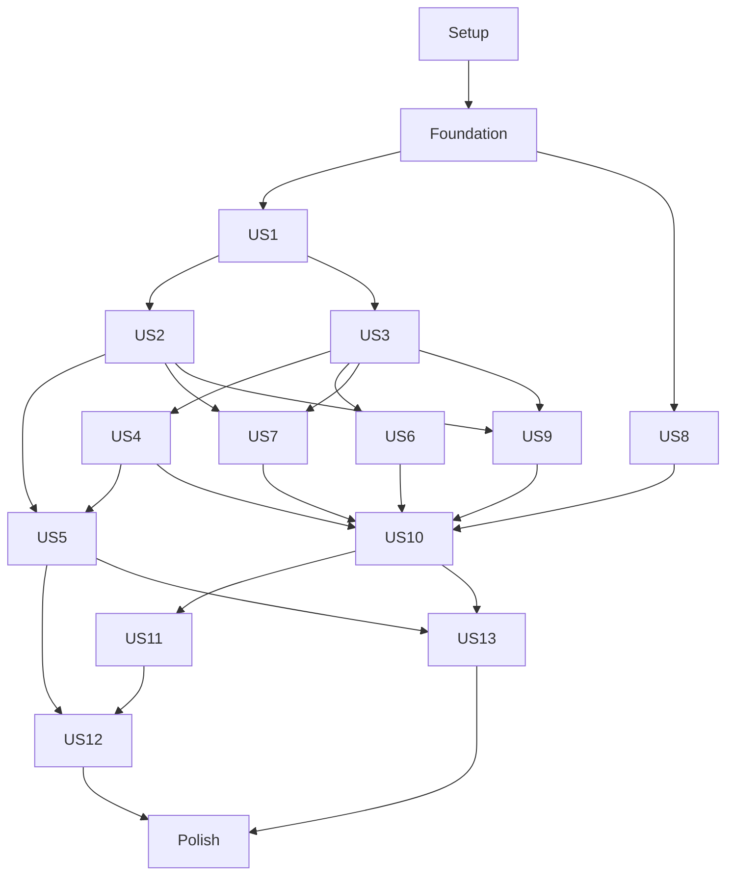

# Tasks: Reckless Desktop Chess

**Input**: Design documents from `specs/001-reckless-desktop-chess/`.

**Branch**: `001-reckless-desktop-chess` | **Created**: 2026-10-16 | **Status**: Implementation in progress.

**Prerequisites**: [plan.md](plan.md), [spec.md](spec.md), [decisions.md](decisions.md),
[data-model.md](data-model.md), [research.md](research.md),
[quickstart.md](quickstart.md), and the six [interface contracts](contracts/).
Direct owner choices and delegated resolutions govern older draft language.
This file adds executable work; it changes neither the approved scope nor the
existing engineering policy.

**Tests**: Included because the specification explicitly requires acceptance
scenarios, fixed-fixture correctness and measurable SC-001 through SC-014
validation. Write the relevant contract/behavior checks first, establish the
intended failing expectations, then implement and rerun the relevant checks.
Native/performance evidence is separate from hermetic behavior tests.

**Organization**: Setup, shared foundations, one phase for each of the 13 P1
stories in specification order, then full-release validation. All stories remain
in the first release. The first playable milestone is an internal increment.

## Format: `[ID] [P?] [Story] Description`

Every actionable item uses an unchecked checkbox, a sequential T-number, an
optional `[P]` marker, the required `[USn]` label within story phases, and exact
repository-relative file paths. `[P]` marks independent file work after the
phase prerequisites and contracts are available. It does not mean that a task
can ignore prerequisites, edit shared files concurrently, or bypass final gates.

## Path Conventions and Execution Boundaries

The root remains one Rust Cargo package. Native components live in `src/`,
frontend source/tooling in `ui/`, Cargo-discovered test roots in `tests/`,
source-mirrored cases beneath those roots, helper tool sources in `tools/` and
offline assets/manifests in `resources/`. Register the native tool dispatcher
as an explicit Cargo binary; add working subcommands as their owning tasks land.
Resources and source paths named below are prospective outputs, not existing
implementations. Large generated datasets remain untracked build inputs.

Load the [constitution](../../.specify/memory/constitution.md) and applicable
[canonical rules](../../.specify/rules/README.md) for implementation. The
[architecture](../../.specify/rules/architecture.md),
[structure](../../.specify/rules/structure.md),
[naming/types](../../.specify/rules/rust-style.md),
[performance](../../.specify/rules/performance.md),
[testing](../../.specify/rules/testing.md),
[code quality](../../.specify/rules/code-quality.md) and
[verification/authorization](../../.specify/rules/verification.md) files remain
the policy owners. Apply them to the concrete components here.

The owner authorized implementation on this new feature branch with a separate
commit and push for each completed task. Credentials, workflow activation,
publication and external conveyance retain their existing authorization
boundaries. The conditional workflow-activation task stays unchecked until its
actual prerequisites pass. An unavailable native host or unresolved release gate
is reported as outstanding, never as a passing test or a reason to remove a feature.

## Phase 1: Setup (Shared Infrastructure)

**Goal**: Establish the pinned root Rust/Tauri package and Bun frontend with reproducible local verification.

**Dependencies**: None.

**Independent Test**: Resolve locked dependencies and run the configured toolchain checks without replacing the Rust pin.

### Implementation

- [X] T001 Resolve the selected stable Rust-side dependencies and actual APIs from `specs/001-reckless-desktop-chess/research.md#final-resolution-research` in `Cargo.toml` and `Cargo.lock`, preserving Rust 1.99.0, edition 2024, root-package layout and existing strict lint/profile settings.
- [X] T002 Initialize the Vue 3.5.44, TypeScript 6.0.3, Vite 8.3.4, Three.js 0.186.1 and Bun 1.4.3 frontend in `ui/package.json`, `ui/bun.lock`, `ui/tsconfig.json` and `ui/vite.config.ts`; resolve compatible stable supporting pins and configure project aliases.
- [X] T003 Configure Tailwind 4.3.3 through its official Vite plugin and shadcn-vue/Reka UI in `ui/components.json` and `ui/src/theme/tokens.css`, with one token owner and local bundled assets.
- [X] T004 Configure Vue-aware type-checked ESLint 10.12.0, typescript-eslint 8.71.2, Prettier 3.9.10 and Tailwind class ordering in `ui/eslint.config.ts`, `ui/.prettierrc.json` and `ui/package.json`; exercise these selected tools on Bun.
- [X] T005 Configure the root Tauri 2.12.4 application, CLI 2.12.3, root Cargo build and local frontend assets in `build.rs`, `tauri.conf.json`, `src/main.rs` and `ui/index.html`, removing Hello World only when the real bootstrap is connected.
- [X] T006 Define least-privilege release capabilities and local-only CSP in `capabilities/main.json` and `tauri.conf.json`, excluding generic shell/filesystem access, remote executable content and test listeners.
- [X] T007 Configure Vitest 5.0.5 browser tests, matching browser-playwright provider, Playwright 1.64.1 and Vue Test Utils 2.5.1 in `ui/vitest.config.ts` and `ui/package.json`; retain stable compatible exact resolution.
- [X] T008 Configure WebdriverIO 9.31.9, @wdio/tauri-service 1.5.0 and the stable test-only native WebDriver feature in `ui/wdio.conf.ts`, `Cargo.toml` and `capabilities/test.json`, ensuring release selection excludes all automation permissions/plugins.
- [X] T009 Extend `Makefile` and `ui/package.json` with sequential formatter, vue-tsc, ESLint, Rust, browser-test and optimized-build gates; make `make run` launch the optimized desktop app with application arguments forwarded only when supplied. T023 connects schema-drift checking when the authoritative DTO schema exists.
- [X] T010 Record actual resolved dependency versions, Bun compatibility and local prerequisites in `specs/001-reckless-desktop-chess/evidence/toolchain.md`, including Linux updated WebKitGTK and native Fathom/Clang prerequisites.

**Checkpoint**: Pinned local toolchain and project entry points are usable.

## Phase 2: Foundational (Blocking Prerequisites)

**Goal**: Build the shared authoritative board, transport, resource, storage and minimal offline 3D infrastructure used by the stories.

**Dependencies**: Setup complete.

**Independent Test**: Exercise boundary contracts with deterministic fixtures, launch a local scene, and prove the current-host engine is identified and ready without any network requirement.

All foundation tasks block story integration. Complete this phase before beginning the story phases.

### Tests requested by the specification

- [X] T011 [P] Add authoritative-position, castling-encoding, full-identity collision and invalid-FEN contract fixtures in `tests/board/position.rs` and `tests/fixtures/positions.json`.
- [X] T012 [P] Add envelope/version, unsigned-counter precision, stale revision, idempotency, queue saturation and event-resync fixtures in `tests/desktop/envelope.rs`.
- [X] T013 [P] Add transactional-save, migration-failure, durable-receipt and missing-fixture checks in `tests/storage/document_store.rs`.

### Implementation

- [X] T014 Implement `BoardPosition` validation and identity in `src/board/position.rs` and `src/board/enums.rs`, enforcing every BoardPosition table constraint in `specs/001-reckless-desktop-chess/data-model.md`; accept structural studies without pretending to prove historical reachability. Exact field constraints: Piece placement: "Validated square/piece/color values; exactly one king per side"; Turn: "`BoardEnumColor`"; Castling rights: "Explicit original rook squares, compatible with selected variant"; En passant: "Validated target and legal-context normalization"; Halfmove/fullmove counters: "Checked bounded integers"; Variant: "Standard or Chess960 castling interpretation"; Legal moves: "Derived from the authoritative position, never browser declarations"; Repetition identity: "Board, turn, castling, and relevant en passant rights; counters excluded".
- [X] T015 Implement typed `BoardMove`, SAN/FEN/Shredder-FEN conversion, promotion and standard/Chess960 king-to-rook mapping in `src/board/move.rs` and `src/board/notation.rs`; retain "typed origin, destination, optional promotion, and special move interpretation" and reject unsupported variant declarations.
- [X] T016 Implement wire identities, revisions, typed errors and protocol/schema versions in `src/desktop/identity.rs`, `src/desktop/envelope.rs` and `src/desktop/error.rs`; preserve "Wire representation is a canonical string" and "Revisions and cumulative 64-bit counters use canonical unsigned decimal strings"; reject unsupported future versions.
- [X] T017 Implement injected monotonic time and deadline values in `src/clock/time_provider.rs` and `src/clock/duration.rs`, with deterministic test time, checked duration boundaries and no persisted wall-clock authority for elapsed time.
- [X] T018 Implement quota/affinity-aware capacity discovery, explicit detection failure, CPU leases and one coordinated CPU executor in `src/capacity/budget.rs`, `src/capacity/lease.rs` and `src/capacity/executor.rs`; establish real admission/release behavior consumed by engine launch and file work.
- [X] T019 Implement the async-facing bundled-rusqlite storage actor and transactional migration runner in `src/storage/document_store.rs` and `src/storage/migration.rs`, using WAL, foreign_keys=ON, synchronous=FULL and a 5-second busy timeout; return durable receipts only after commit.
- [X] T020 Implement the initial games/move-tree/clock/preferences schema and indexes in `src/storage/migrations/0001_core.sql`, with full position identities, foreign keys and independent persistence/IPC versions; add later story tables through subsequent numbered migrations.
- [X] T021 Implement Rust-owned opaque native file/directory handles and validated atomic-write staging in `src/desktop/file_handle.rs` and `src/storage/atomic_file.rs`; bind selections to native dialogs and refuse stale/untrusted handles.
- [X] T022 Implement ordered Tauri subscriptions and mutation deduplication in `src/desktop/stream.rs` and `src/desktop/request_cache.rs`: 64 unacknowledged events, 10-second ack deadline, last 1024 mutation results for 5 minutes, gap/resync semantics and 5 Hz job progress.
- [X] T023 Generate draft-07 JSON schemas, TypeScript wire types and strict Ajv validators from Rust DTOs through `src/desktop/schema.rs`, `ui/tools/generate-contracts.ts` and `ui/src/desktop/generated/contracts.ts`; wire deterministic generation-drift checking into `ui/package.json`.
- [X] T024 Implement the typed frontend bridge and snapshot/revision/sequence store in `ui/src/desktop/bridge.ts` and `ui/src/desktop/snapshot.ts`, exposing typed operations and validated state without another chess-rules implementation.
- [X] T025 Build the verified current-host Reckless v0.9.0 sidecar from commit 0e92358f5acd66e5ac77b1bf558202e47c515435 using `tools/main.rs`, `tools/engine/build.rs`, `Cargo.toml` and `resources/engine/manifest.json`, registering the working tool dispatcher as an explicit root-package Cargo binary and setting Cargo default-run to chess; verify the exact 63,266,880-byte NNUE hash from research, supply EVALFILE, keep Syzygy enabled and override host-native build flags in the isolated external checkout.
- [X] T026 Implement package/checksum/host compatibility selection and bounded startup readiness in `src/engine/package/manifest.rs`, `src/engine/package/selector.rs`, `src/engine/process_provider.rs` and `src/engine/session.rs`, injecting the consumer-owned process boundary, with 5-second uci/ready handshakes and a usable typed engine/capability identity.
- [ ] T027 Create original parametric sculpted GLB pieces and generation provenance in `ui/tools/generate-pieces.ts`, `resources/pieces/chess.glb` and `resources/pieces/provenance.json`, including distinct six-piece silhouettes and offline ivory/ebony satin materials.
- [ ] T028 Implement the minimal direct Three.js/WebGL2 3D-only scene, snapshot rendering, picking and semantic 64-square input surface in `ui/src/board/scene.ts`, `ui/src/board/BoardView.vue` and `ui/src/board/semantic_grid.ts`, with a fully visible board at the initial 20-degree view and explicit initialization failure.
- [ ] T029 Compose real native/UI dependencies, bootstrap snapshot and minimal board/player/action shell in `src/desktop/bootstrap.rs`, `src/lib.rs`, `src/main.rs`, `ui/src/main.ts` and `ui/src/App.vue`; expose only implemented APIs and register the foundation fixtures through `tests/domain.rs`, `tests/storage.rs` and `tests/desktop.rs`.

### Validation

- [ ] T030 Run the configured foundation gates and a current-host optimized offline bootstrap/engine-readiness smoke check; record real fixture counts and engine/model hashes in `specs/001-reckless-desktop-chess/evidence/foundation.md`.

**Checkpoint**: Shared contracts and the minimal offline desktop/engine foundation are verified.

## Phase 3: User Story 1: Play a complete game against Reckless (Priority: P1)

**Goal**: Deliver the first playable offline game with every selected variant, clock family, draw policy, takeback and premove rule.

**Dependencies**: Foundational complete; later US4/US5 deepen visual/native acceptance without being prerequisites for this local milestone.

**Independent Test**: From an offline current-host package, play either color; cover all special moves/results, precise clocks, claims, takebacks and premoves with controlled time and the pinned engine.

### Tests requested by the specification

- [ ] T031 [P] [US1] Add standard/FRC/DFRC legality, special-move, result/claim, intended-move claim and dead-position/side-specific flag-fall fixtures in `tests/game/rules.rs` and `tests/fixtures/adjudication.json`.
- [ ] T032 [P] [US1] Add all time-control families, stage/refund boundaries, exact-deadline moves, snapshot takebacks and once-used low-time alert fixtures in `tests/clock/state.rs`.
- [ ] T033 [P] [US1] Add pinned-engine game sequencing, illegal/late bestmove, premove cancellation and stop-before-takeback tests in `tests/engine/live_game.rs`.

### Implementation

- [ ] T034 [US1] Implement `GameSession` fields and closed state/seats/outcome types in `src/game/session.rs`, `src/game/enums.rs` and `src/game/outcome.rs`, preserving all GameSession table constraints in `specs/001-reckless-desktop-chess/data-model.md` and a single mutation owner. Exact field constraints: Identity and revision: "`GameId`, monotonic revision"; Mode: "Human-versus-engine or local two-player"; Initial state: "Variant, initial `BoardPosition`, optional FRC/DFRC seed/indexes"; Seats: "Human or Reckless player per color; mode validates the combination"; Move tree: "Root and nodes identified by `GameMoveId`"; Live cursor: "Node whose position is authoritative for an active game"; View cursor: "Independently selected historical/variation node"; Clock: "`ClockState` owned by the live line"; Phase: "Setup, active, interrupted, completed, or analysis"; Outcome: "Optional typed result plus reason and originating move"; Metadata: "Typed known PGN tags, ordered validated extension tags".
- [ ] T035 [US1] Implement immutable-parent move nodes and ordered variation trees in `src/game/move_node.rs` and `src/game/tree.rs`, including "plain-text notes, NAGs, saved position markings, and optional post-move clock" and ancestor-cache invalidation.
- [ ] T036 [US1] Implement `ClockTimeControl` and validated stages in `src/clock/time_control.rs` and `src/clock/stage.rs`, preserving "Reject negative or overflowing values"; include untimed, sudden death, Fischer, staged/cyclic, simple delay and Bronstein with exclusive bonus kinds.
- [ ] T037 [US1] Implement `ClockState` turn charging, stage transitions, delay/refund display state and full snapshots in `src/clock/state.rs`; preserve "remaining duration per side, active side, completed move counts, stage, turn-start instant, and paused/running status" and "Increment applies once after a legal accepted move"; pause never grants a second delay.
- [ ] T038 [US1] Implement injected uniform start selection in `src/board/start.rs`: "FRC starts use a validated Scharnagl index 0..959", independent validated DFRC indexes, Standard index 518, persisted initial FEN/indexes and explicit zero-based labels.
- [ ] T039 [US1] Implement standard results, repetition identity/history and explicit human/automatic Reckless draw claims in `src/game/adjudication.rs` and `src/game/draw_claim.rs`, including intended moves, checkmate precedence and locally confirmed draw agreement only.
- [ ] T040 [US1] Implement sound dead-position/side-specific possible-mate proof adjudication in `src/game/mate_proof.rs`, with 2 seconds/1,000,000 states/128 MiB limits and Unknown returning a preserved paused interruption with Retry or explicit consensual result; keep practical coverage a release blocker.
- [ ] T041 [US1] Implement serialized move/result acceptance and native deadline ordering in `src/game/session.rs`, including expected revision, seat, live phase, legality, late-move rejection and atomic clock/tree/result changes.
- [ ] T042 [US1] Implement full-history engine turn orchestration in `src/game/engine_provider.rs` and `src/engine/live_game.rs`, injecting the game-owned engine contract and using startpos only for Standard, FEN for all FRC/DFRC, terminal-root rejection, safe stop/bestmove barriers, exactly one search-limit variant and the selected delay movetime formula.
- [ ] T043 [US1] Implement `StorageGameDocument` serialization and atomic move/pause/resume/result autosaves through `src/storage/game_document.rs` and `src/game/storage_repository.rs`, retaining "validated move tree, result, clock snapshots, and metadata" together with schema, game identity and initial FEN/variant.
- [ ] T044 [US1] Implement manual pause/resume and mode-specific takebacks in `src/game/pause.rs` and `src/game/takeback.rs`, preserving prior-human-turn versus one-local-move targets, clock snapshots, local consent/default/no expiry, cancel-on-move/result and retained/reused variations.
- [ ] T045 [US1] Implement one disabled-by-default queued premove in `src/game/premove.rs`, with preselected promotion, replacement/cancel, actual elapsed charge, legality revalidation and clearing on pause/takeback/fault/relaunch.
- [ ] T046 [US1] Implement game create/start/play/navigate/branch/finish/pause/resume/undo handlers and schema generation in `src/desktop/game_commands.rs`, wired through `src/desktop/bootstrap.rs` with typed revisions and no browser adjudication.
- [ ] T047 [US1] Implement New Game controls, all selected presets/defaults and start-position selectors in `ui/src/game/NewGameDialog.vue` and `ui/src/game/new_game.ts`, with initial White/Standard/10+5 and a distinct configurable 3-second untimed engine budget.
- [ ] T048 [US1] Implement live board input, four-choice promotion, player bars/clocks, low-time state, premove feedback, takeback/claim/resignation confirmation and Return to Live in `ui/src/game/PlayView.vue` and `ui/src/game/controller.ts`; display tenths below 10 seconds and preserve clock precision.

### Validation

- [ ] T049 [US1] Exercise spec story 1 scenarios 1 through 8, the adversarial rules corpus and a real-engine offline game; register tests in `tests/domain.rs` and `tests/engine.rs` and record unresolved proof coverage honestly in `specs/001-reckless-desktop-chess/evidence/us1.md`.

**Checkpoint**: US1 is complete only after its independent criteria and the corresponding specification scenarios pass.

## Phase 4: User Story 2: Use the complete engine for analysis (Priority: P1)

**Goal**: Expose every usable pinned production/diagnostic capability without unsupported commands or incomplete telemetry.

**Dependencies**: Foundational and US1 board/search lifecycle complete.

**Independent Test**: Run each supported limit, ranked candidate analysis, stop/change/restart, configuration, local tablebases and isolated diagnostics using the real pinned engine.

### Tests requested by the specification

- [ ] T050 [P] [US2] Add transcript and real-engine contract cases for PRO-01 through PRO-07, SRC-01 through SRC-05 and OUT-01 through OUT-08 in `tests/engine/protocol.rs`, including readiness-versus-completion, malformed/oversized output and 1,000 stale-result cycles.
- [ ] T051 [P] [US2] Add OPT-01 through OPT-08 validation/application, MultiPV/root caps, tablebase path/load and search-score/raw-eval distinction fixtures in `tests/engine/options.rs`.
- [ ] T052 [P] [US2] Add isolated diagnostic cancellation/reaping, capacity refusal, CLI queued-command behavior and inventory-completeness checks in `tests/engine/workbench.rs`.

### Implementation

- [ ] T053 [US2] Implement typed `EngineSearchLimit` in `src/engine/search/limit.rs` as "infinite analysis, depth, nodes, move time, or clock control"; clock control has both sides' times/increments and "optional moves-to-go", preventing unsupported combined limits.
- [ ] T054 [US2] Complete serialized engine transitions and bounded pipes in `src/engine/session.rs` and `src/engine/uci/transport.rs`, enforcing 64 KiB lines, 256 control messages, 1 MiB diagnostic tails, 2-second stop safety, 3-second shutdown and explicit Retry/new generations.
- [ ] T055 [US2] Implement the versioned typed option/capability registry in `src/engine/capabilities.rs` and `src/engine/uci/options.rs`, covering every OPT row, dynamic Threads bounds, button formatting, unknown-option mismatch and idle-only configuration.
- [ ] T056 [US2] Implement legal PV/analysis parsing and score normalization in `src/engine/analysis.rs` and `src/engine/uci/parser.rs`; keep "exact/lower/upper bound", invert bounds when negating, retain reported perspective and treat "missing fields are not zero".
- [ ] T057 [US2] Implement correlated analysis orchestration and coalescing in `src/engine/search/session.rs`, binding search/process generation/game/revision/history/limit/lease and emitting at most 20 visual snapshots per second without dropping completion/errors.
- [ ] T058 [US2] Implement local Syzygy path preparation and actual load/cardinality diagnostics in `src/engine/tablebase/location.rs` and `src/engine/tablebase/status.rs`, using whitespace-free managed aliases, Unix 0700 location and explicit Windows link limitations without silent copying.
- [ ] T059 [US2] Implement typed `WorkbenchJob` validation/lifecycle in `src/workbench/job.rs` and `src/workbench/enums.rs`, with "validated parameters, package/profile, state, capacity lease, deadline, progress, result, and cancellation"; use 60-second default/10-minute maximum deadlines and perft depth 4 within 1..12.
- [ ] T060 [US2] Implement isolated inspector/raw eval/compiler/perft-divide/45-position bench operations and kill/reap cancellation in `src/workbench/executor.rs`; keep live processes isolated and preserve benchmark upstream defaults.
- [ ] T061 [US2] Implement analysis/configure/clear-hash/tablebase/workbench handlers and generated contracts in `src/desktop/engine_commands.rs` and `src/desktop/workbench_commands.rs`.
- [ ] T062 [US2] Implement ranked analysis lines, cp/mate/bound labels, complete optional statistics and explicit search modes/Stop in `ui/src/analysis/AnalysisView.vue` and `ui/src/analysis/controller.ts`, with an evaluation bar only in analysis/review.
- [ ] T063 [US2] Implement the typed advanced engine configuration, tablebase status and diagnostic workbench UI in `ui/src/workbench/WorkbenchView.vue` and `ui/src/workbench/controller.ts`, exposing prerequisites, progress, cancellation and exportable results.
- [ ] T064 [US2] Implement reproducible diagnostic exports with engine/profile/model/configuration identity in `src/workbench/export.rs` and `ui/src/workbench/DiagnosticResults.vue`, safely preserving bounded informational output.
- [ ] T065 [US2] Document and verify DEV-06 queued arguments, DEV-07 controlled PGO instrument/train/merge/rebuild comparison and DEV-08 controlled SPSA compile status in `tools/engine/pgo.rs`, `tools/engine/spsa_check.rs` and `docs/engine-workflows.md`; record upstream failure as unavailable rather than editing vendor code.
- [ ] T066 [US2] Implement the capability coverage runner and evidence schema in `tools/engine/coverage.rs` and `tests/fixtures/engine-capabilities.json`, deriving completeness from the typed registry and the pinned inventory IDs rather than a separate discovery list.
- [ ] T067 [US2] Integrate analysis/workbench state, safe option barriers and capacity priority in `src/desktop/bootstrap.rs` and `ui/src/main.ts`, leaving unsupported ponder/strength/book/WDL/searchmoves/mate controls explicitly unavailable with source-backed reasons.

### Validation

- [ ] T068 [US2] Run all applicable current-host capability workflows with the exact binary and register tests in `tests/engine.rs`; record every OPT/PRO/SRC/OUT/CHS/EVA/CPU/TB/NUM/DEV row's target applicability, real result or outstanding native prerequisite in `specs/001-reckless-desktop-chess/evidence/engine-capabilities.md`.
- [ ] T069 [US2] Measure p95 stop against 1 second, hard-stop behavior against 2 seconds and all 1,000 lifecycle cycles in `specs/001-reckless-desktop-chess/evidence/us2.md`, without replacing genuine target/profile acceptance with transcript-only results.

**Checkpoint**: US2 is complete only after its independent criteria and the corresponding specification scenarios pass.

## Phase 5: User Story 3: Play locally and keep games (Priority: P1)

**Goal**: Deliver local two-player play, an organized durable library, full PGN/FEN interchange and safe notes/variation editing.

**Dependencies**: US1 game/tree/clock and foundational storage/transport complete.

**Independent Test**: Play locally with no engine replies, round-trip annotated games, organize/search the library, preview duplicates/errors and recover games from Trash.

### Tests requested by the specification

- [ ] T070 [P] [US3] Add full/mainline PGN and declared-variant FEN round-trip, invalid-branch exclusion and streaming-limit fixtures in `tests/notation/interchange.rs`.
- [ ] T071 [P] [US3] Add library metadata filters, normalization/duplicate preview, folder removal, modified-time, Trash/restore and notes/variation-protection tests in `tests/storage/library.rs`.

### Implementation

- [ ] T072 [US3] Complete local-seat creation/turn routing and local consent UI in `src/game/local_play.rs` and `ui/src/game/LocalGameControls.vue`, reusing authoritative legality/clocks and never starting an engine reply.
- [ ] T073 [US3] Implement bounded streaming PGN staging in `src/notation/pgn_import.rs`, with 20 GiB input, 1,000,000 games, 100,000,000 total plies, 100,000 plies per game, 64 variation levels, 1 MiB text fields and 64 MiB decoded buffers, rejecting size/space limit violations before commit; exclude an entire game with invalid moves/branches.
- [ ] T074 [US3] Implement canonical PGN full/mainline export and declared-variant FEN import/export in `src/notation/pgn_export.rs` and `src/notation/fen.rs`, preserving ordered unknown tags, escaped plain-text notes/NAGs/markings/clocks/variations and the 512-byte FEN bound.
- [ ] T075 [US3] Implement collision-checked game/position identity and duplicate matching in `src/notation/game_identity.rs`, with Unicode NFC/trim/case-fold rules, canonical starts/mainline, explicit partial/missing metadata and preserved display strings.
- [ ] T076 [US3] Implement staged import previews, space estimates, exclusion/duplicate counts, default Skip/explicit Keep Copy and cancel cleanup in `src/storage/import_session.rs`; confirm immutable preview identity/digest before atomic commit and preserve existing annotations.
- [ ] T077 [US3] Add library organization/index schema in `src/storage/migrations/0002_library.sql`, preserving "one folder or Unfiled" per game, multiple tags, favorites, Trash status and no fixed total-library game cap.
- [ ] T078 [US3] Implement paged search/filter/sort and canonical metadata updates in `src/storage/library_repository.rs`, covering players/date/result/variant/mode/favorites/tags/folders/opening/game length, 100-item pages and most-recently-updated order without changing modified time on viewing.
- [ ] T079 [US3] Implement nested folder/tag/favorite operations and confirmed folder/subfolder removal to Unfiled in `src/game/library_organization.rs`, preserving the games and valid references.
- [ ] T080 [US3] Implement recoverable Trash/Restore/permanent-delete operations in `src/storage/trash.rs`, with no expiry, surviving-folder-or-Unfiled restoration, no ID overwrite and pause/save/close prerequisites for open unfinished games.
- [ ] T081 [US3] Implement explicit notes/NAG/markings save and confirmed variation promotion/deletion in `src/game/annotations.rs`, preserving the prior main line, subtree scope and running-game played history.
- [ ] T082 [US3] Implement library/import/export/organization/Trash/annotation/variation handlers in `src/desktop/library_commands.rs` and `src/desktop/annotation_commands.rs`, retaining entity revisions and native handles.
- [ ] T083 [US3] Implement library search/filter/favorite/tag/nested-folder controls and empty/error states in `ui/src/library/LibraryView.vue` and `ui/src/library/controller.ts`, including saved-game paused reopen.
- [ ] T084 [US3] Implement import/duplicate/exclusion preview and full/mainline export UI in `ui/src/library/ImportDialog.vue` and `ui/src/library/ExportDialog.vue`, requiring confirmation and showing unsupported syntax explicitly.
- [ ] T085 [US3] Implement Trash restore/permanent-delete/folder removal and open-game Trash confirmations in `ui/src/library/TrashView.vue` and `ui/src/library/FolderDialog.vue`.
- [ ] T086 [US3] Implement plain-text notes with Save/Discard/Stay and variation/Save Markings controls in `ui/src/analysis/AnnotationsPanel.vue` and `ui/src/analysis/VariationTree.vue`, with temporary drawings cleared on selected-position changes.

### Validation

- [ ] T087 [US3] Exercise story 3 scenarios 1 through 9, register the source-mirrored suites through `tests/domain.rs` and `tests/storage.rs`, and record exact round-trip/duplicate/Trash results in `specs/001-reckless-desktop-chess/evidence/us3.md`.

**Checkpoint**: US3 is complete only after its independent criteria and the corresponding specification scenarios pass.

## Phase 6: User Story 4: Enjoy a polished accessible workspace (Priority: P1)

**Goal**: Finish the premium dark/light 3D workspace with accessible input, remembered camera/layout and adaptive on-demand rendering.

**Dependencies**: Foundational scene/assets/bridge complete; US1 supplies playable interactions and US3 supplies study controls for end-to-end review.

**Independent Test**: Exercise every permitted camera view and core keyboard flow at the minimum window and required scales/themes, including reduced motion, idle rendering and scene failure.

### Tests requested by the specification

- [ ] T088 [P] [US4] Add camera corner-fitting, orientation, picking, zoom/tilt bounds and input-cancellation tests in `ui/tests/board/camera.test.ts`.
- [ ] T089 [P] [US4] Add semantic-grid, promotion/dialog focus, non-color status, reduced-motion and layout-scale tests in `ui/tests/board/accessibility.test.ts`.
- [ ] T090 [P] [US4] Add deterministic active-frame adaptation, idle/background exclusion and graphics recovery tests in `ui/tests/board/quality.test.ts`.

### Implementation

- [ ] T091 [US4] Finish graphite/emerald and warm-light tokens, panel elevation and persistent responsive layout in `ui/src/theme/tokens.css` and `ui/src/workbench/WorkspaceView.vue`: 1440x900 default/reset, 1280x800 minimum, 208/64 navigation, 360-wide panel bounded 300..560, 560 board workspace and drawer below 1360.
- [ ] T092 [US4] Bundle Inter 4.1 variable roman/OFL and original accessible SVG figurines in `resources/fonts/InterVariable.woff2`, `resources/fonts/OFL.txt`, `ui/src/board/figurines.ts` and `ui/src/theme/typography.css`; verify offline tabular digits and Letters/Figurines preference.
- [ ] T093 [US4] Refine the original GLB assets, scene lighting and ivory/ebony satin materials in `ui/tools/generate-pieces.ts`, `resources/pieces/chess.glb` and `ui/src/board/materials.ts`, preserving provenance and distinguishable silhouettes under every permitted view.
- [ ] T094 [US4] Implement remembered camera pose and full-board corner fitting in `ui/src/board/camera.ts`: "full 360-degree yaw and tilt 0..45 degrees", 20-degree initial tilt, 35-degree FOV, 8% margin, distance multiplier [1,1.6] initially 1.1, 15-degree yaw/5-degree tilt/10% zoom buttons and Reset View retaining side orientation.
- [ ] T095 [US4] Implement click/drag/keyboard/promotion affordances and annotation picking in `ui/src/board/input.ts` and `ui/src/board/CameraControls.vue`, with 5 CSS-pixel drag threshold, explicit castling choices, pointer/Escape/revision/dialog cancellation and visual-orientation keyboard focus independent of free yaw.
- [ ] T096 [US4] Implement legal dots/check/last-move/capture/coordinate aids and right-click circles/right-drag arrows in `ui/src/board/markings.ts` and `ui/src/board/BoardToolbar.vue`; use approved four colors/modifiers, toggle repeated marks and count captures since the recorded initial position.
- [ ] T097 [US4] Implement responsive 180 ms piece/auto-flip and 160 ms panel motion in `ui/src/board/animation.ts`, keeping tilt/zoom/yaw offset separate from game orientation and canceling obsolete animation without delaying native move input.
- [ ] T098 [US4] Implement Low/Medium/High and Automatic quality plus on-demand invalidation in `ui/src/board/quality.ts` and `ui/src/board/scene.ts`, using the selected shadow/DPR tiers, 2-second active windows, 3 high/10 low windows, 20/13 ms p95 thresholds, 30-second cooldown and effects-before-resolution scaling down to 0.75.
- [ ] T099 [US4] Implement graphics initialization/context/shader/asset-failure interruption, explicit Retry and 10-second recovery deadline in `src/desktop/renderer_commands.rs` and `ui/src/board/RendererRecovery.vue`, preserving all dependent live games paused with no 2D fallback or automatic resume.
- [ ] T100 [US4] Implement accessible status announcements, visible focus, semantic controls and complete loading/empty/error/result states in `ui/src/board/semantic_grid.ts` and `ui/src/workbench/StatusRegion.vue`, with controlled/throttled analysis announcements.
- [ ] T101 [US4] Implement persistent window/nav/panel/tab/camera state and Reset Layout in `src/desktop/layout.rs` and `ui/src/workbench/layout.ts`, fitting changed displays and reporting displays unable to fit the minimum.

### Validation

- [ ] T102 [US4] Record keyboard and VoiceOver/NVDA/Orca checks, both-theme screenshots/interaction recordings at 1280x800, 1440x900 and large windows, 100/150/200% scales, WCAG AA/24-pixel controls and permitted-camera piece readability in `specs/001-reckless-desktop-chess/evidence/us4.md`; mark unavailable native evidence outstanding.

**Checkpoint**: US4 is complete only after its independent criteria and the corresponding specification scenarios pass.

## Phase 7: User Story 5: Install and recover on every target (Priority: P1)

**Goal**: Produce offline native packages for the exact target matrix, select safe engine profiles and recover explicitly from failures.

**Dependencies**: US1 game lifecycle and US2 capability runner complete; US4 supplies final scene/fault behavior. Bundled starter-data release acceptance waits for US13.

**Independent Test**: Clean-install each target package, run offline play/analysis/save, inspect identity/notices and inject engine/graphics/sleep/crash failures.

### Tests requested by the specification

- [ ] T103 [P] [US5] Add manifest hash, full CPU/OS SIMD gating, profile selection and incompatible-build tests in `tests/engine/package.rs`.
- [ ] T104 [P] [US5] Add controlled engine EOF/protocol/stop-deadline, sleep, saved-clock restart and no-orphan shutdown tests in `tests/desktop/recovery.rs`.
- [ ] T105 [P] [US5] Add native installer/offline/recovery automation scenarios in `ui/tests/native/installation.e2e.ts`, using dedicated instrumented test builds and separately inspecting production artifacts for absence of automation plugins/listeners.

### Implementation

- [ ] T106 [US5] Build portable Windows/Linux x86 baseline, fully gated x86-64-v3/v4, Apple ARM64 NEON and separate Linux NUMA profiles in `tools/engine/build.rs` and `resources/engine/manifest.json`, recording exact compiler/features/binary/network/source hashes and keeping production Syzygy enabled.
- [ ] T107 [US5] Implement complete CPU plus OS extended-state and Linux NUMA/library/topology compatibility selection in `src/engine/package/selector.rs` and `src/engine/package/platform.rs`, allowing only compatible app-owned advanced overrides with explicit fallback reasons.
- [ ] T108 [US5] Configure Windows 11 x86-64 unsigned NSIS and the offline Evergreen WebView2 installer in `tauri.conf.json` and `tools/package/windows.rs`; verify runtime installer redistribution and clean offline setup without paid signing.
- [ ] T109 [US5] Configure macOS 14+ Apple Silicon-only DMG and nested ad-hoc signing in `tools/package/macos.rs` and `tauri.conf.json`, validating portable ARM engine loading and documented manual OS approval without Developer ID/notarization.
- [ ] T110 [US5] Configure Ubuntu 22.04+ x86-64 .deb/AppImage generation and dependency checks in `tools/package/linux.rs` and `tauri.conf.json`, with updated WebKitGTK 4.1, X11/Wayland validation and explicit offline dependency preparation.
- [ ] T111 [US5] Implement native sleep/focus/quit/tab-close and recovery orchestration in `src/desktop/lifecycle.rs` and `src/game/recovery.rs`, distinguishing live-clock focus behavior, explicit pauses, last-durable crash snapshots, successful Retry and later explicit Resume.
- [ ] T112 [US5] Implement save-failure interruption, newest-consistent Retry Save and save-before-close/quit/Trash barriers in `src/game/save_coordinator.rs` and `ui/src/game/RecoveryDialog.vue`, retaining unsaved memory state and preventing silent data loss.
- [ ] T113 [US5] Package full third-party notices, exact engine/model identity and corresponding-source/build materials through `tools/package/notices.rs`, `resources/notices/manifest.json` and `docs/third-party-notices.md`; preserve personal-use/no application license-file change and separately gate any external conveyance on NNUE terms.
- [ ] T114 [US5] Implement Engine Information, diagnostic/setup/retry and recovered-paused views in `ui/src/workbench/EngineInformation.vue` and `ui/src/game/RecoveryDialog.vue`, exposing profile/identity/capability/source access without leaking secrets.
- [ ] T115 [US5] Document actual clean install/uninstall, unsigned Windows/manual Mac approval, Linux prerequisite preparation and local native builds in `docs/install.md` and `specs/001-reckless-desktop-chess/quickstart.md`.

### Validation

- [ ] T116 [US5] Execute Windows 11 x64, macOS 14+ ARM and Ubuntu 22.04+ x64 X11/Wayland clean-package tests, plus actual suitable-hardware NUMA and optimized-profile checks; record exact OS/WebView/CPU/package hashes and failures in `specs/001-reckless-desktop-chess/evidence/us5.md`.
- [ ] T117 [US5] Verify release binaries exclude development URLs, test permissions/plugins/listeners and all unwanted target architectures using `tools/package/verify.rs`; retain unperformed native/profile checks as release blockers in `specs/001-reckless-desktop-chess/evidence/release.md`.

**Checkpoint**: US5 is complete only after its independent criteria and the corresponding specification scenarios pass.

## Phase 8: User Story 6: Construct and annotate study positions (Priority: P1)

**Goal**: Provide a validated position editor with saveable invalid drafts, session-local history and safe FEN/play transfer.

**Dependencies**: Foundational board/transport/storage, US1 New Game and US3 notes/variations complete.

**Independent Test**: Construct valid/invalid positions with mouse/keyboard, save/reopen drafts, round-trip FEN and transfer a valid position only through explicit New Game Start.

### Tests requested by the specification

- [ ] T118 [P] [US6] Add invalid-draft persistence, structural king/check/right/counter validation, declared-variant FEN and source-game isolation tests in `tests/board/editor.rs`.
- [ ] T119 [P] [US6] Add editor placement, shortcut, unsaved-edit, Undo/Redo/session-reset and Play-from-Position flows in `ui/tests/editor/editor.test.ts`.

### Implementation

- [ ] T120 [US6] Implement raw editor draft fields and validation findings in `src/board/editor/draft.rs` and `src/board/editor/validation.rs`, preserving invalid status separately from BoardPosition and exact halfmove 0..1000000/fullmove 1..1000000 bounds.
- [ ] T121 [US6] Implement editor-local select/place/remove/move, piece/turn/castling/en-passant/counter edits and session-only Undo/Redo in `src/board/editor/session.rs`, with confirmed Clear Board/Standard Setup and no modification of the source game.
- [ ] T122 [US6] Persist valid/invalid drafts with explicit save and separate identities in `src/storage/migrations/0003_editor.sql` and `src/storage/editor_repository.rs`; reopen saved position fields without persisted Undo/Redo.
- [ ] T123 [US6] Implement editor new/update/validate/save/list/delete/FEN-transfer handlers in `src/desktop/editor_commands.rs`, creating a separate FEN draft only after unsaved-edit resolution and blocking play/search until validation succeeds.
- [ ] T124 [US6] Implement piece palette, click/drag/keyboard placement/removal, field validation and explicit Save/Discard/Stay in `ui/src/editor/PositionEditor.vue` and `ui/src/editor/controller.ts`, including selected-position-or-Standard draft initialization.
- [ ] T125 [US6] Implement shared Library Positions/editor draft lists and valid-only Play from Position/New Game prefill in `ui/src/library/PositionsView.vue` and `ui/src/editor/DraftList.vue`, requiring explicit Start and preserving current drafts.
- [ ] T126 [US6] Connect validated drafts to analysis/annotations and generated IPC in `src/desktop/bootstrap.rs` and `ui/src/main.ts`, preserving existing game/tree histories and all four promotion choices.

### Validation

- [ ] T127 [US6] Register editor fixtures through `tests/domain.rs`, exercise story 6 scenarios 1 through 7 and record draft/FEN/annotation round trips in `specs/001-reckless-desktop-chess/evidence/us6.md`.

**Checkpoint**: US6 is complete only after its independent criteria and the corresponding specification scenarios pass.

## Phase 9: User Story 7: Review full games and explore openings (Priority: P1)

**Goal**: Deliver durable game reports and offline indexed explorer/book study, preserving played history and exact statistics.

**Dependencies**: US2 analysis, US3 library/tree/identity and foundational storage complete; use fixed local corpora before US13 prepares production starters.

**Independent Test**: Analyze a fixed game and variations, verify its scoring/source identity, query a known corpus and exercise legal/zero-weight book positions without feeding opponent moves.

### Tests requested by the specification

- [ ] T128 [P] [US7] Add report adjacent-position correlation, selected metric/mates/bounds/forced exclusions, partial/outdated states and scheduling/relaunch tests in `tests/report/job.rs` and `tests/report/scoring.rs`.
- [ ] T129 [P] [US7] Add first-occurrence/transposition, combined deduplication, partial-date/missing-rating filters, denominators and opening-name/sample-order fixtures in `tests/opening/explorer.rs`.
- [ ] T130 [P] [US7] Add independent Polyglot key/move/record decoding, illegal-entry rejection, zero/scaled weights and study-only navigation fixtures in `tests/opening/book.rs`.

### Implementation

- [ ] T131 [US7] Implement `ReportJob` identity/configuration/line digest/search budget/progress and `ReportMoveFinding` source/evaluation/alternatives/policy-version models in `src/report/job.rs` and `src/report/finding.rs`, preserving "Source game/line revision" and "completion/cancellation state" with a configurable 3-second-per-position default.
- [ ] T132 [US7] Implement the exact selected versioned expected-score/loss/accuracy policy in `src/report/scoring.rs`: cp clamp [-10000,10000], cp/400 logistic, mover perspective, inaccuracy/mistake/blunder thresholds .05/.10/.20, forced-move exclusion, per-player mean-loss accuracy and one-decimal display; distinguish mates, missed mates, bounds and unavailable/partial samples.
- [ ] T133 [US7] Implement durable report job/results migrations and repository in `src/storage/migrations/0004_reports.sql` and `src/storage/report_repository.rs`, preserving completed positions across pause/cancel/relaunch and old reports as outdated after line changes.
- [ ] T134 [US7] Implement automatic app-played mainline reports, explicit imported/variation analysis and immutable-line invalidation in `src/report/service.rs`, avoiding report creation merely on reopen, import or metadata-only edits.
- [ ] T135 [US7] Implement FIFO report scheduling and priority in `src/report/scheduler.rs`, pausing for every running live game, yielding to interactive analysis/live demand, retaining completed work and restarting interrupted positions with full budget.
- [ ] T136 [US7] Implement `OpeningCorpus`/query/filter/result types in `src/opening/corpus.rs` and `src/opening/query.rs`, preserving "Source/version, local games/index, supported metadata, and validation state" and "Missing ratings/results are unavailable".
- [ ] T137 [US7] Implement legal first-40-ply opening indexing and bounded deeper-position extension in `src/opening/index.rs` and `src/storage/opening_repository.rs`, using full collision-checked position identity and at most 128 MiB batches on spare leased capacity.
- [ ] T138 [US7] Implement combined-source deduplication and exact continuation/result/rating statistics in `src/opening/statistics.rs`, counting only first occurrence per game, known-result outcome denominators, next-move frequency denominators and separate unknown/ending counts.
- [ ] T139 [US7] Implement dataset/date/player/rating/time-control/result filters, partial-date disclosure, deepest opening labels and 50-sample pagination in `src/opening/explorer.rs`; default rating criterion Both Players, exclude missing required metadata and preserve every source identity.
- [ ] T140 [US7] Implement Standard-only Polyglot parser/legal move lookup and study weights in `src/opening/book.rs`, validating big-endian QHHI entries, descending weights/UCI ties, one-decimal normalized shares and unavailable all-zero percentages.
- [ ] T141 [US7] Implement shared-position study continuation navigation in `src/game/study.rs`, reusing or adding a variation while preserving the main line and refusing live-move submission from explorer/book actions.
- [ ] T142 [US7] Implement report start/cancel/read/list and corpus/book preview/apply/query handlers in `src/desktop/report_commands.rs` and `src/desktop/opening_commands.rs`, with typed entity revisions, immutable previews and bounded progress/cancellation.
- [ ] T143 [US7] Implement full-game evaluation graph, progress/partial/outdated labels, per-player accuracy and clickable finding/branch UI in `ui/src/report/ReportView.vue` and `ui/src/report/controller.ts`.
- [ ] T144 [US7] Implement explorer filters/stats/sample games and study-only book panels in `ui/src/opening/ExplorerPanel.vue`, `ui/src/opening/BookPanel.vue` and `ui/src/opening/controller.ts`, sharing the selected board cursor across tabs.
- [ ] T145 [US7] Connect report completion triggers, study annotations, opening library fields and generated IPC in `src/desktop/bootstrap.rs` and `ui/src/main.ts`, retaining engine evaluations/raw diagnostics distinctions.
- [ ] T146 [US7] Add browser acceptance cases for findings, graph navigation, study-only continuations, missing data and selected-position tab continuity in `ui/tests/study/review.test.ts`, using fixed local corpus/book fixtures.

### Validation

- [ ] T147 [US7] Register report/opening fixtures through `tests/domain.rs` and `tests/storage.rs`; exercise all story 7 scenarios and record exact metric/statistic/reference-book results in `specs/001-reckless-desktop-chess/evidence/us7.md`.

**Checkpoint**: US7 is complete only after its independent criteria and the corresponding specification scenarios pass.

## Phase 10: User Story 8: Solve chess puzzles (Priority: P1)

**Goal**: Deliver complete local timed puzzle training with listed solutions, assisted practice and durable non-overlapping outcomes.

**Dependencies**: Foundational board/time/storage/3D available; no engine-search or report dependency. US13 supplies production CSV/starter provisioning.

**Independent Test**: Use fixed valid/invalid puzzle collections to exercise both timer modes, hints/retries/skip, focus/sleep/relaunch, exhaustion, history and exact summary rates.

### Tests requested by the specification

- [ ] T148 [P] [US8] Add valid/unlisted/illegal solution, progressive-hint reset, failed-then-practice-solved, random listed-reply and no-engine-search fixtures in `tests/puzzle/solution.rs`.
- [ ] T149 [P] [US8] Add controlled session/per-puzzle timer, readiness start, review/exhaustion pauses, expiry races and <=1-second checkpoint-recovery tests in `tests/puzzle/timer.rs`.
- [ ] T150 [P] [US8] Add persisted shuffle/history, zero-denominator rates, confirmed deletion/recomputed summaries and active-run deletion refusal tests in `tests/puzzle/history.rs`.

### Implementation

- [ ] T151 [US8] Implement `PuzzleDefinition` identity/position/validated solution-tree/difficulty/theme model in `src/puzzle/definition.rs`; preserve "Starting position and accepted solution tree, with source identity" and missing optional metadata as unavailable.
- [ ] T152 [US8] Implement `PuzzleSession`/attempt/outcome state in `src/puzzle/session.rs` and `src/puzzle/enums.rs`, preserving "Each timed run uses exactly one countdown mode" with 5-minute session/60-second puzzle defaults and no player rating or points.
- [ ] T153 [US8] Implement listed-line progression, legal-unlisted versus illegal feedback, progressive hints and practice retries in `src/puzzle/solution.rs`, marking whole-attempt assistance and retaining original failed primary outcomes.
- [ ] T154 [US8] Implement native session/per-puzzle countdown ownership and active-time accounting in `src/puzzle/timer.rs`, starting only when board ready/visible/interactive, charging replies/animations/hints/retries and excluding pause/review/exhaustion time.
- [ ] T155 [US8] Implement shuffle-without-repeat, frozen filters, persisted listed-reply randomness and explicit exhausted-collection reshuffle in `src/puzzle/selection.rs` and `src/puzzle/random_provider.rs`, pinning the active dataset version.
- [ ] T156 [US8] Implement all pause/resume/review/next/skip/end/expiry transitions in `src/puzzle/session.rs`, hiding paused content, requiring explicit Resume after focus/sleep/relaunch and retaining failed outcomes on skip/timeout/practice completion.
- [ ] T157 [US8] Add puzzle/run/attempt/event/checkpoint schema and transactional repository in `src/storage/migrations/0005_puzzles.sql` and `src/storage/puzzle_repository.rs`, saving every accepted input/transition and active countdown once per second; save failure pauses with Retry Save.
- [ ] T158 [US8] Implement non-overlapping summary counts and assisted/unassisted solve rates in `src/puzzle/summary.rs`, with all finalized failures/timeouts/skips in the denominator, unavailable zero rate and practice/hints as separate events.
- [ ] T159 [US8] Implement confirmed individual/session/all-history deletion in `src/puzzle/history.rs`, refusing active-run deletion, recomputing summaries and retaining datasets indefinitely until explicitly removed.
- [ ] T160 [US8] Implement puzzle filter/start/move/hint/skip/next/pause/resume/end/history/delete handlers and native focus/sleep integration in `src/desktop/puzzle_commands.rs` and `src/desktop/lifecycle.rs`.
- [ ] T161 [US8] Implement puzzle setup/filter/timer/board/hint/retry/skip/pause/solution-review UI in `ui/src/puzzle/PuzzleView.vue` and `ui/src/puzzle/controller.ts`, with readiness acknowledgement and no alternative-solution engine verification.
- [ ] T162 [US8] Implement persisted-run Resume, exhaustion/Reshuffle, summaries/history/deletion and confirmed End Run views in `ui/src/puzzle/PuzzleHistory.vue` and `ui/src/puzzle/SessionSummary.vue`.
- [ ] T163 [US8] Add browser acceptance of hidden pause content, explicit Resume/Next, timer-mode exclusivity, unlisted wording and history outcomes in `ui/tests/puzzle/session.test.ts`.

### Validation

- [ ] T164 [US8] Register deterministic puzzle suites through `tests/domain.rs` and `tests/storage.rs`; exercise story 8 scenarios 1 through 9 and record exact outcome/timer/checkpoint evidence in `specs/001-reckless-desktop-chess/evidence/us8.md`.

**Checkpoint**: US8 is complete only after its independent criteria and the corresponding specification scenarios pass.

## Phase 11: User Story 9: Manage simultaneous games safely (Priority: P1)

**Goal**: Make simultaneous games share one total CPU/hash budget while keeping independent clocks, saving and clear admission states.

**Dependencies**: US1 live games, US3 saved reopen and US2 search/option barriers complete.

**Independent Test**: Start, switch, pause/resume and close multiple games at one-worker and detected-maximum budgets; inject insufficient capacity, save faults and tab/quit races.

### Tests requested by the specification

- [ ] T165 [P] [US9] Add deterministic equal-share/remainder rotation, human-turn reservations/lending, safe-boundary reclaim and no-oversubscription fixtures in `tests/capacity/concurrent_games.rs`.
- [ ] T166 [P] [US9] Add multi-game clock/search identity, hash release/recreate, insufficient-memory admission, pause/save/close/quit and relaunch-paused tests in `tests/game/concurrent_games.rs`.

### Implementation

- [ ] T167 [US9] Implement multi-game ownership and independent search/clock/revision routing in `src/game/collection.rs`, preserving "Each game owns its state, clocks, revisions, and search correlation independently".
- [ ] T168 [US9] Implement at-least-one-thread running-game reservations and quotient/remainder equal active-search shares in `src/capacity/scheduler.rs`, with stable remainder rotation and lending/reclaim only at safe search boundaries.
- [ ] T169 [US9] Implement initial total hash budget and memory admission in `src/capacity/memory.rs`: floor(min(startup available RAM/10,2 GiB)/MiB), minimum 1 MiB per engine, exact quotient/remainder split, pinned NNUE plus 128 MiB per-process allowance and 512 MiB headroom; refuse rather than silently shrink.
- [ ] T170 [US9] Implement paused-game stop/quit/reap and cache release plus Resume reconstruction in `src/engine/session_pool.rs`, releasing old allocations before new grants and never pretending Hash accepts zero.
- [ ] T171 [US9] Implement separate paused admission waits and running-turn capacity waits in `src/game/admission.rs`, avoiding clock charge before first Start/Resume admission while preserving running clocks during search-capacity waits.
- [ ] T172 [US9] Implement aggregate per-game autosave interruption, confirmed close-tab, successful pause/save-all quit and paused-tab restoration in `src/game/collection.rs` and `src/desktop/lifecycle.rs`, blocking exit when a required save fails.
- [ ] T173 [US9] Implement game tabs, all-live-games turn/clock overview and resource/admission/unsaved feedback in `ui/src/game/GameTabs.vue` and `ui/src/game/GameOverview.vue`, keeping unselected games running.
- [ ] T174 [US9] Expose collection operations/overview and actual resource allocations through `src/desktop/game_commands.rs` and `ui/src/desktop/generated/contracts.ts`, using existing generated schemas and identity guards.
- [ ] T175 [US9] Add browser multi-tab history/Return to Live/admission/close confirmation flows in `ui/tests/game/concurrent_games.test.ts`, including selected-game versus all-game alert source identities.

### Validation

- [ ] T176 [US9] Run one-worker and detected-maximum controlled concurrency/real-engine scenarios, measure peak non-hash memory allowances and record zero-budget-violation/clock identity evidence in `specs/001-reckless-desktop-chess/evidence/us9.md`; register suites through `tests/domain.rs`.

**Checkpoint**: US9 is complete only after its independent criteria and the corresponding specification scenarios pass.

## Phase 12: User Story 10: Configure a personal workspace (Priority: P1)

**Goal**: Provide common/advanced Settings, portable previewed imports, all-action discovery, remappable shortcuts and correct offline audio.

**Dependencies**: US1 through US9 supply feature settings/actions; US11/US12 later connect their own Data/Update sections to the same registry and transport.

**Independent Test**: Change every group, inspect saved versus effective values, restart/import/reset, trigger shortcut conflicts and verify selected/all-game sound behavior across focus changes.

### Tests requested by the specification

- [ ] T177 [P] [US10] Add immediate/saved/pending settings, section/all reset, included-field merge, path exclusion, schema-version and unavailable-option tests in `tests/desktop/preferences.rs`.
- [ ] T178 [P] [US10] Add palette applicability/confirmations, context/OS shortcut conflicts and focus/mute/priority/no-replay audio tests in `ui/tests/settings/preferences.test.ts`.

### Implementation

- [ ] T179 [US10] Implement typed `Preferences` groups/revision/defaults and validation in `src/desktop/preferences.rs`, preserving "validated accepted values and an explicit settings revision" and "Distinguish saved preferences from pending/effective runtime configuration".
- [ ] T180 [US10] Implement persisted typed patches and safe engine/resource option application in `src/storage/preferences_repository.rs` and `src/engine/configuration.rs`, applying appearance immediately, requiring Save elsewhere and preserving existing per-game/run/report snapshots.
- [ ] T181 [US10] Implement 1 MiB versioned JSON settings export/import/migration/preview/apply in `src/desktop/preferences_import.rs`, excluding machine paths, merging only included supported fields after confirmation and rejecting unsupported older/newer versions unchanged.
- [ ] T182 [US10] Implement confirmed per-section/Reset All settings without altering games/history/datasets in `src/desktop/preferences_reset.rs`, returning saved-versus-effective status through existing preference commands.
- [ ] T183 [US10] Implement grouped Settings forms, immediate appearance, Save/Discard/Stay, pending engine status and reset/import previews in `ui/src/settings/SettingsView.vue` and `ui/src/settings/controller.ts`, covering every approved common/advanced group.
- [ ] T184 [US10] Implement a typed all-workspace action registry and palette in `ui/src/workbench/action_registry.ts` and `ui/src/workbench/CommandPalette.vue`, deriving availability/confirmations and shortcut actions from one registered action surface.
- [ ] T185 [US10] Implement shortcut context/remapping/conflict/reset behavior in `ui/src/settings/shortcuts.ts` and `ui/src/settings/KeyboardSettings.vue`, retaining Cmd/Ctrl+K/N/comma, F outside text fields and all selected notation/editor/puzzle bindings with visible equivalents.
- [ ] T186 [US10] Generate original offline move/check/result/low-time WAV assets and provenance in `ui/tools/generate-sounds.ts`, `resources/sounds/manifest.json`, `resources/sounds/move.wav`, `resources/sounds/check.wav`, `resources/sounds/result.wav` and `resources/sounds/low-time.wav`.
- [ ] T187 [US10] Implement native aggregate app-owned focus events and persisted per-side/game low-time-used flags in `src/desktop/focus.rs` and `src/game/alerts.rs`, keeping live clocks running and puzzle focus-pause separate, and preventing takeback/relaunch warning replay.
- [ ] T188 [US10] Implement serialized selected-game move/check and all-game result/low-time audio routing in `ui/src/workbench/audio.ts`, with result > low-time > check > move priority, 100 ms same-category coalescing, overlap dropping and permanent discard of muted/unfocused events.
- [ ] T189 [US10] Implement master/category volume and enable controls in `ui/src/settings/AudioSettings.vue`, preserving "70% master and 100% category levels, combined multiplicatively" and never replaying suppressed events on focus or unmute.
- [ ] T190 [US10] Wire preferences, palette/shortcut/audio registries and generated schemas at `src/desktop/bootstrap.rs` and `ui/src/main.ts`, retaining reset/import confirmation and runtime capability validation.

### Validation

- [ ] T191 [US10] Exercise all story 10 scenarios with restart, real safe-boundary option application and browser controls; register native tests through `tests/desktop.rs` and record SC-014 evidence in `specs/001-reckless-desktop-chess/evidence/us10.md`.

**Checkpoint**: US10 is complete only after its independent criteria and the corresponding specification scenarios pass.

## Phase 13: User Story 11: Back up and restore local data (Priority: P1)

**Goal**: Protect all committed user data with consistent manual/daily/safety snapshots and interruption-safe cross-platform replacement restore.

**Dependencies**: Foundational durable storage plus US3/US6/US7/US8 user schemas, US9 pause/save-all and US10 Data Settings complete.

**Independent Test**: Back up a representative collection including Trash, reports, drafts and puzzle runs; restore across target schemas/platform paths and inject backup/restore failures.

### Tests requested by the specification

- [ ] T192 [P] [US11] Add revision-consistent backup contents/exclusions, first/daily due times, 30/all/five-plus-protected retention and persistent-warning/manual-retry fixtures in `tests/storage/backup.rs`.
- [ ] T193 [P] [US11] Add archive validation, path/option/schema preview, mandatory safety snapshot, staged migration and every interrupted-rename recovery boundary in `tests/storage/restore.rs`.

### Implementation

- [ ] T194 [US11] Implement typed backup identity/category/manifest/checksum/dependency/recovery protection models in `src/storage/backup/manifest.rs` and backup history in `src/storage/migrations/0006_backups.sql`, preserving unencrypted local snapshots and no credential/dataset/update-installer inclusion.
- [ ] T195 [US11] Implement SQLite online snapshots plus revision-consistent checksummed archives in `src/storage/backup/create.rs`, validating disk space and fixed archive entry/path rules while avoiding mixed database/settings revisions.
- [ ] T196 [US11] Implement manual Backup Now, first due at 24 hours from initial successful user-data creation and subsequent 24-hour successful-automatic scheduling in `src/storage/backup/scheduler.rs`, with overdue launch handling and no in-session automatic retry loop.
- [ ] T197 [US11] Implement category-specific retention in `src/storage/backup/retention.rs`, retaining latest 30 automatic/all manual and separate latest-five pre-restore/pre-update safety categories plus unresolved-recovery protection.
- [ ] T198 [US11] Implement archive/path/count/decoded-size/checksum/schema validation and cross-platform path/unavailable-option/dependency previews in `src/storage/backup/preview.rs`, keeping destination machine locations by default and rejecting unsupported schemas unchanged.
- [ ] T199 [US11] Implement confirmed restore after successful fresh safety backup, complete staged migration/fsync and recoverable same-volume rename journal in `src/storage/backup/restore.rs` and `src/storage/backup/journal.rs`, preserving original data until validation succeeds.
- [ ] T200 [US11] Implement deterministic interrupted-restore completion/rollback and paused game/puzzle recovery in `src/storage/backup/recovery.rs` and `src/desktop/bootstrap.rs`, without automatic unconfirmed restore or mixed-version state.
- [ ] T201 [US11] Implement backup create/list/preview/restore handlers and successful pause/save-all/unsaved-edit prerequisites in `src/desktop/backup_commands.rs`, retaining immutable preview IDs/digests and failure causes.
- [ ] T202 [US11] Implement Backup Now, destination/status/persistent-warning/Retry and previewed confirmed restore controls in `ui/src/settings/BackupSettings.vue` and `ui/src/settings/RestoreDialog.vue`, allowing play to continue when only automatic backup fails.
- [ ] T203 [US11] Add browser backup warning/retention/preview and blocked-safety/unsupported-schema flows in `ui/tests/settings/backup.test.ts`, including restore confirmation and paused reopened games/runs.

### Validation

- [ ] T204 [US11] Register backup/restore suites through `tests/storage.rs`, verify complete same/cross-platform user snapshots and interruption boundaries, and record story 11 evidence in `specs/001-reckless-desktop-chess/evidence/us11.md`.

**Checkpoint**: US11 is complete only after its independent criteria and the corresponding specification scenarios pass.

## Phase 14: User Story 12: Receive private updates without losing a game (Priority: P1)

**Goal**: Implement private authenticated stable updates and a zero-payment gated tag-release pipeline with explicit safe installation/recovery.

**Dependencies**: US5 packages, US9 pause/save-all, US10 Settings and US11 successful safety backup/recovery complete; workflow activation additionally requires verified hard billing stops and authorized owner-held key setup.

**Independent Test**: Use controlled native transport/time/credential ports and local signed artifacts to cover every download/approval/cache/install failure; validate real target installers separately.

### Tests requested by the specification

- [ ] T205 [P] [US12] Add private release/asset identity, HTTPS/origin/redirect credential handling, target/version/signature and 15-second check fixtures in `tests/desktop/update_discovery.rs`.
- [ ] T206 [P] [US12] Add metered/unknown per-attempt approval, network changes, 60-second no-byte/30-minute total timeout, cancel/partial cleanup, retry and retained-cache cases in `tests/desktop/update_download.rs`.
- [ ] T207 [P] [US12] Add explicit install/unsaved-edit/save/backup/signature prerequisites, durable intent, install/migration failures and paused relaunch fixtures in `tests/desktop/update_install.rs`.

### Implementation

- [ ] T208 [US12] Implement native credential-store ownership through Keychain/Windows Credential Manager/Linux Secret Service in `src/desktop/update/credentials.rs`, with repository-scoped Contents-read token entry/replacement, redaction and an explicit session-only action when Linux secure storage is unavailable.
- [ ] T209 [US12] Implement the typed stable-check/download/cache/install/recovery state machine in `src/desktop/update/state.rs`, including missing/rejected credentials, manual retryability and no automatic installation/restore/retry.
- [ ] T210 [US12] Implement authenticated GitHub release/manifest/asset-ID discovery in `src/desktop/update/discovery.rs`, allowing only the selected repository/origins, HTTPS stable newer matching-target versions and safe redirects without forwarding Authorization cross-origin.
- [ ] T211 [US12] Implement native network-cost adapters and attempt-scoped approval in `src/desktop/update/network_cost.rs`, treating unsupported detection as Unknown, listening to OS changes plus 5-second active polling and stopping/discarding on observed metered/unknown changes.
- [ ] T212 [US12] Implement bounded native reqwest streaming and disk-space admission in `src/desktop/update/download.rs`, with 15-second overall discovery, 60-second no-byte/30-minute total download deadlines, 6 GiB installer cap, cancellation and no automatic retries.
- [ ] T213 [US12] Implement durable validated installer cache in `src/desktop/update/cache.rs`, fsync/rename on completion, cleanup partials on cancel/failure/relaunch, keep the prior completed cache until replacement validates and expose no Remove Download action.
- [ ] T214 [US12] Integrate tauri-plugin-updater 2.14.0 verification/install against its pinned source in `src/desktop/update/verifier.rs` and `Cargo.toml`, verifying version/target/size/digest/signature on persisted bytes and accounting for the plugin's verification/install byte-buffer memory before admission.
- [ ] T215 [US12] Implement confirmed installation orchestration in `src/desktop/update/install.rs`, resolving unsaved edits, pausing/successfully saving every game, requiring a fresh successful safety backup and persisting version/backup/schema install intent before handoff.
- [ ] T216 [US12] Implement NSIS, Apple Silicon app-update and verified .deb system-installer/AppImage handoffs in `src/desktop/update/platform.rs`, requesting OS approval where required and preserving paused state on cancellation/failure.
- [ ] T217 [US12] Implement startup install-identity verification, migration-stop recovery preview and explicit safe Retry/manual-compatible-version guidance in `src/desktop/update/recovery.rs`, preserving original data and never promising automatic binary rollback.
- [ ] T218 [US12] Implement update check/approve/cancel/retry/install/credential-status handlers and nonblocking startup invocation in `src/desktop/update_commands.rs` and `src/desktop/bootstrap.rs`, allowing one check at a time and respecting Retry-After before explicit retries.
- [ ] T219 [US12] Implement persistent update/credential status, approval, progress/Cancel, Download Newer Version and confirmed Install/recovery views in `ui/src/settings/UpdateSettings.vue` and `ui/src/settings/UpdateInstallDialog.vue`, with explicit manual-reopening guidance where needed.
- [ ] T220 [US12] Add browser update-state/action/confirmation coverage in `ui/tests/settings/update.test.ts`, including no blocking credential prompt, no Remove Download, no background retry and games restored paused.
- [ ] T221 [US12] Prepare concrete OTA signing-key/public-key transition, encrypted disconnected removable backup/restore rehearsal and protected GitHub secrets procedures in `docs/update-signing.md`; keep client download credentials separate and do not generate, expose or provision owner secrets without applicable authorization.
- [ ] T222 [US12] Verify actual repository/account included compute/storage allowances, standard ARM Mac runner availability, hard no-overage controls and final release-asset feasibility in `specs/001-reckless-desktop-chess/evidence/ci-budget.md`; if unverifiable, keep automation disabled and retain the local-build path.
- [ ] T223 [US12] Prepare the inert pinned-action verification/release workflow templates in `.github/workflow-templates/verify.yml` and `.github/workflow-templates/release.yml`, with native target matrix, matching vMAJOR.MINOR.PATCH Cargo/Tauri/UI versions, minimum permissions, no PR secrets, serialized tag jobs, one-day transient artifacts and no final-release cleanup.
- [ ] T224 [US12] Validate template success/failure/allowance-exhaustion and draft-then-complete-publication behavior through `tools/package/release_check.rs` and `tests/desktop/release_workflow.rs`; failures must never publish an incomplete release or start paid work.

### Validation

- [ ] T225 [US12] Run deterministic update fixtures and source-pinned private-delivery integration and native signature/cache/install/restore validation using isolated local fixtures, with any live-credential validation separately authorized on Windows NSIS, macOS ARM, Linux AppImage and .deb; register through `tests/desktop.rs` and record exact outcomes plus every remaining gate in `specs/001-reckless-desktop-chess/evidence/us12.md`.

**Checkpoint**: US12 is complete only after its independent criteria and the corresponding specification scenarios pass.

## Phase 15: User Story 13: Study offline with bundled and personal data (Priority: P1)

**Goal**: Prepare licensed bounded Standard starters and safe manual PGN/Polyglot/puzzle CSV dataset lifecycle without runtime downloads.

**Dependencies**: US3 PGN/identity, US7 explorer/book, US8 puzzle model/repository and US10 Data Settings complete; integrate final resource packaging with US5 before release.

**Independent Test**: Install without network, query both correctly labelled collections, solve bundled puzzles, inspect the generated book and preview/import/replace/delete personal data safely.

### Tests requested by the specification

- [ ] T226 [P] [US13] Add master-title filtering, deterministic stratified selection, full identity/source provenance and installed-byte quota tests in `tests/opening/starter_data.rs`.
- [ ] T227 [P] [US13] Add old/current Lichess CSV headers, optional DailyDate, quoted UTF-8/unknown fields, setup-first-move and invalid-row preview fixtures in `tests/puzzle/csv_import.rs`.
- [ ] T228 [P] [US13] Add manual dataset staged-replace/cancel/delete, active-version pinning, removed-source history and offline/no-auto-download tests in `tests/storage/datasets.rs`.

### Implementation

- [ ] T229 [US13] Implement dataset format/source/version/license/checksum/location/validation types in `src/storage/dataset_package.rs` and schema in `src/storage/migrations/0007_datasets.sql`, preserving "format, checksum, local location, and validation state" across corpus/book/puzzle versions.
- [ ] T230 [US13] Implement reproducible source acquisition/provenance through `tools/data/acquire.rs` and `resources/datasets/sources.json`, freezing December 2025 CC0 standard games, the puzzle export advertised 2026-10-05 and openings revision a6189a30dc273ccb21fc2536a9a2fefd5592a67a; record actual URLs/licenses/SHA-256 and fail if the selected source is missing/changed.
- [ ] T231 [US13] Implement deterministic source normalization and separately labelled master/broad subset preparation in `tools/data/select.rs`, requiring both master title tags in GM/IM/FM/WGM/WIM/WFM, excluding broadcasts, using canonical-identity hash order and approved rating/time-class strata.
- [ ] T232 [US13] Implement Lichess-compatible CSV streaming in `src/puzzle/csv_import.rs`: "PuzzleId,FEN,Moves,Rating,RatingDeviation,Popularity,NbPlays,Themes,GameUrl,OpeningTags", optional DailyDate, quoted UTF-8, validated full lines, preserved unknown metadata and missing optional rating/theme availability; apply Moves[0] before displaying the player solution beginning at Moves[1].
- [ ] T233 [US13] Implement deterministic puzzle rating-band/theme stratification and actual selection targets in `tools/data/puzzles.rs`, up to 100,000 master games, 250,000 broad games and 200,000 puzzles without claiming unavailable counts.
- [ ] T234 [US13] Implement generated master-only Standard-initial-position Polyglot book in `tools/data/book.rs`, using deduplicated first position occurrences through 40 plies, every observed legal move and exact selected max-65535 nearest/minimum-one overflow scaling.
- [ ] T235 [US13] Build immutable starter databases/indexes/book/opening labels/manifests in `tools/data/build.rs` and `resources/datasets/manifest.json`, enforcing 2,000,000,000 installed bytes including indexes, 800/800/300/50/50 decimal MB component ceilings and deterministic count reduction until all caps pass.
- [ ] T236 [US13] Implement personal dataset preview/apply/cancel/replacement/deletion in `src/storage/dataset_import.rs`, reusing bounded PGN/Polyglot/CSV validation and corpus/book/puzzle import preview handlers, 1 MiB CSV rows, space checks, confirmed immutable previews and atomic version switching.
- [ ] T237 [US13] Implement active-run/query/report dataset version leases and history snapshots/source retention in `src/storage/dataset_registry.rs`, refusing destructive changes that invalidate active work and retaining old versions until references release.
- [ ] T238 [US13] Implement Data Settings/source/license/count/import/update/delete controls in `ui/src/settings/DatasetSettings.vue` and `ui/src/opening/DatasetPicker.vue`, allowing separate/combined sources and truthful unsupported-variant/missing-data states.
- [ ] T239 [US13] Connect packaged starter discovery and personal dataset commands through `src/desktop/dataset_commands.rs`, `src/desktop/bootstrap.rs` and `ui/src/main.ts`, with no automatic client dataset download or update.
- [ ] T240 [US13] Integrate generated-data staging and offline resources in `tauri.conf.json`, `.gitignore` and `tools/package/verify.rs`, retaining source manifests in Git while keeping large generated databases/acquisition caches outside tracked source and measuring actual package/resource hashes.

### Validation

- [ ] T241 [US13] Register starter/import/dataset suites through `tests/domain.rs` and `tests/storage.rs`, verify independent Polyglot references and all story 13 scenarios, and record actual source hashes/counts/licenses/installed bytes in `specs/001-reckless-desktop-chess/evidence/us13.md`.

**Checkpoint**: US13 is complete only after its independent criteria and the corresponding specification scenarios pass.

## Phase 16: Polish & Cross-Cutting Concerns

**Goal**: Close every full-release acceptance gate across all stories without treating documentation, skipped hardware checks or unresolved provenance as passing results.

**Dependencies**: All 13 story implementations complete; conditional activation, external-conveyance and unavailable-native evidence retain their explicit gates.

**Independent Test**: Run the complete configured gates, full native offline journeys, performance/reference corpus and evidence reconciliation for all FR/SC and capability IDs.

### Implementation

- [ ] T242 Complete property/reference/invariant and malformed-input coverage spanning every game/clock/tree/FEN/PGN/puzzle boundary in `tests/domain.rs`, `tests/storage.rs` and `tests/fixtures/reference-manifest.json`, linking fixtures to the 88 specification acceptance scenarios.
- [ ] T243 Run the adversarial dead-position and side-specific timeout-mating corpus against proof budgets; record practical coverage and latency in `specs/001-reckless-desktop-chess/evidence/adjudication.md`, leaving the release blocked if required correctness remains unproved.
- [ ] T244 Run large/deep/duplicate import, full-scale indexed explorer, dataset replacement and consistent backup/restore stress workloads in `benches/storage.rs` and `benches/opening.rs`, recording throughput, p95 latency, peak memory and cancellation behavior at one/max capacity.
- [ ] T245 Implement and run repeatable optimized integrated engine/GUI benchmarks in `tools/benchmark/run.rs` and `benches/engine.rs`, measuring p95 input <=100 ms, Automatic active frame p95 <=16.7 ms, offline start <=3 seconds, p95 stop <=1 second and idle CPU <1% of one logical core on the selected reference classes.
- [ ] T246 Measure one-worker versus detected-maximum scaling, total native/WebView/process memory and shared admission allowances in `specs/001-reckless-desktop-chess/evidence/performance.md`, using identical pins/settings/corpora and investigating any contention or unexplained scaling deficit.
- [ ] T247 Run all 13 browser/native journeys in dedicated instrumented test builds and actual production-package smoke checks through `ui/tests/native/full_release.e2e.ts` on Windows 11 x64, macOS 14+ ARM and Ubuntu 22.04+ x64 X11/Wayland, including offline starter data, sleep, graphics recovery, save failure and no orphan subprocesses.
- [ ] T248 Complete both-theme/100-150-200%-scale/camera/reduced-motion and VoiceOver/NVDA/Orca review in `specs/001-reckless-desktop-chess/evidence/accessibility.md`, recording contrast, target-size, focus and premium piece-readability fixes as actual results.
- [ ] T249 Audit IPC capabilities/CSP, untrusted imports/archive paths, update redirect/auth/signature trust, credential redaction/exclusions and test-tool removal in `specs/001-reckless-desktop-chess/evidence/security.md`, with failing boundary fixtures fixed in their owning components.
- [ ] T250 Complete exact capability/profile/native tablebase/NUMA evidence reconciliation using `tools/engine/coverage.rs` and `specs/001-reckless-desktop-chess/evidence/engine-capabilities.md`; no usable inventory row may disappear or be classified as upstream unavailable merely because it is unbuilt.
- [ ] T251 Complete native private-update install/relaunch/.deb handoff/interrupted migration and pre-update retention acceptance in `specs/001-reckless-desktop-chess/evidence/updates.md`, preserving explicit approval/save/backup checks and owner-controlled signing custody.
- [ ] T252 Audit dependency/asset/data/source notices, no-payment CI controls and conditional model-conveyance gate in `specs/001-reckless-desktop-chess/evidence/provenance.md` and `specs/001-reckless-desktop-chess/evidence/ci-budget.md`, retaining personal-only use while any external-conveyance requirement is unresolved.
- [ ] T253 Update actual setup/run/import/backup/update instructions and truthful support limits in `README.md`, `docs/install.md` and `specs/001-reckless-desktop-chess/quickstart.md`, replacing stale planning-language questions with implemented behavior and measured evidence.
- [ ] T254 Activate `.github/workflows/verify.yml` and `.github/workflows/release.yml` only after all story integrations, production starter packaging, preceding native/release acceptance, the verified no-overage gate and authorized protected signing setup pass; otherwise leave templates inert and mark the automation release gate outstanding in `specs/001-reckless-desktop-chess/evidence/release.md`, without pushing tags or publishing as part of task execution.
- [ ] T255 Run the final canonical `make verify` sequence and validate every FR-001..FR-026/SC-001..SC-014/capability/acceptance allocation in `specs/001-reckless-desktop-chess/evidence/release.md`; record real counts, unresolved gates and exact artifact hashes without publishing, committing or pushing.

**Checkpoint**: Release readiness requires recorded passing evidence for every required gate; generation alone completes none.

## Dependencies & Execution Order

### Phase Dependencies

Numeric order is the default sequential execution order. Setup precedes all
foundations; foundations precede every story. The graph shows the real shared
component dependencies and the full-release join. Stories use their own fixed
fixtures for independent validation after these prerequisites. Production
starter integration is completed in US13, then all native packages are retested.

### User Story Dependencies

| Story | Implementation prerequisites | Independent acceptance focus |
| --- | --- | --- |
| US1 | Foundational complete; later US4/US5 deepen visual/native acceptance without being prerequisites for this local milestone. | From an offline current-host package, play either color; cover all special moves/results, precise clocks, claims, takebacks and premoves with controlled time and the pinned engine. |
| US2 | Foundational and US1 board/search lifecycle complete. | Run each supported limit, ranked candidate analysis, stop/change/restart, configuration, local tablebases and isolated diagnostics using the real pinned engine. |
| US3 | US1 game/tree/clock and foundational storage/transport complete. | Play locally with no engine replies, round-trip annotated games, organize/search the library, preview duplicates/errors and recover games from Trash. |
| US4 | Foundational scene/assets/bridge complete; US1 supplies playable interactions and US3 supplies study controls for end-to-end review. | Exercise every permitted camera view and core keyboard flow at the minimum window and required scales/themes, including reduced motion, idle rendering and scene failure. |
| US5 | US1 game lifecycle and US2 capability runner complete; US4 supplies final scene/fault behavior. Bundled starter-data release acceptance waits for US13. | Clean-install each target package, run offline play/analysis/save, inspect identity/notices and inject engine/graphics/sleep/crash failures. |
| US6 | Foundational board/transport/storage, US1 New Game and US3 notes/variations complete. | Construct valid/invalid positions with mouse/keyboard, save/reopen drafts, round-trip FEN and transfer a valid position only through explicit New Game Start. |
| US7 | US2 analysis, US3 library/tree/identity and foundational storage complete; use fixed local corpora before US13 prepares production starters. | Analyze a fixed game and variations, verify its scoring/source identity, query a known corpus and exercise legal/zero-weight book positions without feeding opponent moves. |
| US8 | Foundational board/time/storage/3D available; no engine-search or report dependency. US13 supplies production CSV/starter provisioning. | Use fixed valid/invalid puzzle collections to exercise both timer modes, hints/retries/skip, focus/sleep/relaunch, exhaustion, history and exact summary rates. |
| US9 | US1 live games, US3 saved reopen and US2 search/option barriers complete. | Start, switch, pause/resume and close multiple games at one-worker and detected-maximum budgets; inject insufficient capacity, save faults and tab/quit races. |
| US10 | US1 through US9 supply feature settings/actions; US11/US12 later connect their own Data/Update sections to the same registry and transport. | Change every group, inspect saved versus effective values, restart/import/reset, trigger shortcut conflicts and verify selected/all-game sound behavior across focus changes. |
| US11 | Foundational durable storage plus US3/US6/US7/US8 user schemas, US9 pause/save-all and US10 Data Settings complete. | Back up a representative collection including Trash, reports, drafts and puzzle runs; restore across target schemas/platform paths and inject backup/restore failures. |
| US12 | US5 packages, US9 pause/save-all, US10 Settings and US11 successful safety backup/recovery complete; workflow activation additionally requires verified hard billing stops and authorized owner-held key setup. | Use controlled native transport/time/credential ports and local signed artifacts to cover every download/approval/cache/install failure; validate real target installers separately. |
| US13 | US3 PGN/identity, US7 explorer/book, US8 puzzle model/repository and US10 Data Settings complete; integrate final resource packaging with US5 before release. | Install without network, query both correctly labelled collections, solve bundled puzzles, inspect the generated book and preview/import/replace/delete personal data safely. |

### Within Each Story

Establish the tests first, then validated models, owning behavior, adapters and
handlers, UI integration and scenario evidence. Numbered implementation tasks
are sequential unless the explicit parallel batch below applies. Register nested
Rust cases from their Cargo-discovered roots. Generated IPC types are regenerated
from the owning Rust schema whenever a story extends operations. A story's
fixture checks do not substitute for later native/profile/release acceptance.

## Parallel Opportunities and Examples

Independent fixture/test-authoring tasks below use disjoint files after the
listed phase prerequisites. These are possible work batches; execution follows
the canonical authorization and worktree rules. Shared bootstrap, generated
contracts, Cargo manifests, Makefile and test-root registration remain serialized.
Verification gates retain their canonical sequential order.

| Story | Parallel batch after prerequisites | Why files are independent |
| --- | --- | --- |
| US1 | T031 + T032 + T033 | tests/game/rules.rs; tests/clock/state.rs; tests/engine/live_game.rs |
| US2 | T050 + T051 + T052 | tests/engine/protocol.rs; tests/engine/options.rs; tests/engine/workbench.rs |
| US3 | T070 + T071 | tests/notation/interchange.rs; tests/storage/library.rs |
| US4 | T088 + T089 + T090 | ui/tests/board/camera.test.ts; ui/tests/board/accessibility.test.ts; ui/tests/board/quality.test.ts |
| US5 | T103 + T104 + T105 | tests/engine/package.rs; tests/desktop/recovery.rs; ui/tests/native/installation.e2e.ts |
| US6 | T118 + T119 | tests/board/editor.rs; ui/tests/editor/editor.test.ts |
| US7 | T128 + T129 + T130 | tests/report/job.rs; tests/opening/explorer.rs; tests/opening/book.rs |
| US8 | T148 + T149 + T150 | tests/puzzle/solution.rs; tests/puzzle/timer.rs; tests/puzzle/history.rs |
| US9 | T165 + T166 | tests/capacity/concurrent_games.rs; tests/game/concurrent_games.rs |
| US10 | T177 + T178 | tests/desktop/preferences.rs; ui/tests/settings/preferences.test.ts |
| US11 | T192 + T193 | tests/storage/backup.rs; tests/storage/restore.rs |
| US12 | T205 + T206 + T207 | tests/desktop/update_discovery.rs; tests/desktop/update_download.rs; tests/desktop/update_install.rs |
| US13 | T226 + T227 + T228 | tests/opening/starter_data.rs; tests/puzzle/csv_import.rs; tests/storage/datasets.rs |

The foundational batch is T011 + T012 + T013. Once shared foundations are stable,
US8 domain work can proceed independently of live-engine implementation; analysis,
library and editor test authoring can overlap only after their named contracts
exist. Do not concurrently run tasks that touch the same composition roots or
configuration files.

## Requirement and Contract Allocation

All 26 existing functional requirement identifiers and all 14 success criteria
remain intact. Ranges include model, behavior, UI and explicit verification work;
they are coverage owners rather than assertions that work has been performed.

| Requirement | Owning task ranges |
| --- | --- |
| FR-001 | T031..T049 (US1); T070..T087 (US3); T165..T176 (US9) |
| FR-002 | T031..T049 (US1) |
| FR-003 | T031..T049 (US1); T070..T087 (US3); T088..T102 (US4) |
| FR-004 | T070..T087 (US3) |
| FR-005 | T050..T069 (US2); T103..T117 (US5) |
| FR-006 | T050..T069 (US2); T103..T117 (US5) |
| FR-007 | T050..T069 (US2); T128..T147 (US7) |
| FR-008 | T050..T069 (US2) |
| FR-009 | T011..T030 (foundation); T031..T049 (US1); T050..T069 (US2); T103..T117 (US5) |
| FR-010 | T011..T030 (foundation); T165..T176 (US9); T242..T255 (polish) |
| FR-011 | T011..T030 (foundation); T088..T102 (US4); T177..T191 (US10) |
| FR-012 | T088..T102 (US4); T242..T255 (polish) |
| FR-013 | T103..T117 (US5); T226..T241 (US13) |
| FR-014 | T103..T117 (US5); T165..T176 (US9) |
| FR-015 | T103..T117 (US5) |
| FR-016 | T031..T049 (US1); T103..T117 (US5); T205..T225 (US12); T226..T241 (US13) |
| FR-017 | T118..T127 (US6) |
| FR-018 | T128..T147 (US7) |
| FR-019 | T128..T147 (US7); T226..T241 (US13) |
| FR-020 | T128..T147 (US7); T226..T241 (US13) |
| FR-021 | T148..T164 (US8); T226..T241 (US13) |
| FR-022 | T226..T241 (US13) |
| FR-023 | T177..T191 (US10) |
| FR-024 | T177..T191 (US10) |
| FR-025 | T192..T204 (US11) |
| FR-026 | T103..T117 (US5); T205..T225 (US12); T242..T255 (polish) |

| Success criterion | Validation owners |
| --- | --- |
| SC-001 | T031..T049 (US1); T165..T176 (US9) |
| SC-002 | T050..T069 (US2); T103..T117 (US5) |
| SC-003 | T088..T102 (US4); T242..T255 (polish) |
| SC-004 | T031..T049 (US1); T103..T117 (US5); T242..T255 (polish) |
| SC-005 | T050..T069 (US2); T103..T117 (US5) |
| SC-006 | T103..T117 (US5); T205..T225 (US12); T226..T241 (US13); T242..T255 (polish) |
| SC-007 | T070..T087 (US3); T192..T204 (US11) |
| SC-008 | T088..T102 (US4); T177..T191 (US10); T242..T255 (polish) |
| SC-009 | T165..T176 (US9); T242..T255 (polish) |
| SC-010 | T070..T087 (US3); T118..T127 (US6) |
| SC-011 | T128..T147 (US7) |
| SC-012 | T128..T147 (US7); T226..T241 (US13) |
| SC-013 | T148..T164 (US8); T226..T241 (US13) |
| SC-014 | T177..T191 (US10) |

| Design contract | Owning phases |
| --- | --- |
| [Desktop IPC](contracts/desktop-ipc.md) | Foundation and each story's typed handlers/generated schemas |
| [Engine protocol](contracts/engine-protocol.md) | Foundation, US1, US2, US5, US9 |
| [Reckless capability inventory](contracts/reckless-capabilities.md) | US2, US5 and final evidence reconciliation |
| [UI experience](contracts/ui-experience.md) | Foundation, US1, US3, US4 and US6 through US13 |
| [Study tools](contracts/study-tools.md) | US3, US6, US7, US8, US11, US13 |
| [Packaging and updates](contracts/packaging.md) | US5, US12, US13 and final release checks |

Board and GameSession table constraints are quoted verbatim in their owning
model tasks. Other tasks quote their constrained model fields and give selected
numerical limits/defaults at the owning implementation boundary. The full
[data model](data-model.md) and [resolved decisions](decisions.md) remain the
source for their relationships, algorithms and complete lifecycle policies.

## Implementation Strategy

### First Playable Milestone

Complete Setup, Foundational and US1. Demonstrate a real offline human-versus-
Reckless game on the current host with all selected game/clock rules and
controlled failure evidence. This is the suggested MVP for internal validation;
it does not redefine the first release or excuse outstanding adjudication gates.

### Incremental Delivery

Follow the story order and dependency graph, verifying each independent journey
before integrating the next slice. Use tiny fixed corpus/puzzle/book fixtures
until US13 prepares actual licensed starters. Keep all 13 stories and the final
native/performance/accessibility/update/data gates in the full first release.
Prepare inert automation first; activation requires actual zero-overage and
signing prerequisites. Publishing or creating an external release is separate
from implementing and locally validating those workflows.

### Full Release Completion

Run the final cross-cutting phase after all story integrations. Retain blocked
native, model-conveyance, signing or CI evidence explicitly. A generated task
list, a policy selection or a skipped platform check cannot mark a release gate
passed. Update the release evidence rather than silently reducing the scope.

## Task Counts

| Phase/story | Tasks | ID range |
| --- | --- | --- |
| setup | 10 | T001..T010 |
| foundation | 20 | T011..T030 |
| US1 | 19 | T031..T049 |
| US2 | 20 | T050..T069 |
| US3 | 18 | T070..T087 |
| US4 | 15 | T088..T102 |
| US5 | 15 | T103..T117 |
| US6 | 10 | T118..T127 |
| US7 | 20 | T128..T147 |
| US8 | 17 | T148..T164 |
| US9 | 12 | T165..T176 |
| US10 | 15 | T177..T191 |
| US11 | 13 | T192..T204 |
| US12 | 21 | T205..T225 |
| US13 | 16 | T226..T241 |
| polish | 14 | T242..T255 |

**Total**: 255 tasks. **Parallel markers**: 37 independent test-authoring tasks.
Checked tasks record completed implementation work. Unchecked tasks remain
outstanding; workflow activation and release readiness require their own evidence.
